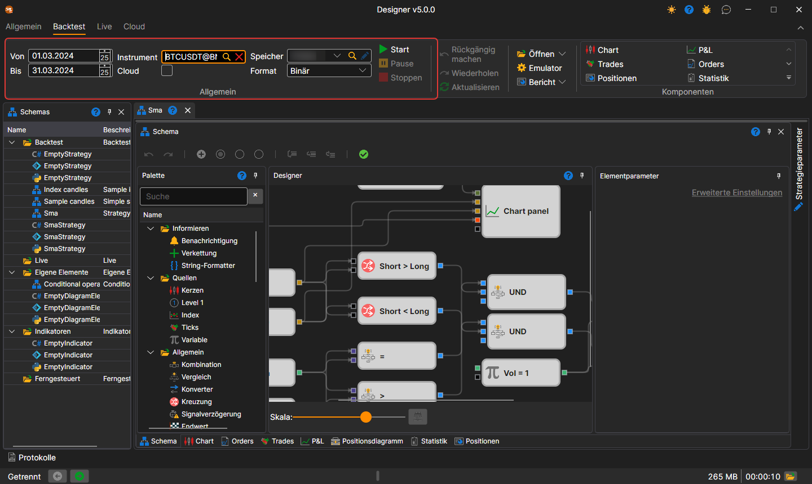
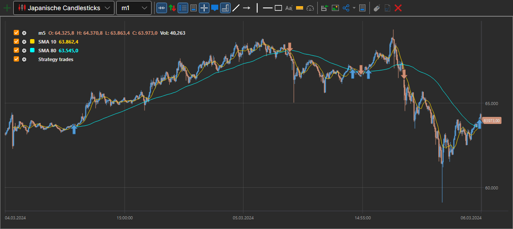
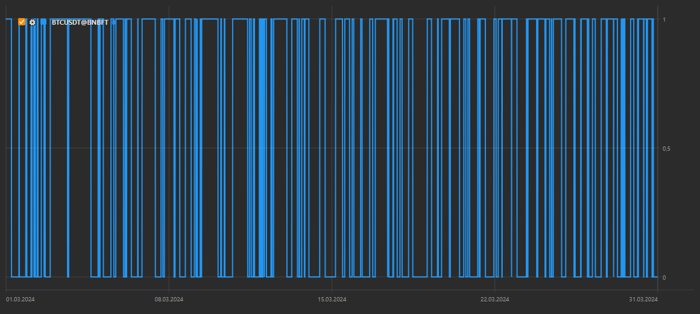
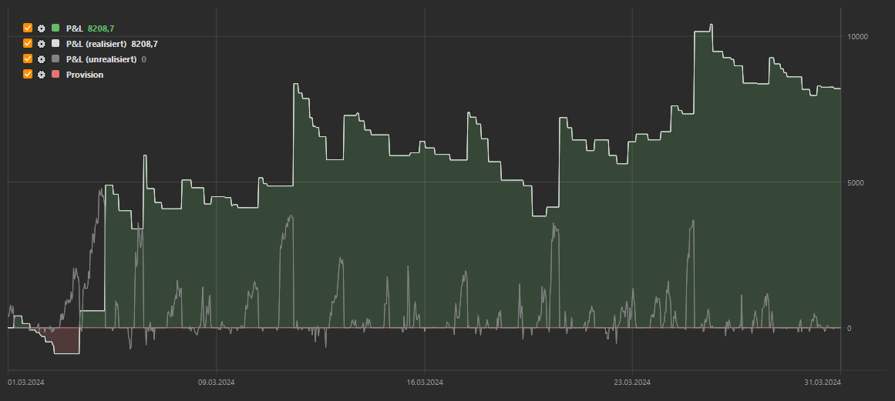

# Erste Schritte

Als Beispiel wird die SMA-Strategie betrachtet.

Um den Test auf historischen Daten auszuführen, wählen Sie eine Strategie aus, deren Schema auf der Historie getestet werden soll. Die Strategie wird im Panel [Schemata](../user_interface/schemas.md) im Strategieordner durch Doppelklick auf die gewünschte Strategie ausgewählt.

Laden Sie vor dem Testen Marktdaten (Instrumente, Kerzen, Tick-Trades und/oder Orderbücher). Dies wird im Abschnitt [Marktdatenspeicher](../market_data_storage.md) beschrieben.

Beim Wechsel in den Tab mit der Strategie wird im **Menüband** automatisch der Tab **Backtest** geöffnet. Legen Sie in diesem Tab den Testzeitraum fest (**Von** und **Bis**), wählen Sie im Feld **Instrument** das Instrument und in den Feldern **Speicher** und **Format** den Marktdatenspeicher ([Marktdatenspeicher](../market_data_storage.md)) und das Format, in dem er geschrieben ist.

Im Beispiel mit der SMA-Strategie werden die folgenden Parameter verwendet:

1. Instrument BTCUSDT@BNBFT
2. Zeitraum vom 01.03.2024 bis zum 31.03.2024
3. Ein Speicher, in den die Kerzen dieses Instruments für diesen Zeitraum geladen wurden
4. Speicherformat - **Binär**

Die Strategie selbst bildet auf Fünf-Minuten-Kerzen zwei gleitende Durchschnitte — **SMA 10** und **SMA 80** — und handelt mit dem Volumen, das der Würfel **Vol = 1** im Schema vorgibt.

Nachdem alle erforderlichen Parameter eingerichtet wurden, starten Sie den Strategietest durch Klicken auf die Schaltfläche .

Während oder nach dem Test können Sie Charts und Tabellen mit Testinformationen anzeigen.

Das Diagramm zeigt, dass die Ausführungen wie von der Strategie vorgesehen an den Schnittpunkten der gleitenden Durchschnitte stattfinden.

Im **Positionsdiagramm** ist zu sehen, dass die Position der Strategie zwischen 0 und 1 wechselt: Die Strategie kauft, wenn der kurze Durchschnitt den langen von unten nach oben kreuzt, und schließt die Position bei der umgekehrten Kreuzung.

Das Diagramm **P&L** zeigt, wie sich Gewinn und Verlust der Strategie während des Tests verändert haben, und außerdem die Provision.

## Empfohlene Inhalte

[Live-Ausführung](../live_execution/getting_started.md)
