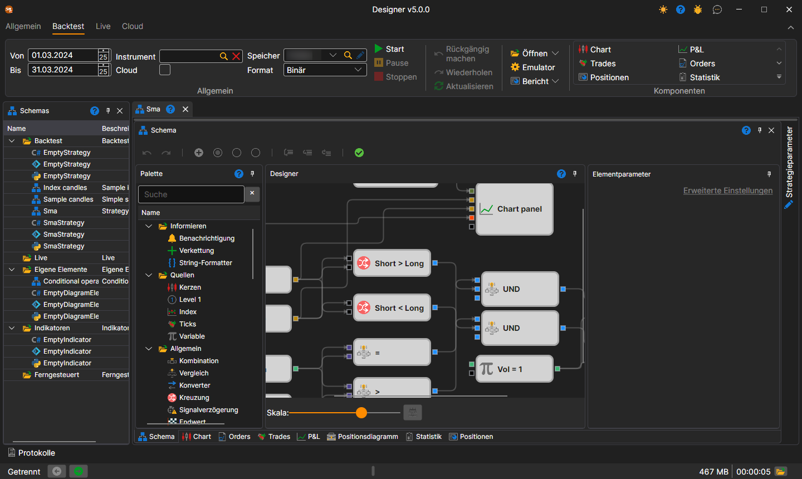
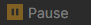
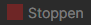
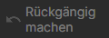
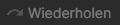
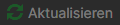

# Benutzeroberfläche

Um den Test auf historischen Daten auszuführen, wählen Sie eine Strategie aus, deren Schema auf der Historie getestet werden soll. Die Strategie wird im Panel [Schemata](../user_interface/schemas.md) im Strategieordner durch Doppelklick auf die gewünschte Strategie ausgewählt. Wenn Sie eine Strategie für den Arbeitsbereich auswählen, erscheint ein neuer Tab mit der Strategie. Beim Wechsel in diesen Tab wird im Menüband automatisch der Tab **Backtest** geöffnet.

In der Gruppe **Allgemein** der Registerkarte **Backtest** werden der Testzeitraum (**Von** und **Bis**), das **Instrument**, der Marktdatenspeicher (**Speicher**) und das Format, in dem er geschrieben ist (**Format**), festgelegt. Das Kontrollkästchen **Cloud** startet den Test in der StockSharp-Cloud statt auf diesem Computer.

Der Strategietest wird durch Klicken auf die Schaltfläche **Start**  gestartet. Nach dem Start des Strategietests werden die Schaltfläche **Pause** , die den Test anhält, und die Schaltfläche **Stoppen** , die den Test vollständig beendet, aktiv. Beim Bearbeiten der Strategie sind die Schaltflächen **Rückgängig machen** (Ctrl+Z) , die die letzte Aktion rückgängig macht, **Wiederholen** (Ctrl+Y) , die das Rückgängiggemachte wiederherstellt, und **Aktualisieren** (Ctrl+R) , die das Schema vollständig aktualisiert, hilfreich.

Die übrigen Schaltflächen der Registerkarte:

- **Öffnen** — dieselbe Strategie zur [Optimierung](../optimization/brute_force.md) oder für den [Handel](../live_execution/getting_started.md) öffnen;
- **Emulator** — [Emulationseinstellungen](../user_interface/components/backtesting_settings.md);
- **Bericht** — ein Bericht über den abgeschlossenen Test im Format Excel, JSON, XML oder CSV;
- die Gruppe **Komponenten** — Komponenten, die der Strategieregisterkarte hinzugefügt werden können: Diagramm, P&L, Ausführungen und andere.

Der [Debugger](debugging.md) — Haltepunkte und schrittweise Ausführung — befindet sich auf dem Panel **Schema**.

Der ausgewählte Strategietab enthält standardmäßig die folgenden Panels:

- Das Panel **Schema**, in dem der Hauptarbeitsprozess für die Gestaltung der Strategie und ihrer Komponenten durch Kombinieren von Würfeln und Verbindungslinien ausgeführt wird. Das Schema wird im Abschnitt [Diagramm-Panel](../strategies/using_visual_designer/diagram_panel.md) ausführlich beschrieben.
- Die Panels der Informationskomponenten — **Diagramm**, **Aufträge**, **Ausführungen**, **P&L**, **Positionsdiagramm**, **Statistik**, **Positionen** — als Registerkarten unter dem Schema.
- Das Panel **Strategieparameter**, standardmäßig am rechten Rand der Strategieregisterkarte eingeklappt: die Parameter des Schemas, die vor dem Start geändert werden können.

## Empfohlene Inhalte

[Rücktest-Einstellungen](../user_interface/components/backtesting_settings.md)

