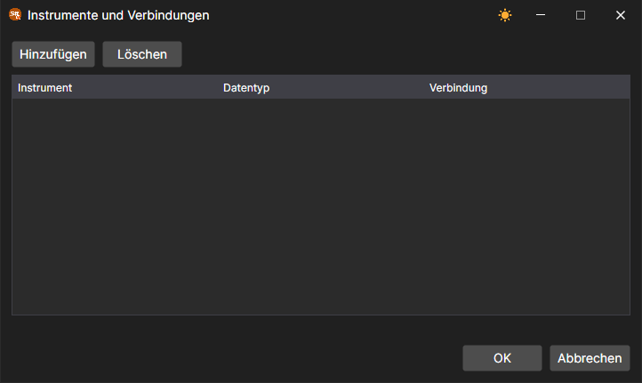

# Symbolzuordnung

Dasselbe Instrument kann in verschiedenen Handelssystemen unterschiedlich heißen, und Daten und Aufträge dafür können über verschiedene Verbindungen laufen. Dafür gibt es im [Designer](../../designer.md) drei Fenster.

## Codezuordnung

Die Schaltfläche **Codezuordnung** im Marktdaten-Panel öffnet das Fenster **Instrumentencodes <\-> Adaptercodes**. In der Liste über der Tabelle wird die Verbindung ausgewählt, die Schaltfläche  fügt eine Zeile hinzu, und die Schaltfläche zum Löschen entfernt die markierte. In den Spalten **Instrumentencode** und **Börsensegmentcode** wird das Instrument so angegeben, wie es im **Designer** heißt, und in den Spalten **Code im Adapter** und **Börsensegmentcode im Adapter** so, wie es die ausgewählte Verbindung nennt.

## Instrumente und Verbindungen

Der Eintrag **Instrumente und Verbindungen** in der Dropdown-Liste der Schaltfläche **Verbinden** auf der Registerkarte **Allgemein** öffnet ein Fenster, in dem für ein Instrument und einen Datentyp die Verbindung gewählt wird, über die diese Daten bezogen werden. Die Schaltfläche **Hinzufügen** fügt eine Zeile hinzu, in der die Spalten **Instrument**, **Datentyp** und **Verbindung** ausgefüllt werden; die Schaltfläche **Löschen** entfernt die markierte Zeile.

## Portfolios und Verbindungen

Der Eintrag **Portfolios und Verbindungen** derselben Liste öffnet ein gleichartiges Fenster für Portfolios: In der Spalte **Portfolio** wird das Portfolio angegeben und in der Spalte **Verbindung** die Verbindung, über die Aufträge dafür gesendet werden.

Im [Terminal](../../terminal.md) werden beide Fenster über das Menü **Einstellungen** des [Hauptmenüs](../../terminal/user_interface/ribbon.md) geöffnet.
