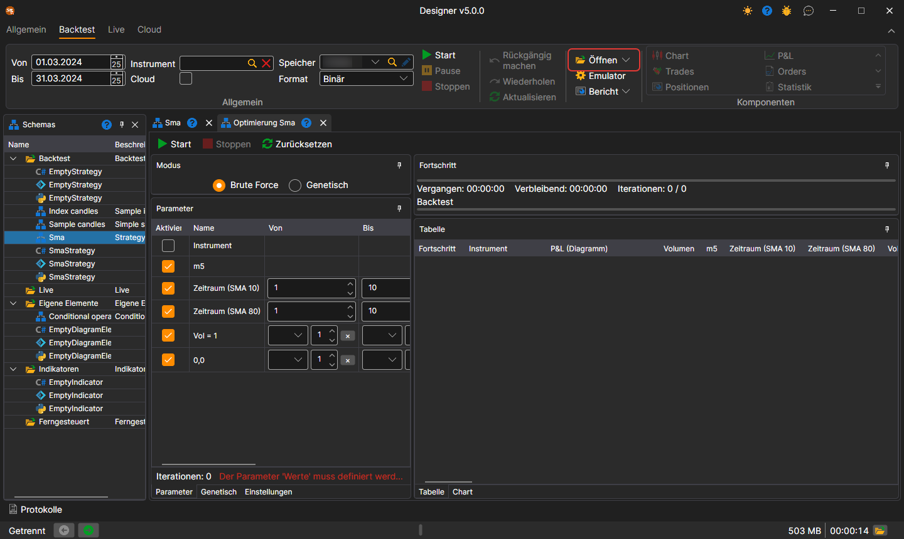
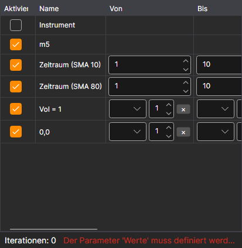
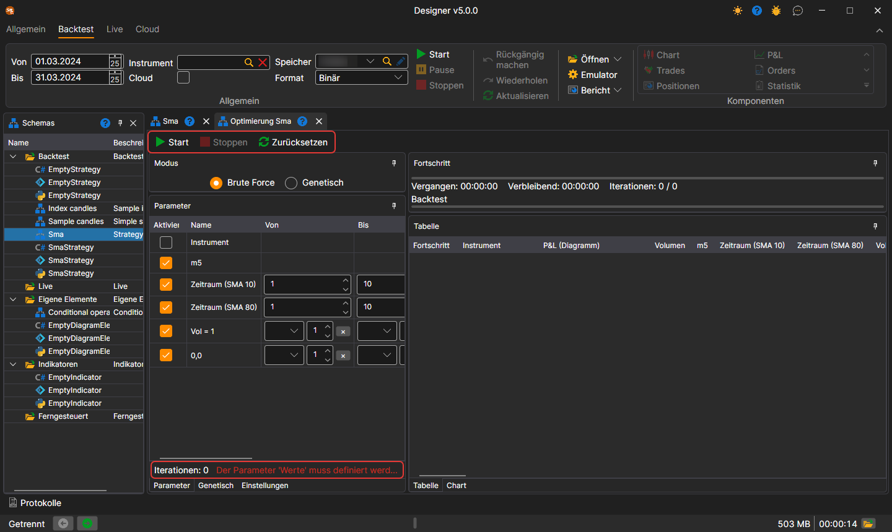

# Brute-Force-Optimierung

Um in den Strategieoptimierungsmodus zu wechseln, öffnen Sie auf der Registerkarte **Backtest** die Dropdown-Liste **Öffnen** und wählen Sie **Optimierung**. Das Optimierungsbeispiel wird anhand der SMA-Strategie betrachtet, die [aus Würfeln](../strategies/using_visual_designer/first_strategy.md) erstellt wurde.

Im Arbeitsbereich wird ein Tab mit dem Namen Optimierung + 'Strategiename' geöffnet. Der Tab **Optimierung** ist in zwei Bereiche unterteilt: links — was und wie optimiert wird, rechts — das Optimierungsergebnis:

- Links oben — **Modus**: **Brute-Force** oder **Genetisch**. Darunter die Tabs: **Parameter** — die Strategieparameter, die [durchlaufen](optimization_parameters.md) werden; **Genetisch** — Einstellungen für [Genetik](genetic.md); **Einstellungen** — Einstellungen der Emulation und des Optimierers selbst, zum Beispiel wie viele Durchläufe gleichzeitig ausgeführt werden (**Parallel**) und wie viele Iterationen zulässig sind (**Iterationen**).
- Rechts — **Fortschritt**: wie viel Zeit vergangen ist, wie viel ungefähr noch bleibt und wie viele der geplanten Iterationen ausgeführt sind. Darunter der Tab **Tabelle**, in der jede Zeile das Ergebnis des Tests der Strategie mit eindeutigen Parametern darstellt, und der Tab **Chart** zur Anzeige der Ergebnisse als [3D-Chart](3d_chart.md).

Das Festlegen der Parameter für die Iteration führt zu mehr als 1000 Iterationen. Nach dem Start des Optimierers zeigt der Fortschritt oben über den Ergebnissen Daten zur geplanten Anzahl von Iterationen, zur bereits abgeschlossenen Anzahl und zur ungefähr benötigten Zeit bis zum Abschluss:

## Parametertabelle und Schaltflächen des Panels

In der Parametertabelle ist für jede Zeile zu sehen, wie viele Werte sie bei den angegebenen Werten **Von**, **Bis** und **Schritt** ergibt (Spalte **Anzahl**) und was in der Zeile nicht stimmt (Spalte **Fehler**) — zum Beispiel ein Schritt, bei dem die Iteration die obere Grenze nicht erreicht. Unter der Tabelle steht, wie viele Durchläufe die Iteration aller Parameter zusammen ergibt, und der erste Fehler, falls es einen gibt.

Die Schaltflächen **Start**, **Stoppen** und **Zurücksetzen** befinden sich direkt im Panel des Optimierers, darunter der Fortschrittsbalken des aktuellen Durchlaufs. Die Ergebnistabelle hat die Spalte **Instrument**: das Instrument, auf dem der Durchlauf stattfand.

## Siehe auch

[Rücktestbeispiel](../backtesting/getting_started.md)

