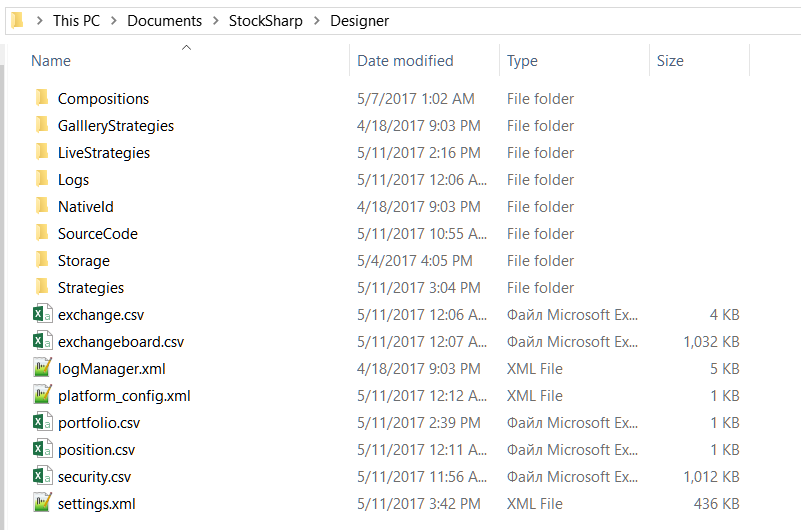

# Einstellungsverzeichnis

Die folgenden Verzeichnisse sind für [Designer](../../designer.md) wichtig:

1. Das Verzeichnis, in dem [Designer](../../designer.md) installiert ist. Aus diesem Ordner können Sie [Designer](../../designer.md) durch Ausführen von **Designer.exe** starten oder [Designer](../../designer.md) durch Ausführen von **Designer.Update.exe** aktualisieren. Das Löschen dieses Verzeichnisses entfernt [Designer](../../designer.md), die Einstellungen von [Designer](../../designer.md) werden jedoch nicht gelöscht.

2. Das Einstellungsverzeichnis von **Designer** befindet sich unter dem Dokumentenordner des Benutzers: …\\StockSharp\\Designer\\ (zum Beispiel c:\\Users\\User\\Documents\\StockSharp\\Designer\\). Das Löschen dieses Verzeichnisses setzt alle [Designer](../../designer.md)-Einstellungen auf ihre Standardwerte zurück. **Alle erstellten Strategien, heruntergeladenen Instrumente und anderen im Einstellungsverzeichnis gespeicherten Informationen werden ZERSTÖRT.**

Dieses Verzeichnis enthält die folgenden Ordner und Dateien:

- Die Ordner `Backtest`, `Live`, `Remote`, `Optimization`, `Custom` und `Indicator` entsprechen den Ordnern **Backtest**, **Live-Handel**, **Ferngesteuert**, den Optimierungen, **Eigene Elemente** und **Indikatoren** im [Schemata-Panel](../user_interface/schemas.md). Jede Strategie, jeder Block und jeder Indikator wird in einer eigenen JSON-Datei gespeichert, die statt eines Namens eine Kennung trägt. Das Löschen einer Datei entfernt die entsprechende Strategie bzw. den Block aus dem [Schemata-Panel](../user_interface/schemas.md). Bearbeiten Sie diese Dateien nicht manuell; dadurch kann die entsprechende Strategie bzw. der Block beschädigt werden. Eine Datei, die nicht gelesen werden kann, wird beim Start übersprungen: Die übrigen Strategien werden geladen, und der Grund wird ins Protokoll geschrieben. Wenn Sie eine Strategiedatei manuell in einen dieser Ordner legen und [Designer](../../designer.md) neu starten, erscheint die Strategie im entsprechenden Ordner des [Schemata-Panels](../user_interface/schemas.md).
- **Logs** enthält alle Absturzprotokolle von [Designer](../../designer.md), was die Fehlerbehebung im [Designer](../../designer.md) vereinfacht.
- **Speicher** enthält Marktdaten, die [Designer](../../designer.md) in den entsprechenden [Marktdatenspeicher](../market_data_storage.md) heruntergeladen hat. Der Ordner wird erstellt, wenn der [Marktdatenspeicher](../market_data_storage.md) erstellt wird, und der Standardpfad zeigt auf diesen Ordner. Das Löschen dieses Ordners entfernt alle heruntergeladenen Marktdaten aus dem entsprechenden Speicher. Wenn der Speicher CSV-Dateien enthält, können diese in einem Standard-Texteditor oder in MS Excel bearbeitet werden. BIN-Dateien können nicht manuell bearbeitet werden.
- **exchange.csv** und **exchangeboard.csv** enthalten die Liste der **Börsen**, Instrumentcodes und Handelsmodi. Diese Dateien können in einem Standard-Texteditor oder MS Excel bearbeitet werden.
- **security.csv** enthält alle empfangenen und erstellten Instrumente aus allen Quellen. Das Löschen dieser Datei entfernt alle Instrumente aus dem [Designer](../../designer.md). Das Hinzufügen neuer Instrumente wird unter [Instrumente herunterladen](../market_data_storage/download_instruments.md) und [Instrument erstellen](../market_data_storage/create_instrument.md) beschrieben. Diese Datei kann in einem Standard-Texteditor oder MS Excel bearbeitet werden.
- **portfolio.csv** und **position.csv** enthalten alle empfangenen und erstellten Portfolios sowie deren aktuelle Positionen. Das Löschen dieser Dateien entfernt die entsprechenden Daten aus dem [Designer](../../designer.md). Wenn [Designer](../../designer.md) bei jeder Verbindung Portfolioinformationen empfängt, können Positionsinformationen dennoch dauerhaft verloren gehen. Diese Dateien können in einem Standard-Texteditor oder MS Excel bearbeitet werden.
- **settings.json** enthält aktuelle Einstellungen. [Designer](../../designer.md) erstellt diese Datei, wenn sich Einstellungen ändern oder wenn das Programm geschlossen wird. Das Löschen dieser Datei setzt die aktuellen Einstellungen auf Standardwerte zurück. Bearbeiten Sie diese Datei nicht manuell; dadurch kann [Designer](../../designer.md) beschädigt werden.

Erstellen Sie Sicherungskopien der Dateien, die Sie ändern, oder des gesamten Verzeichnisses, bevor Sie einzelne Dateien manuell bearbeiten oder die Einstellungen von [Designer](../../designer.md) zurücksetzen.

## Siehe auch

[Auf die neue Version aktualisieren](../update_to_the_new_version.md)

