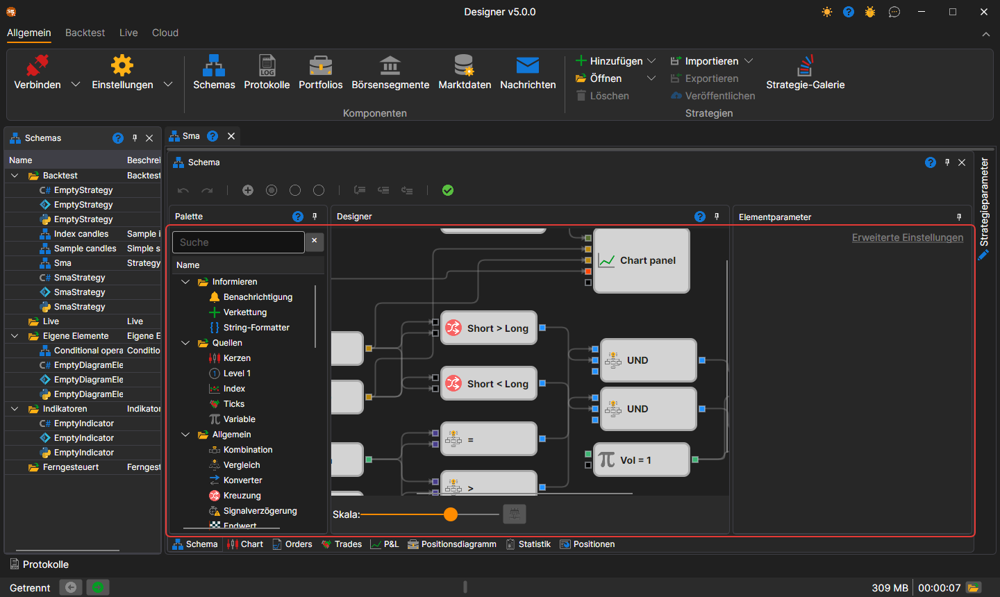
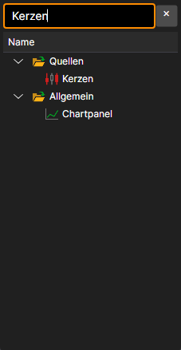
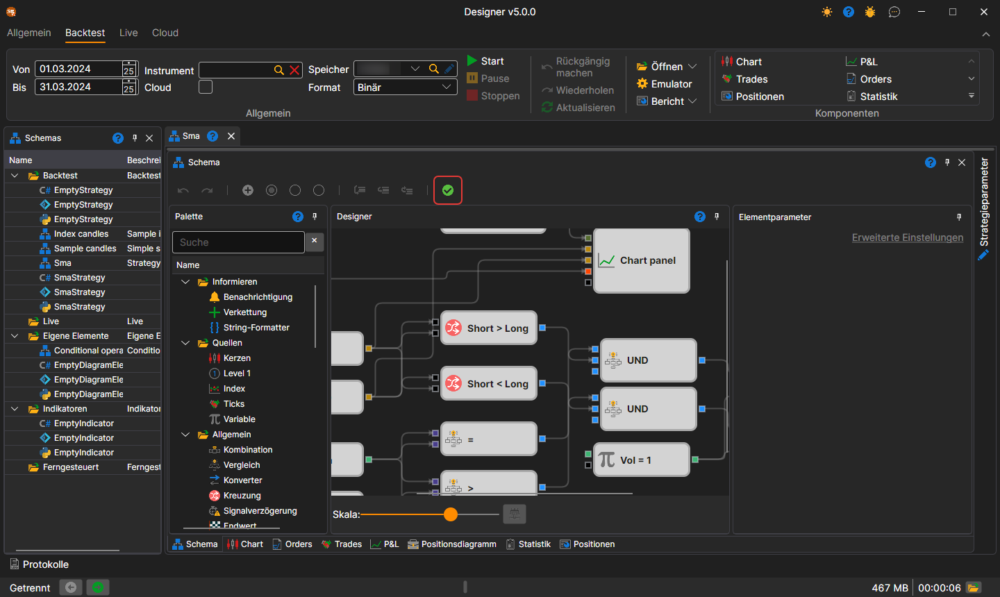
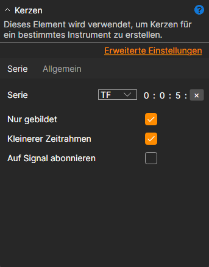
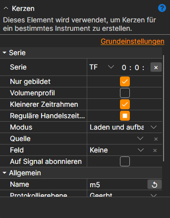

# Strategie-Designer

Der Hauptprozess zum Entwerfen einer Strategie und ihrer Komponentenelemente findet im Panel **Schema** statt, indem Blöcke kombiniert und mit Linien verbunden werden. Das Panel Schema besteht aus den Panels **Elemente-Palette**, **Designer** und **Elementparameter**.

## Palette-Panel

Das Panel **Elemente-Palette** enthält Blöcke, aus denen Strategien erstellt werden. Alle Elemente in der Palette sind in Kategorien unterteilt, die im Abschnitt [Beschreibung der Blöcke](elements.md) beschrieben werden. Um einen Block zum Panel **Designer** hinzuzufügen, klicken Sie mit der linken Maustaste auf den gewünschten Block und ziehen ihn bei gedrückter Taste in das Panel **Designer**. Ein Doppelklick auf einen Block legt ihn in die Mitte des Panels **Designer**. Danach wird das Element automatisch ausgewählt, und seine Parameter werden im Fenster zur Bearbeitung der Blockeigenschaften angezeigt.

Die Suchzeile über der Palette findet einen Block nach seinem Namen, nach seiner Beschreibung und nach dem Namen seiner Kategorie. Die Taste **Enter** legt den ausgewählten Block auf das Panel **Designer** oder, wenn nichts ausgewählt ist, den ersten gefundenen.

## Designer-Panel

Das Panel **Designer** ist der Bereich, in dem der gesamte Prozess zum Erstellen einer Strategie durch Kombinieren von Blöcken und Verbindungen (Linien) erfolgt. Es stellt das Strategieschema visuell dar. Ausführliche Informationen zum Erstellen einer Strategie finden Sie im Abschnitt [Algorithmus aus Blöcken erstellen](first_strategy.md).

Die ausgewählten Blöcke werden mit den Pfeiltasten verschoben: um einen Schritt, mit gedrückter **Shift** um zehn. Während eine Verbindungslinie gezogen wird, sind nur die Anschlüsse hervorgehoben, an die sie angeschlossen werden kann, und das Ende der Linie rastet von selbst am nächstgelegenen von ihnen ein.

Der Maßstab des Schemas wird mit dem Schieberegler **Skala** unter dem Panel oder mit dem Mausrad bei gedrückter **Ctrl** geändert. Tasten des Panels **Designer**:

| Tasten | Aktion |
|---|---|
| **Ctrl+Z**, **Ctrl+Y** | eine Aktion rückgängig machen und wiederholen |
| **Ctrl+C**, **Ctrl+X**, **Ctrl+V** | die ausgewählten Blöcke kopieren, ausschneiden und einfügen |
| **Ctrl+A** | alle Blöcke auswählen |
| **Delete** | die Auswahl löschen |
| **Esc** | die Auswahl aufheben oder das Ziehen einer Linie abbrechen |
| **Ctrl+Plus**, **Ctrl+Minus** | vergrößern und verkleinern |
| **Ctrl+0** | den ursprünglichen Maßstab wiederherstellen |
| **Ctrl+1** | das gesamte Schema in das Panel einpassen |
| **Alt+Z** | das Schema in das Panel einpassen oder zum vorherigen Maßstab zurückkehren |

Die Schaltfläche mit dem Häkchen auf der Leiste des Schemas, deren Tooltip **Das Diagramm prüfen, indem sein Code generiert und kompiliert wird** lautet, prüft das Schema, ohne die Strategie zu starten. Wenn das Schema einen Fehler enthält, wird sein Text rot über dem Panel **Designer** angezeigt; dort erscheinen auch die Fehler des Debuggers.

## Panel Elementparameter

Das Panel **Elementparameter** zeigt die Parameter des auf dem Panel **Designer** ausgewählten Blocks an. Der ausgewählte Block wird mit einem Rahmen hervorgehoben.

Das Panel **Elementparameter** kann in zwei Modi angezeigt werden: *Basiseinstellungen* und *Erweiterte Einstellungen*.

Standardmäßig werden die Eigenschaften beim Erstellen eines Schemas zunächst im Modus *Basiseinstellungen* angezeigt. Um in den Modus *Erweiterte Einstellungen* zu wechseln, müssen Sie auf die entsprechende Überschrift klicken.

Im Modus *Basiseinstellungen* werden nur die wichtigsten Eigenschaften des Blocks angezeigt. Für den Block [Kerzen](elements/data_sources/candles.md) werden beispielsweise der Zeitrahmen, das Flag zum Empfangen nur gebildeter Kerzen, das Flag für die Möglichkeit, Kerzen aus einem kleineren Zeitrahmen zu bilden, und das Flag zum Abonnieren von Kerzen per Signal angezeigt.

Im Modus *Erweiterte Einstellungen* werden alle änderbaren und konfigurierbaren Eigenschaften des Blocks angezeigt.

Alle Blöcke enthalten einen Satz vordefinierter Eigenschaften, die im Modus *Erweiterte Einstellungen* sichtbar werden:

- **Name** – der Name des Elements, der im Designer angezeigt wird.
- **Protokollierungsstufe** – die Protokollierungsstufe für dieses Element.
- **Parameter** – Parameter des Elements in übergeordneten Elementen anzeigen.
- **Anschlüsse** – Anschlüsse des Elements in übergeordneten Elementen anzeigen.

Ausführliche Informationen zu den Eigenschaften jedes Blocks finden Sie im Abschnitt [Beschreibung der Blöcke](elements.md).

## Siehe auch

[Beschreibung der Blöcke](elements.md)

