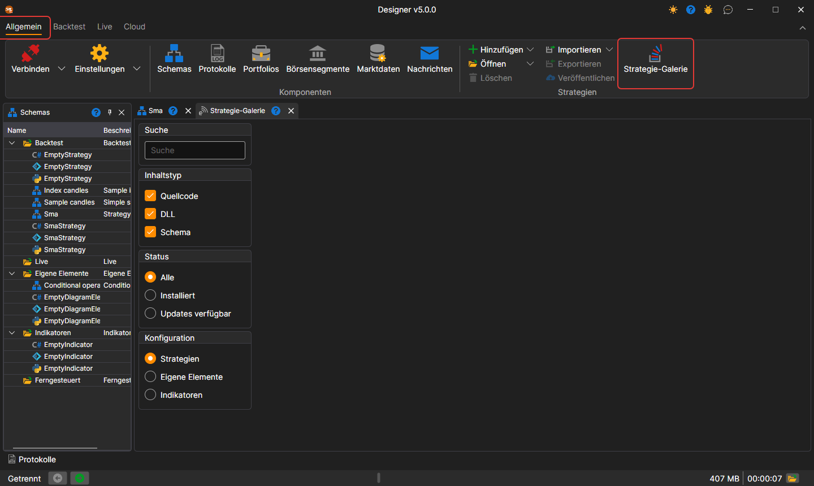

# Strategiegalerie

Die **Strategiegalerie** bietet die Möglichkeit, fertige Handelsstrategien auf Ihren Computer herunterzuladen. Sie können die **Strategiegalerie** öffnen, indem Sie auf der Registerkarte **Allgemein** auf die Schaltfläche **Strategiegalerie** klicken.

Die Karten der Strategien erscheinen nach und nach, während der Katalog von der Website gelesen wird; solange das Lesen läuft, zeigt das Panel den Hinweis **Strategien aus der Galerie laden...**. Wenn der Katalog nicht gelesen werden konnte, zeigt das Panel den Grund und die Schaltfläche **Aktualisieren**, die das Laden wiederholt.

Um eine Strategie auf Ihren Computer herunterzuladen, müssen Sie:

- die gewünschte Strategie auswählen und auf die Schaltfläche Herunterladen klicken:

  

- die Strategie wird dem Strategiebaum im Abschnitt **Rücktest** hinzugefügt:

  

## Siehe auch

[Eigene Strategie veröffentlichen](strategy_gallery/publish_own_strategy.md)

