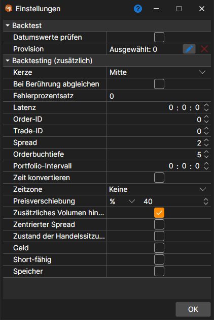

# Rücktest-Einstellungen

Die Emulationseinstellungen werden mit der Schaltfläche **Emulator** auf der Registerkarte **Backtest** des Menübands geöffnet, wenn eine Strategie zum Test auf historischen Daten oder zur Optimierung geöffnet ist. Wenn Sie eine Eigenschaft auswählen, erscheint unten im Fenster ihre ausführliche Beschreibung. Die Eigenschaften sind gruppiert:

**Backtest**

- **Datumswerte prüfen** - prüfen, ob die geladenen Tage Handelstage sind.
- **[Provision](../commissions.md)** - die Provision (Brokergebühren, Börsengebühren usw.).

**Emulation (zusätzlich)**

- **Kerze** - zu welchem Kerzenpreis Orders ausgeführt werden, wenn der Test auf Kerzen läuft: Mitte, Eröffnung, Hoch, Tief oder Schluss.
- **Bei Berührung zusammenführen** - während der Emulation Orders zusammenführen, wenn der Trade-Preis den Orderpreis berührt (d. h. ihm entspricht).
- **Fehlerprozentsatz** - der Prozentwert des Fehlers bei der Registrierung neuer Orders. Der Wert kann von 0 (keine Fehler) bis 100 reichen.
- **Latenz** - der Mindestwert der registrierten Orderlatenz.
- **Order-ID** - die Nummer, ab der der Emulator Kennungen für Orders generiert.
- **Trade-ID** - die Nummer, ab der der Emulator Kennungen für Trades generiert.
- **Spread** - die Spread-Größe in Preisschritten. Sie wird beim Angeben des Spreads für die Generierung eines Orderbuchs aus Tick-Trades verwendet.
- **Orderbuchtiefe** - die maximale Tiefe des Orderbuchs, das aus den Ticks generiert wird.
- **Portfoliointervall** - das Intervall für die Neuberechnung des Portfolios. Wenn das Intervall null ist, wird keine Neuberechnung durchgeführt.
- **Zeit ändern** - die Zeit für Orders und Trades in Börsenzeit ändern.
- **Zeitzone** - die Zeitzone der Börse.
- **Preisverschiebung** - die Preisverschiebung vom letzten Trade, mit der die Grenzen der maximalen und minimalen Preise für die nächste Sitzung angegeben werden.
- **Zusätzliches Volumen hinzufügen** - zusätzliches Volumen zum Orderbuch hinzufügen, wenn Orders mit großem Volumen registriert werden.
- **Zentrierter Spread** - den Spread gleichmäßig um Preise verteilen, bei denen unbekannt ist, welche Seite gehandelt hat (zum Beispiel Preise aus Kerzen), damit Kauf und Verkauf dieselbe Hälfte des Spreads zahlen.
- **Zustand der Handelssitzung** - den Handelszustand prüfen.
- **Geld** - den Geldsaldo prüfen.
- **Short-fähig** - ob Short-Positionen eröffnet werden dürfen.
- **Speicher** - das Speichern der Nachrichten erlauben, die der Emulator erzeugt.

Der Testzeitraum, das Instrument, der Marktdatenspeicher und sein Format werden direkt auf der Registerkarte **Backtest** festgelegt ([Benutzeroberfläche](../../backtesting/user_interface.md)), die Parameter des Schemas im Panel **Strategieparameter** am rechten Rand der Strategieregisterkarte.

## Empfohlene Inhalte

[Chart](chart.md)
