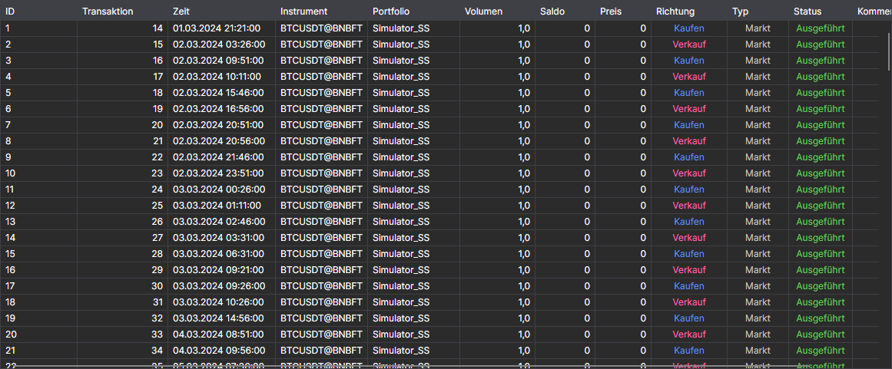

# Aufträge

Die Komponente **Aufträge** ist eine Tabelle mit Orders, die vollständige Informationen über alle Orders der Strategie anzeigt.

Die Liste über der Tabelle wählt aus, welche Orders angezeigt werden: **Alle**, nur aktive (**Aktiv**), ausgeführte (**Ausgeführt**) oder abgelehnte (**Fehlgeschlagen**).

Wie Tabellenzeilen kopiert, durchsucht und gefiltert und Spalten eingerichtet werden, ist im Abschnitt [Arbeiten mit Tabellen](../../../terminal/user_interface/tables.md) beschrieben.

## Empfohlene Inhalte

[Ausführungen](trades.md)

