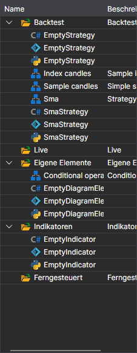
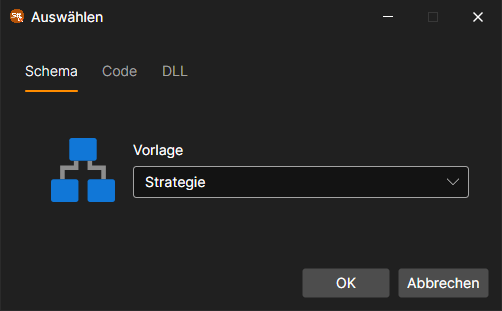

# Schemata-Panel

Um das Panel **Schemata** zu öffnen, klicken Sie auf der Registerkarte **Allgemein** auf die Schaltfläche **Schemata**. Das Panel **Schemata** enthält einen Baum von Skripten, die nach Zweck in Ordner gruppiert sind. Strategieschemata und benutzerdefinierte Blöcke unterscheiden sich nicht. Sie werden mit einem gemeinsamen Editor, dem [Strategie-Designer](../strategies/using_visual_designer/diagram_panel.md), bearbeitet. Um Verwechslungen zu vermeiden, sind sie jedoch in zwei unabhängige Listen aufgeteilt und werden in unterschiedlichen Ordnern gespeichert (Strategien im Ordner **Backtest**, benutzerdefinierte Blöcke im Ordner **Eigene Elemente**). Die Auswahl eines Schemas zur Bearbeitung erfolgt durch Doppelklick auf den erforderlichen Eintrag in der Liste. Das ausgewählte Schema wird anschließend im Designer zur Anzeige und Bearbeitung geöffnet. Nachfolgend finden Sie eine Beschreibung der Ordner im Panel **Schemata**:

Die Tastenkombination **Ctrl+F** über dem Baum öffnet eine Suchzeile: Sie findet ein Schema nach Name, Beschreibung, Kennung und Typ, und **Esc** schließt sie.

1. Der Ordner **Backtest** enthält Handelsstrategien, die sowohl als Schemata aus Elementen und deren Verbindungen als auch aus Code erstellt wurden. Sie können eine neue Strategie hinzufügen, indem Sie auf der Registerkarte **Allgemein** auf die Schaltfläche **Hinzufügen**  klicken und **Strategie** auswählen. Alternativ klicken Sie im Panel **Schemata** mit der rechten Maustaste auf den Ordner **Backtest** und wählen im Dropdown-Menü die Schaltfläche **Hinzufügen** . Wählen Sie im geöffneten Fenster aus, wie genau Sie eine Strategie erstellen möchten.

    

    Strategien können mit einem visuellen Designer ohne Programmierung oder mit dem integrierten Quellcode-Editor erstellt werden. Zusätzlich können externe DLL-Dateien mit in Microsoft Visual Studio geschriebenen Strategien eingebunden werden. Ausführliche Informationen zu **Strategien** finden Sie im Abschnitt [Arbeiten mit Blöcken](../strategies/using_visual_designer.md).

    Wenn die auf der Registerkarte ausgewählte DLL-Bibliothek nicht gelesen werden kann oder keinen passenden Strategietyp enthält, wird der Grund rot unter den Registerkarten angezeigt, und die Schaltfläche **OK** ist nicht verfügbar.

2. Der Ordner **Eigene Elemente** enthält Elemente, die eine abgeschlossene Funktionalität darstellen und in verschiedenen Schemata oder mehrfach in einem Schema mit unterschiedlichen Eigenschaftswerten verwendet werden können. Solche Elementgruppen können in einen separaten Block ausgelagert werden, der anschließend wie jedes Standardelement verwendet wird. Ein **Benutzerdefinierter Block** ist ein normales Schema, das wie jedes Strategieschema gespeichert, geladen und bearbeitet wird. Fügen Sie ein neues zusammengesetztes Element hinzu, indem Sie auf der Registerkarte **Allgemein** auf die Schaltfläche **Hinzufügen**  klicken und **Eigene Elemente** auswählen. Alternativ klicken Sie im Panel **Schemata** mit der rechten Maustaste auf den Ordner **Eigene Elemente** und wählen im Dropdown-Menü die Schaltfläche **Hinzufügen** . Neue benutzerdefinierte Blöcke werden automatisch zur **Elementpalette** in der Gruppe **Eigene Elemente** hinzugefügt und können beim Erstellen anderer Strategieschemata und benutzerdefinierter Blöcke verwendet werden. Ausführliche Informationen zu **Benutzerdefinierte Blöcke** finden Sie im Abschnitt [Erstellen zusammengesetzter Elemente](../strategies/using_visual_designer/composite_elements.md).

3. Der Ordner **Live-Handel** enthält Strategien, die für den Handel hinzugefügt wurden. Gestartete Strategien sind mit dem Symbol  markiert, gestoppte Strategien mit dem Symbol . Wie Strategien zum Ordner **Live-Handel** hinzugefügt und gestartet werden, ist im Abschnitt [Live-Handel](../live_execution/getting_started.md) beschrieben.

4. Der Ordner **Indikatoren** enthält Ihre eigenen Indikatoren für Handelsstrategien, die Sie selbst geschrieben haben. Neue Indikatoren können nicht mit Schemata erstellt werden; verfügbar sind nur Code und externe DLL-Dateien. Die Verwendung eigener Indikatoren in Schemata ist über den Block [Indikator](../strategies/using_visual_designer/elements/common/indicator.md) bei Auswahl des Indikatortyps möglich.

5. Der Ordner **Ferngesteuert** enthält Strategien, die sich auf einem Remote-Server befinden. Ein Doppelklick auf eine solche Strategie öffnet ihre Registerkarte, auf der die Strategie auf dem Server gestartet und gestoppt und bei einer laufenden Strategie die Position geschlossen werden kann.

## Siehe auch

[Protokoll-Panel](logs.md)
