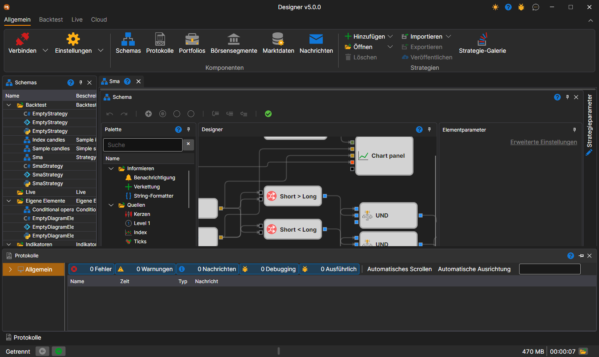

# Arbeitsbereich

Der **Arbeitsbereich** im [Designer](../../designer.md) ist eine Fensteroberfläche mit Panel-Docking, ähnlich wie in Microsoft Visual Studio. Wenn Sie mit der linken Maustaste auf den Kopfbereich eines Panels klicken und die Taste gedrückt halten, können Sie das Panel an einer passenden Stelle andocken. Durch Ziehen an den Rändern des Panels können Sie dessen Höhe oder Breite anpassen:

Unten im Fenster befindet sich die Statusleiste: ob [Designer](../../designer.md) verbunden ist (**Getrennt**, **Verbunden** oder der Text des Verbindungsfehlers), StockSharp-Nachrichten, die Zähler der Warnungen und Fehler des Protokolls, die letzte Protokollmeldung (ein Klick darauf öffnet das [Protokoll-Panel](logs.md)), der belegte Speicher, die Laufzeit und die Schaltfläche für den Protokollordner. Diese Teile sind im Abschnitt [Statusleiste](../../terminal/user_interface/status_bar.md) des Terminals ausführlicher beschrieben.

## Empfohlene Inhalte

[Schemata](schemas.md)

