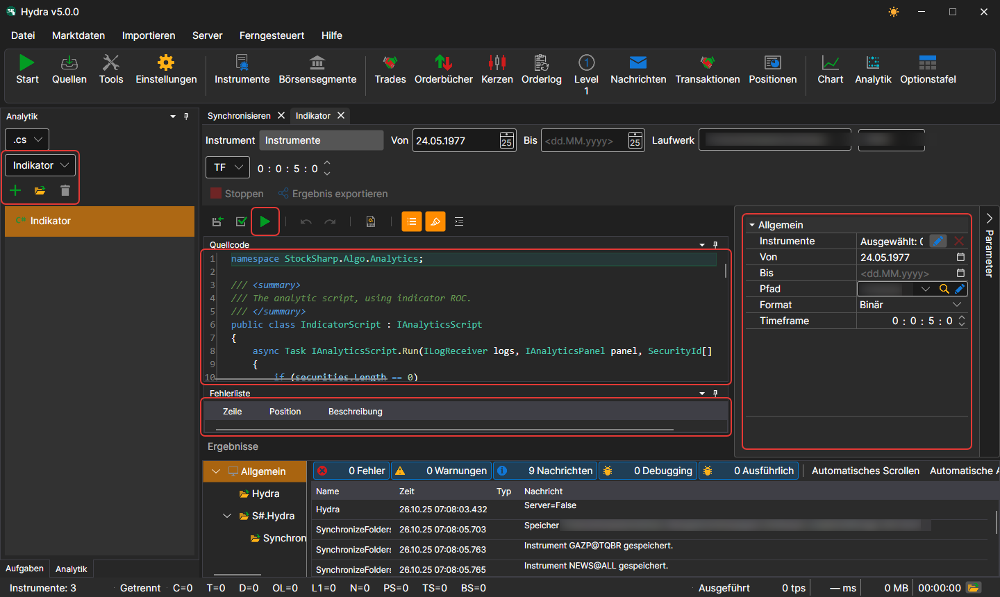
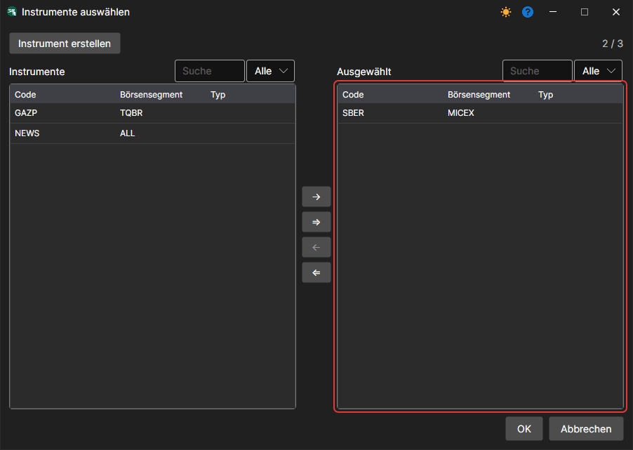

# Skript ausführen

Um ein neues Analyseskript zu erstellen, öffnen Sie im linken Panel die Registerkarte **Analytik**, wählen Sie die Sprache des Skripts und eine Vorlage für einen schnellen Einstieg und klicken Sie auf **Hinzufügen**. Das Skript wird in einer eigenen Registerkarte geöffnet:

Der Screenshot zeigt die Hauptoberflache dieser Funktion, die aus mehreren wichtigen Komponenten besteht:

- **Panel „Analytik“**: Links werden Sprache und Vorlage des neuen Skripts gewählt (Intraday-Volumen, Volumenprofil, Charts, Indikatoren und andere Analysewerkzeuge); darunter befinden sich die Symbolschaltflächen **Hinzufügen**, **Öffnen** und **Löschen** (der Name der Schaltfläche ist im Tooltip zu sehen) und die Liste der erstellten Skripte.
- **Startparameter und Schaltflächen**: Über dem Code werden Instrumente, Zeitraum, Speicher, Format und Zeitrahmen festgelegt, und die Schaltflächen führen **Quellcode speichern**, **Referenzen** (Assemblys und Pakete, auf die das Skript verweist), **Quelle kompilieren und ausführen**, **Stoppen** und **Ergebnis exportieren** aus.
- **Codefenster**: Das Codefenster zeigt den Quellcode des ausgewählten Analyseskripts. Benutzer können den Code direkt bearbeiten, um analytische Berechnungen und Strategien anzupassen oder zu erstellen.
- **Parameterpanel**: rechts, wird mit der Schaltfläche **Parameter** aufgeklappt; darin werden Parameter für Analyseskripte festgelegt, einschließlich Auswahl von Instrumenten, Analysezeitraum, Datenpfad und weiteren Einstellungen.
- **Fehlerliste**: Am unteren Rand der Oberfläche befindet sich eine Liste der Fehler, die während der Kompilierung oder Ausführung des Analyseskripts erkannt wurden.

Das Analyseskript ist als Klasse formatiert, die von [IAnalyticsScript](xref:StockSharp.Algo.Analytics.IAnalyticsScript) erbt.

Beim Festlegen der Parameter:

- **Instrument** kann je nach Logik des Skripts auf ein oder mehrere Instrumente gesetzt werden.

- Der Datumsbereich.
- Der Speicher, aus dem Daten abgerufen werden sollen.
- Der Arbeitszeitrahmen des Skripts, falls es einen verwendet.

Durch Klicken auf die Schaltfläche  wird das Skript kompiliert und ausgeführt, und die Ergebnisse seiner Ausführung werden in einer neuen Registerkarte geöffnet.

