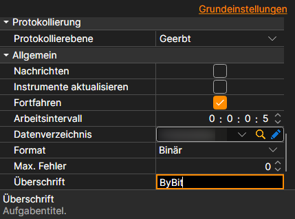

# Allgemeine Verbindungseinstellungen

Verbindungseigenschaften, die für alle Quellen gemeinsam gelten.

**Allgemein**

Die eigenen Einstellungen jeder Quelle stehen an erster Stelle: Schlüssel, Adressen, Wiederverbindung. Danach folgen die Einstellungen, die für alle Quellen gemeinsam sind:

- **Nachrichten** - Nachrichten herunterladen.
- **Instrumente aktualisieren** - Instrumente beim Verbinden aktualisieren.
- **Fortfahren** - das Herunterladen ab dem zuletzt heruntergeladenen Datum fortsetzen.
- **Arbeitsintervall** - Arbeitsintervall.
- **Datenverzeichnis** - Verzeichnis mit Daten, in dem die finalen Dateien im StockSharp-Format gespeichert werden.
- **Format** - Datenformat: BIN\/CSV.
- **Max. Fehler** - Maximale Anzahl von Fehlern, nach der die Aufgabe gestoppt wird. Der Standardwert ist 0, was bedeutet, dass die Anzahl der Fehler ignoriert wird.
- **Überschrift** - Titel der Aufgabe.
- **Arbeitszeit** - der Zeitplan der Aufgabe.
- **Validierung** - was mit Daten geschehen soll, die die Prüfung nicht bestanden haben: nichts, sie löschen oder das Abonnement beenden.

**Ferngesteuert**

- **Aktiviert** - die Aufgabe fernsteuern.
- **Benachrichtigung** - der Kanal, in den die Benachrichtigungen über die Aufgabe gelangen.
- **Protokollierebene** - welche Meldungen der Aufgabe an den Kanal gesendet werden.

