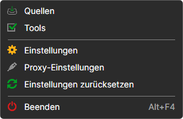
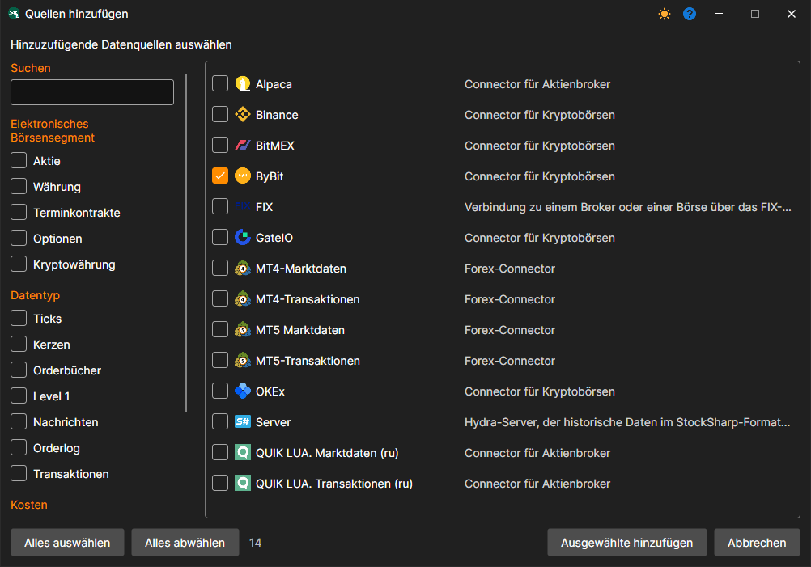
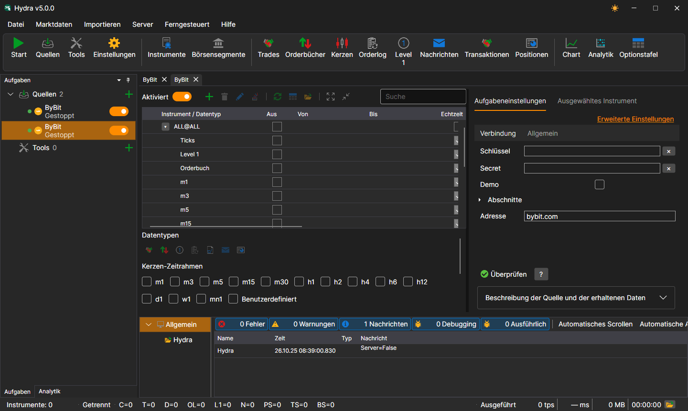
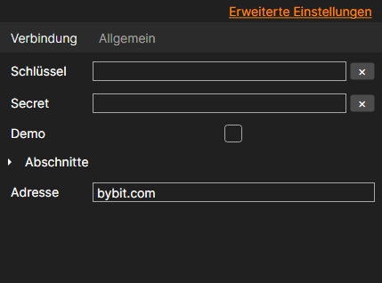

# Quelle auswählen

Um eine neue Marktdatenquelle hinzuzufügen, öffnen Sie das Menü **Datei** und wählen Sie den Eintrag **Quellen** — oder klicken Sie auf die Schaltfläche **Quellen** in der Symbolleiste.

Es öffnet sich eine Liste der Quellen. Sie können mehrere gleichzeitig markieren — per Klick auf das Kontrollkästchen oder auf den Namen — und auf **Ausgewählte hinzufügen** klicken.

Sie können auch mehrere Instanzen derselben Quelle hinzufügen — zum Beispiel zwei **ByBit** mit unterschiedlichen Schlüsseln oder unterschiedlichen Ordnern für die heruntergeladenen Daten. Jede Instanz ist eine eigene Aufgabe im Panel **Aufgaben**. Die **Überschrift** auf der Registerkarte **Allgemein** in den Einstellungen der Quelle hilft, sie zu unterscheiden.

Damit die Quelle nach dem Klicken auf die Schaltfläche **Start** Daten herunterlädt, muss sie aktiviert sein. Dazu dient der Schalter : Jede Quelle hat ihn im Panel **Aufgaben** und über der Instrumententabelle der Quelle (**Aktiviert**). Die Quelle kann vor oder nach dem Hinzufügen von Instrumenten aktiviert werden.

Eine nicht benötigte Quelle wird mit dem Befehl **Löschen** im Kontextmenü der Quelle im Panel **Aufgaben** gelöscht.

Die Einstellungen der Quelle befinden sich auf der Registerkarte **Aufgabeneinstellungen** rechts neben der Instrumententabelle. Auf der Registerkarte **Verbindung** steht das, ohne das sich die Quelle nicht verbindet: Schlüssel, Adresse usw.; auf der Registerkarte **Allgemein** steht der Rest. Der Link **Erweiterte Einstellungen** zeigt alle Parameter der Quelle, nicht nur die grundlegenden.

Allgemeine Einstellungen für alle Quellen finden Sie im Eintrag [Allgemeine Verbindungseinstellungen](common_connection_settings.md).

Jede Verbindung hat ihre eigenen Besonderheiten. Der Link [Liste der Connectors](../data_sources.md) enthält eine Liste der Konnektoren und ihrer Einstellungen.

**Sehen Sie sich das [Video-Tutorial](../videos/sources_samples.md) an**

