# Erster Start

Beim ersten Start bietet Hydra an, Datenquellen auszuwählen. Später wird dasselbe Fenster mit der Schaltfläche **Quellen** in der Symbolleiste oder über das Menü **Datei** geöffnet.

Markieren Sie die erforderlichen Quellen — Sie können sowohl auf das Kontrollkästchen als auch auf den Namen klicken. Die Filter links grenzen die Liste ein: Börsenplatz, Datentyp, Kosten; das Feld **Suchen** sucht nach dem Namen. Als Beispiel markieren wir **ByBit** und klicken auf **Ausgewählte hinzufügen**.

Danach öffnet sich ein gleichartiges Fenster mit den Hilfsprogrammen — Aufgaben, die keine Daten herunterladen, sondern mit bereits heruntergeladenen Daten arbeiten: Import und Export nach Zeitplan, Konvertierung, Sicherung in die Cloud. Weitere Details dazu finden Sie im Abschnitt [Aufgaben](tasks.md). Wenn Sie vorerst keine Hilfsprogramme benötigen, klicken Sie auf **Abbrechen**.

Für jede hinzugefügte Quelle fragt Hydra, ob sie jetzt aktiviert werden soll. Eine aktivierte Quelle lädt Daten herunter, wenn die Schaltfläche **Start** gedrückt wird; eine deaktivierte wird übersprungen. Antworten Sie mit **Ja**.

Die Quelle erscheint im Panel **Aufgaben** links, und in der Mitte öffnet sich ihr Panel: die Instrumententabelle, darunter die Einstellungen der empfangenen Daten, rechts die Verbindungseinstellungen.

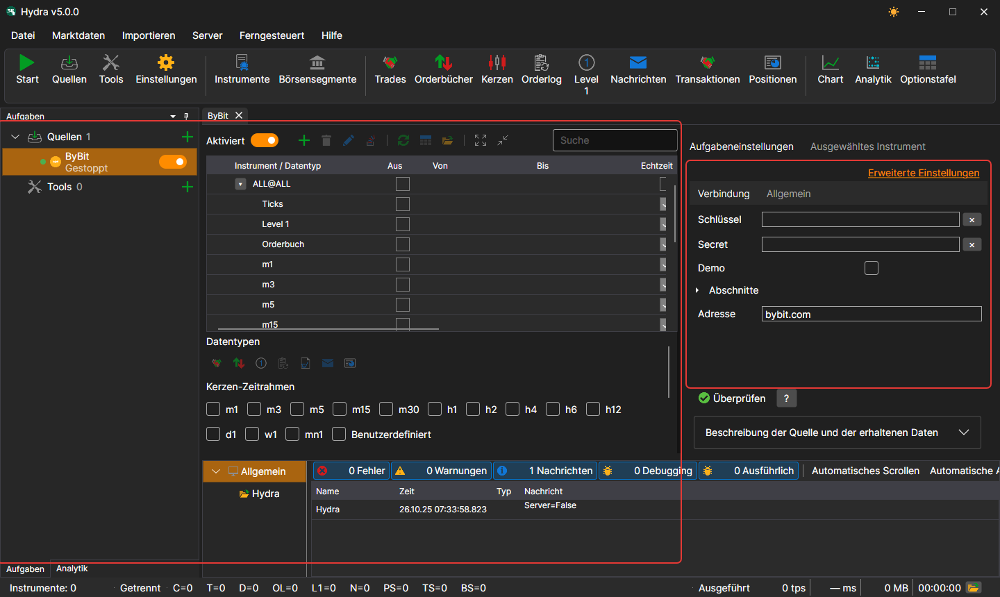

## Instrumente

> [!TIP]
> Daten werden nur für die Instrumente heruntergeladen, die der Quelle hinzugefügt wurden.

Direkt nach dem Hinzufügen hat die Quelle nur das Hilfsinstrument **ALL@ALL** — „alle Instrumente der Quelle“. Darüber werden die Daten heruntergeladen, die die Quelle für alle ihre Instrumente auf einmal liefern kann. Als Beispiel fügen wir das Spot-Paar BTCUSDT hinzu.

1. Klicken Sie auf die Schaltfläche **Instrumente hinzufügen**  über der Instrumententabelle. Es öffnet sich ein Auswahlfenster: links die Instrumente, die Hydra kennt, rechts die für die Quelle ausgewählten.

   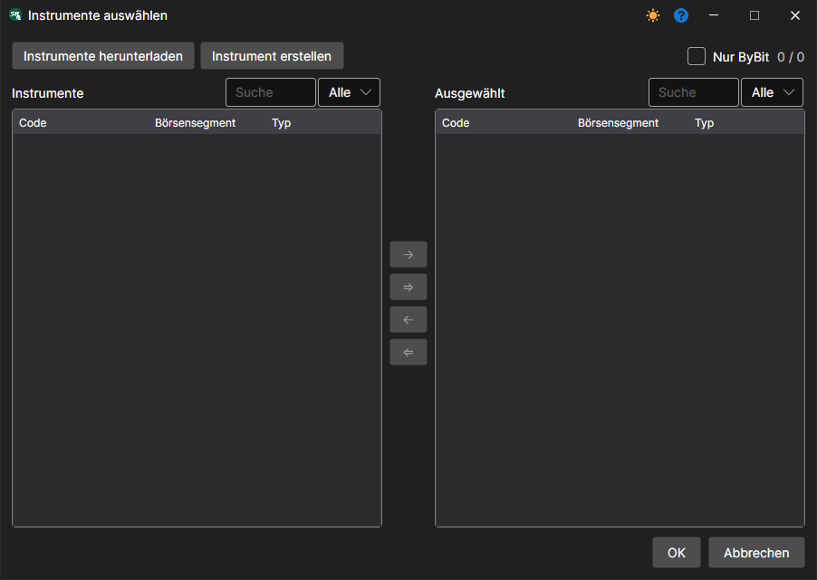

2. Beim ersten Mal ist die Liste links leer: Hydra kennt noch kein einziges Instrument. Klicken Sie auf **Instrumente herunterladen**. Im geöffneten Fenster werden die Suchbedingungen festgelegt; das Kontrollkästchen **Alle** fordert von der Quelle die gesamte Liste an.

   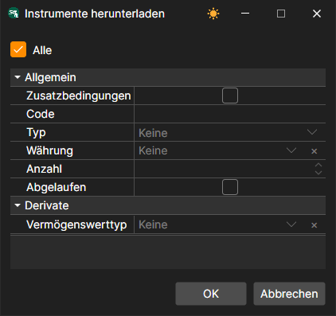

   Bei einer Reihe von Quellen können Sie statt der gesamten Liste die benötigten Instrumente [angeben](prepare_for_download/instruments_list.md).

3. Klicken Sie auf **OK**. Wenn die Quelle antwortet, meldet Hydra, wie viele neue Instrumente hinzugefügt wurden, und sie erscheinen in der Liste links. Der Zähler über der Liste zeigt, wie viele Instrumente sichtbar und wie viele insgesamt bekannt sind; das Kontrollkästchen **Nur ByBit** blendet die Instrumente aus, die bereits andere Quellen herunterladen.

   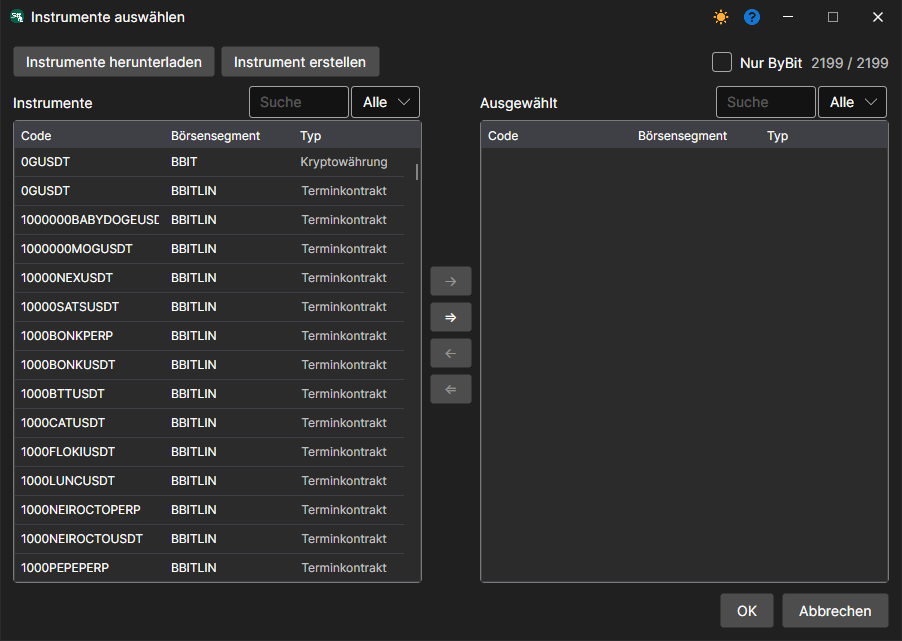

4. Beginnen Sie, den Code des Instruments in das Feld **Suche** über der Liste einzugeben.

   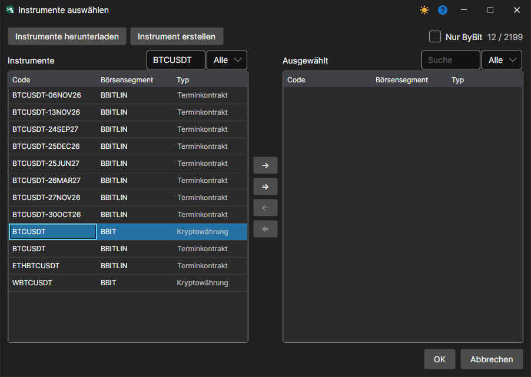

5. Verschieben Sie das Instrument per Doppelklick oder mit der Pfeilschaltfläche nach rechts und klicken Sie auf **OK**.

   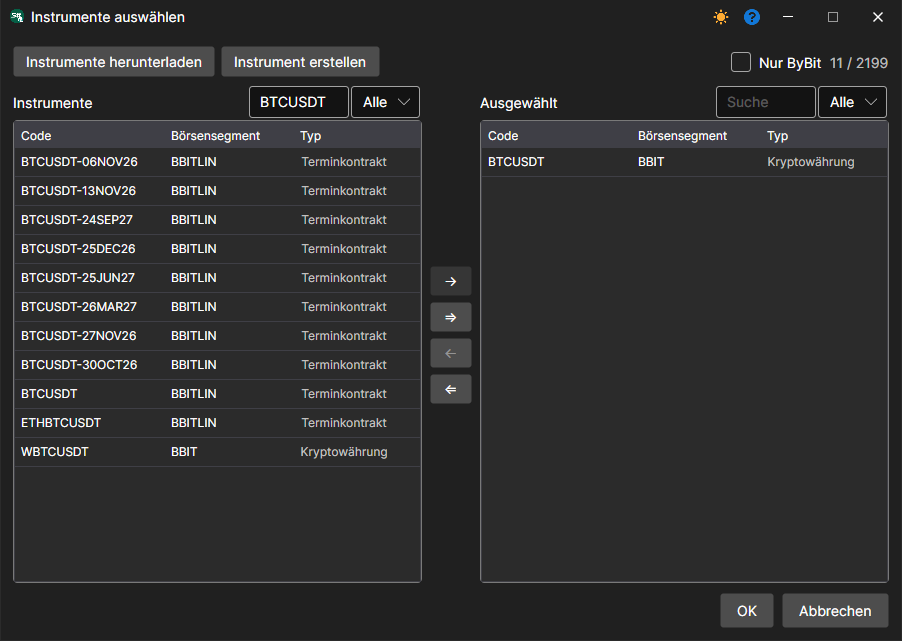

## Datentypen und Zeitraum

Nach der Auswahl der Instrumente fragt Hydra, welche Daten für sie heruntergeladen werden sollen. Wir markieren **Ticks** und Fünf-Minuten-Kerzen **TF: 00:05:00** — jeder Klick fügt der Auswahl einen weiteren Typ hinzu.

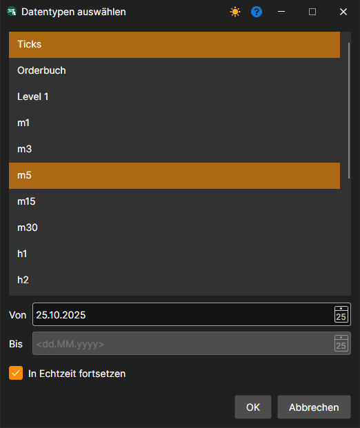

Das Datum **Von** ist der Beginn der Historie. Das Kontrollkästchen **In Echtzeit fortsetzen** lässt die Quelle auch dann weiter Daten empfangen, wenn die Historie heruntergeladen ist; das Datum **Bis** wird dabei nicht benötigt. Wie viel Historie die Quelle liefert, hängt von ihr selbst ab.

Nach **OK** erscheint das Instrument in der Tabelle der Quelle. Die Tabelle ist baumartig: In der Zeile des Instruments steht sein Code, darunter die ausgewählten Datentypen mit Anfangs- und Enddatum.

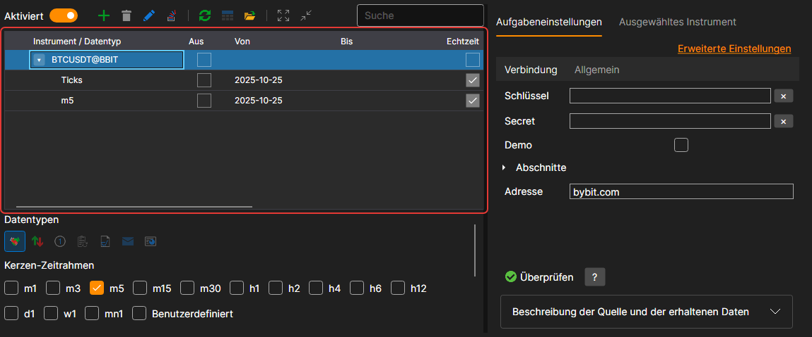

Wenn für ein Instrument kein einziger Datentyp ausgewählt ist oder Preisschritt, Volumenschritt oder Anzahl der Nachkommastellen nicht festgelegt sind, erscheint links in seiner Zeile das Symbol ⚠. Der Tooltip des Symbols erklärt, was fehlt.

Unter der Tabelle befinden sich die Einstellungen der darin markierten Zeilen. Markieren Sie eine oder mehrere Zeilen, und die Einstellungen werden auf alle gleichzeitig angewendet:

- **Datentypen** — welche Daten empfangen werden. Die Auswahl hängt von der Quelle ab.

  

- **Kerzen-Zeitrahmen** — welche Kerzen heruntergeladen werden. Die Liste der Zeitrahmen hängt ebenfalls von der Quelle ab; **Benutzerdefiniert** öffnet ein Fenster, in dem ein [eigener Kerzentyp](prepare_for_download/custom_candles.md) festgelegt wird.

  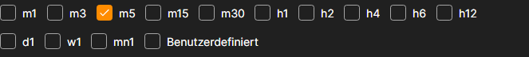

- **Von** und **Bis** — der Zeitraum des Herunterladens. Ohne Enddatum lädt die Quelle alles herunter, was bis heute verfügbar ist, und wenn sie in Echtzeit arbeiten kann und das Kontrollkästchen **Echtzeit** gesetzt ist, empfängt sie auch danach weiter Daten.

  **Kerzenaufbau** — woher die Kerzen genommen werden: **Laden** — fertig von der Quelle, **Aufbau** — von Hydra selbst aufbauen, **Laden und aufbauen** — laden und fehlende aufbauen. **Aufbaufeld** — woraus aufgebaut wird: aus dem Preis des letzten Trades, der Mitte des Spreads, dem besten Preis usw. Kerzen aufzubauen ist praktisch, wenn die Quelle sie nicht im benötigten Zeitrahmen liefert.

  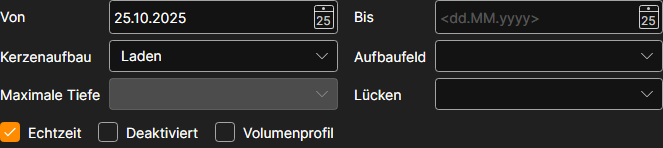

## Herunterladen

Klicken Sie in der Symbolleiste auf **Start**. Die Quelle verbindet sich und beginnt mit dem Herunterladen. Der Fortschritt ist im Panel **Protokolle** unten im Fenster zu sehen, und die Statusleiste zählt die empfangenen Daten: **C** — Kerzen, **T** — Ticks usw. Die Protokolle werden außerdem in Dateien im Ordner von Hydra gespeichert.

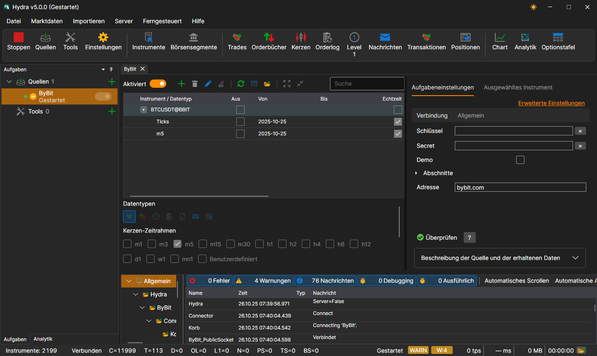

Sie können auch [weitere Quellen](data_sources/select_source.md) hinzufügen.

Die heruntergeladenen Daten können [angezeigt](working_with_data/view_and_export.md) werden, aus ihnen können [Kerzen aufgebaut](working_with_data/candles_generation.md) werden, und sie können in verschiedene Formate [exportiert](working_with_data/export_data.md) werden.

**Sehen Sie sich das [Video-Tutorial](videos/first_start.md) an**.
