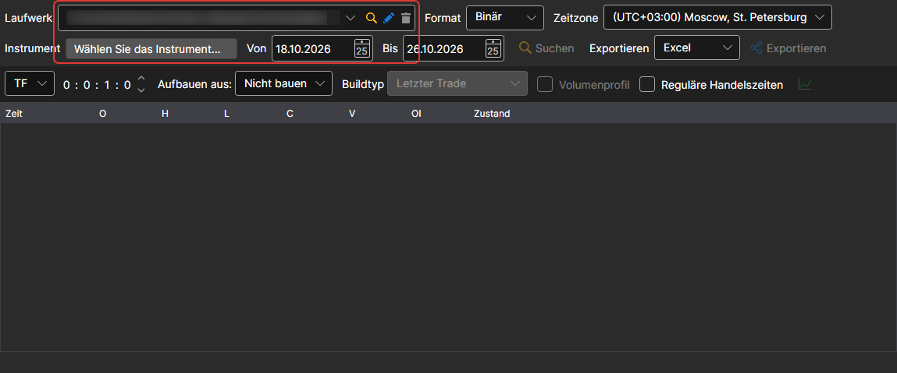
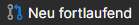
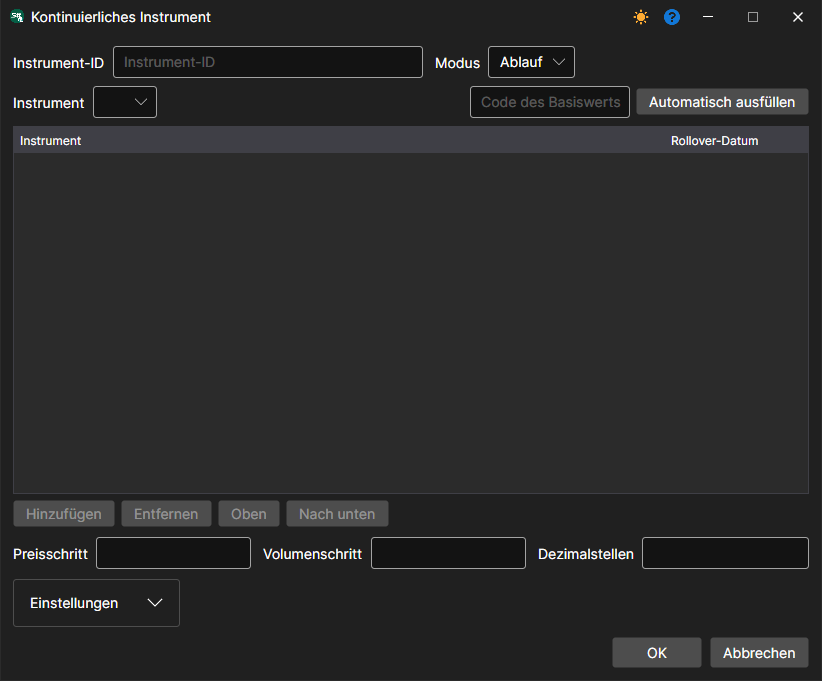
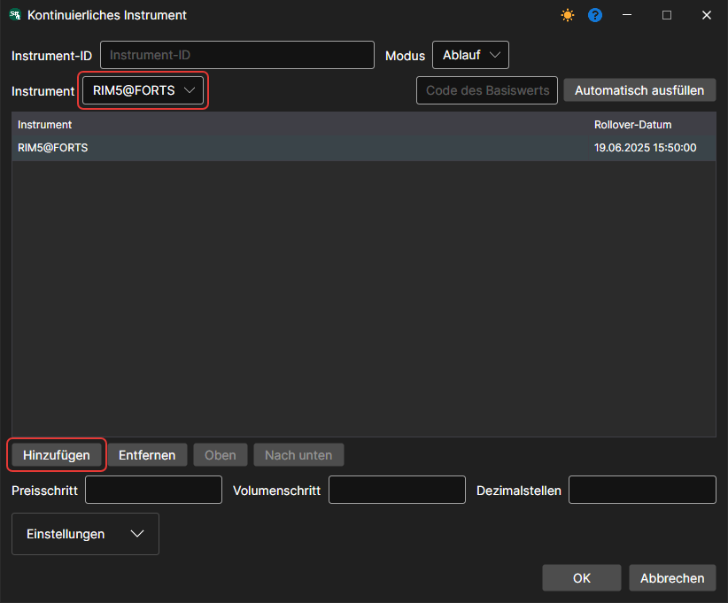
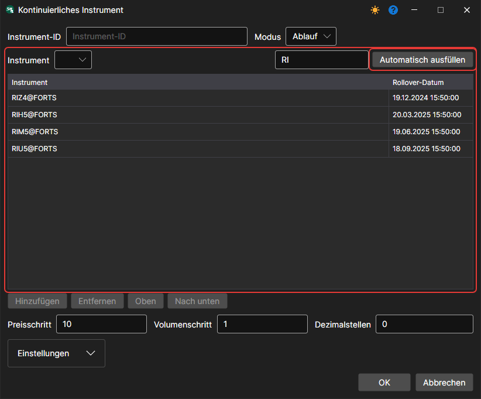
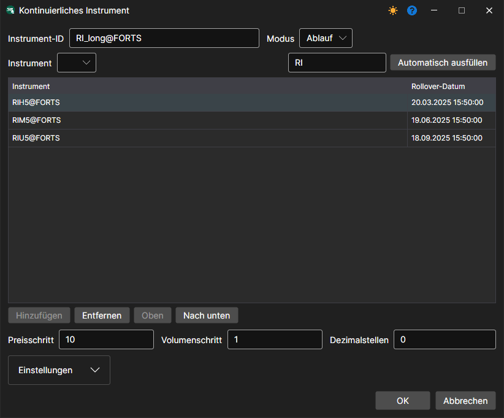
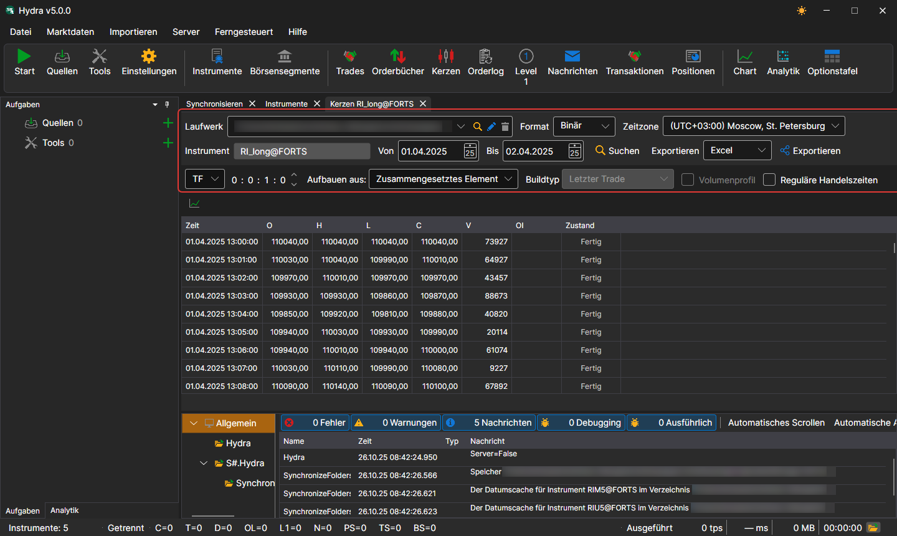

# Fortlaufende Futures

Das Programm [Hydra](../../hydra.md) ermöglicht es dem Benutzer, verschiedene Typen von Marktdaten aus unterschiedlichen Kontrakten zu einem einzigen fortlaufenden Instrument zusammenzufassen.

Wählen Sie dazu im Menü **Marktdaten** den Eintrag **Instrumente**, sodass das Panel **Instrumente** angezeigt wird. Prüfen Sie vor dem Zusammenfassen der Daten, welche Marktdaten verfügbar sind. Wählen Sie den Pfad aus, in dem sich die Daten befinden, und prüfen Sie die Instrumente, die Sie zusammenfassen möchten. Wenn Lücken vorhanden sind, laden Sie die fehlenden Marktdaten herunter, zum Beispiel aus einer unterstützten Datenquelle.

Als Beispiel betrachten wir das Zusammenfassen von E-mini S&P 500 Futures.

1. Um einen fortlaufenden Futures-Kontrakt zu erstellen, klicken Sie im Panel **Instrumente** auf die Schaltfläche **Neu fortlaufend**.

   Danach erscheint das folgende Fenster:
2. Um einen fortlaufenden Future zu erstellen, müssen Sie einen Namen angeben und Kontrakte hinzufügen.

   Es gibt zwei Möglichkeiten, Kontrakte hinzuzufügen.
   - Manuell: einen Kontrakt in der Liste **Instrument** auswählen und auf die Schaltfläche **Hinzufügen** klicken.
   - Wenn Sie im Feld **Code des Basiswerts** die ersten beiden Buchstaben des Kontrakts angeben, zum Beispiel RI, und auf die Schaltfläche **Automatisch ausfüllen** klicken, werden alle in der Datenbank gefundenen Kontrakte mit ihren Verfallsdaten hinzugefügt.
3. Wählen Sie die erforderlichen Kontrakte aus und legen Sie deren Übergangsdaten fest. 
4. Weisen Sie anschließend die Instrumentkennung **ES\_continuous@CME** zu und klicken Sie auf die Schaltfläche **OK**. Danach wird ein neues Instrument erstellt.
5. Wählen Sie danach im Menü **Marktdaten** den Eintrag [Kerzen](../working_with_data/view_and_export/candles.md), wählen Sie das resultierende Instrument und den Datenzeitraum aus, setzen Sie im Feld **Erstellen aus** den Wert **Zusammengesetztes Element** und klicken Sie dann auf die Schaltfläche . 

Die erzeugten Daten können in die Formate Excel, XML, JSON oder TXT exportiert werden. Der Export erfolgt über die Dropdown-Liste.

