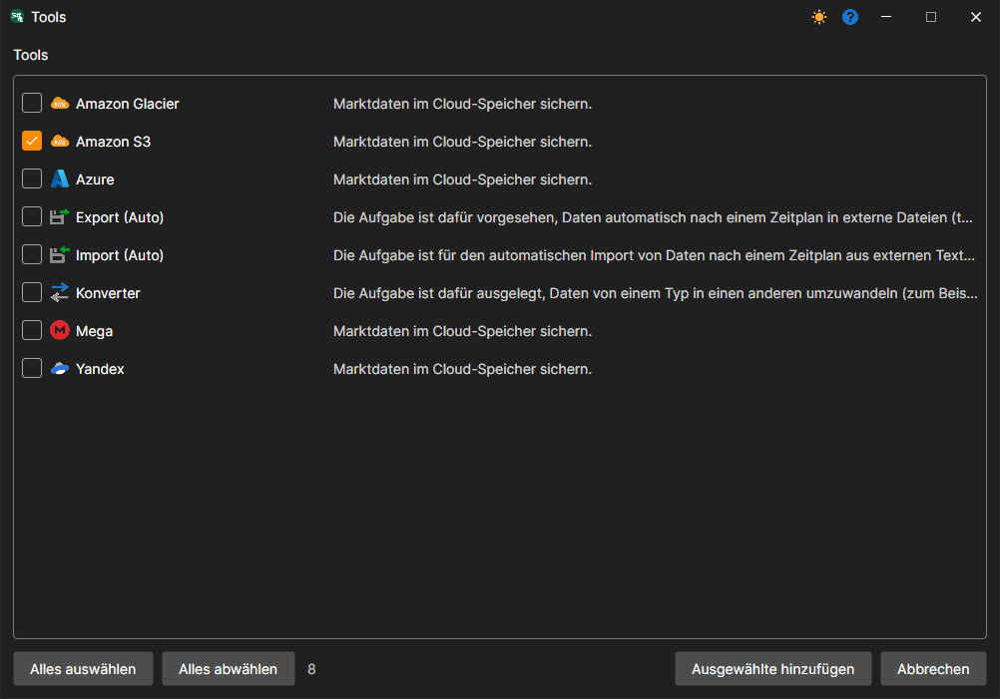
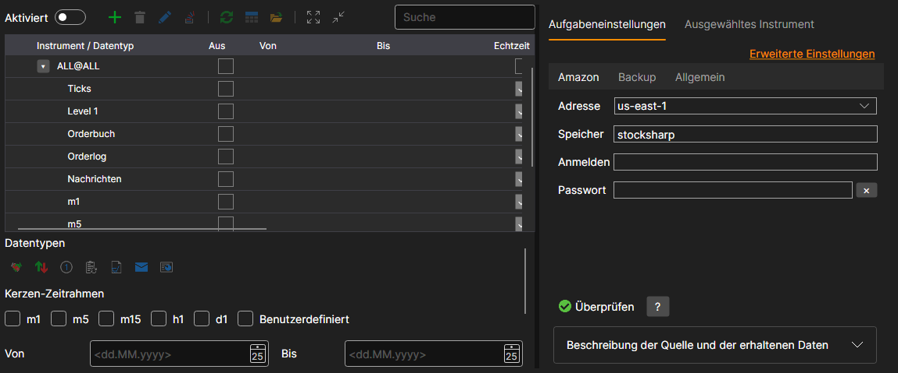

# Hydra-Einstellungen

Im Folgenden wird beschrieben, wie Sie eine Backup-Aufgabe erstellen und konfigurieren.

1. Um eine Aufgabe zu erstellen, klicken Sie auf die Schaltfläche **Tools**, markieren im geöffneten Fenster den Eintrag **Amazon S3** und klicken auf die Schaltfläche **Ausgewählte hinzufügen**. Auf die Frage, ob die Aufgabe jetzt aktiviert werden soll, können Sie mit **Nein** antworten - die Aufgabe wird nach der Einrichtung mit ihrem Schalter aktiviert.
2. Danach müssen Sie die Aufgabe konfigurieren. Die Einstellungen sind auf Registerkarten verteilt, und der Link **Erweiterte Einstellungen** zeigt sie alle in einer Liste.

   **Amazon**
   - **Adresse** - die Region, die in den Bucket-Einstellungen angegeben ist. Siehe [Regionen und Endpunkte](https://docs.aws.amazon.com/general/latest/gr/rande.html#s3_region).
   - **Speicher** - der Bucket-Name.
   - **Anmelden** - der Zugriffsschlüssel **Access Key ID**.
   - **Passwort** - der Zugriffsschlüssel **Secret Access Key**.

   **Backup**
   - **Ordner** - der Ordner in der Cloud, in den die Daten hochgeladen werden. Wenn er nicht festgelegt ist, werden die Daten in das Stammverzeichnis des Buckets hochgeladen.
   - **Zeitversatz** - ein Versatz in Tagen ab dem aktuellen Datum, damit die Daten einer nicht abgeschlossenen Handelssitzung nicht kopiert werden.
   - **Fehler** - wie oft ein fehlgeschlagener Vorgang (Anlegen eines Ordners, Hochladen einer Datei) wiederholt wird, bevor die Aufgabe einen Fehler meldet.

   **Allgemein**
   - **Fortfahren** - das Kopieren ab dem zuletzt kopierten Datum fortsetzen.
   - **Betriebsintervall** - das Ausführungsintervall.
   - **Datenverzeichnis** - Datenverzeichnis, aus dem die Daten für die Konvertierung gelesen werden.
   - **Format** - Format der konvertierten Daten: BIN\/CSV.
   - **Max. Fehler** - maximale Anzahl von Fehlern, bei deren Erreichen die Aufgabe gestoppt wird. Standardmäßig 0, die Anzahl der Fehler wird ignoriert.
   - **Kopfzeile** - Aufgabentitel.
   - **Arbeitszeiten** - der Zeitplan der Aufgabe. Wenn das Häkchen im Feld gesetzt ist, wird die Schaltfläche **...** verfügbar, die den Zeitplan-Editor öffnet.

   **Protokollierung**
   - **Protokollierungsstufe** - die Protokollierungsstufe.
3. Nachdem Sie die Aufgabe eingerichtet haben, fügen Sie die Instrumente hinzu, die im Backup-Speicher gespeichert werden sollen, und klicken Sie auf die Schaltfläche **Starten**.

## Empfohlene Inhalte

[Konto erstellen und konfigurieren](setup.md)
