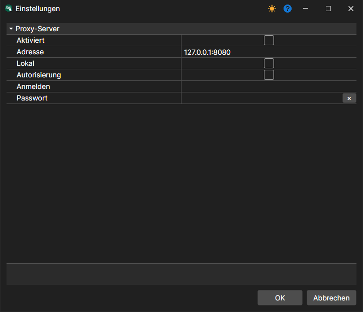

# Netzwerkeinstellungen

Menü **Datei \=\> Proxy-Einstellungen**. (Der Eintrag **Server \=\> Netzwerkeinstellungen** enthält die Einstellungen des [Servermodus](../server_mode/settings.md).)

Damit können Sie die Proxy-Einstellungen konfigurieren.
