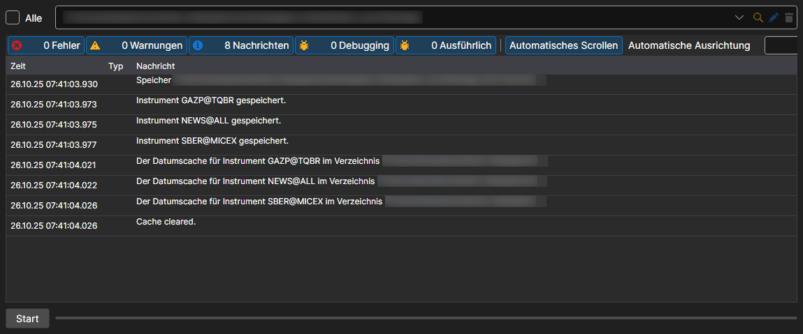

# Synchronisierung

Menü **Importieren \=\> Synchronisieren**.

Damit können Sie Instrumente aus heruntergeladenen Dateien wiederherstellen.

Der Eintrag **Importieren \=\> Index erstellen** baut den Index des Speichers neu auf — die Liste, welche Daten für welche Tage darin liegen. Hydra baut den Index auch selbst neu auf, in dem Intervall, das in den allgemeinen Einstellungen festgelegt ist.
