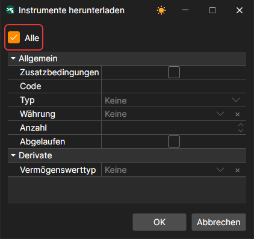
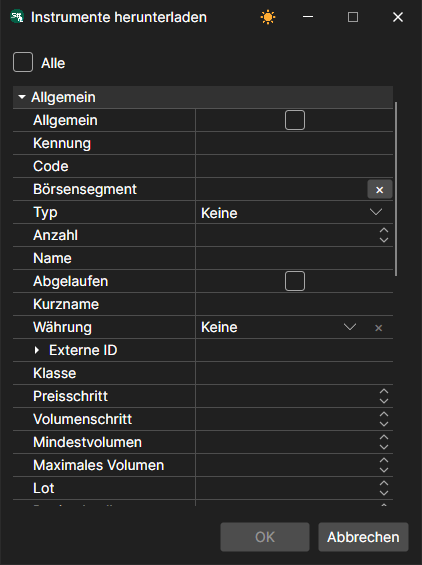
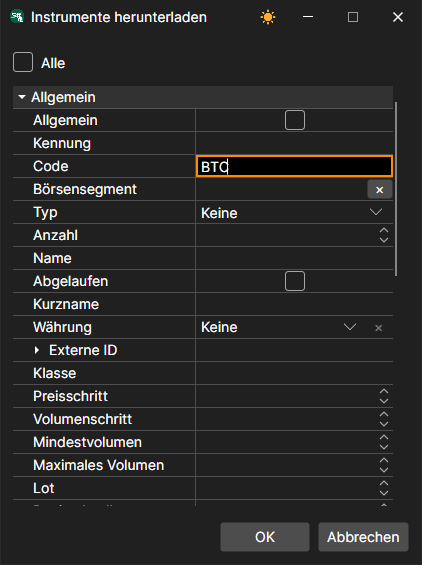
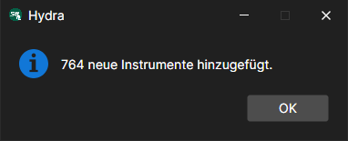
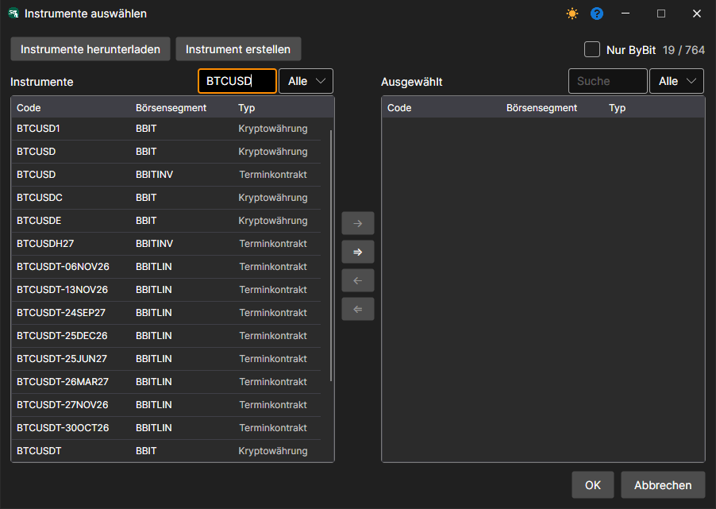
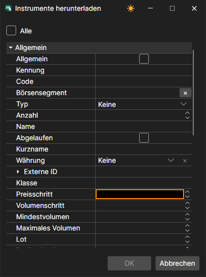
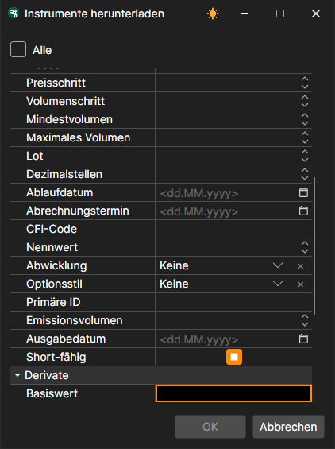

# Instrumentenliste

Einrichtung des Instruments zum Herunterladen.

Für eine Reihe von Quellen ist es möglich, Einstellungen für das Herunterladen der erforderlichen Instrumente vorzunehmen.

Betrachten wir als Beispiel das Herunterladen von Instrumenten aus der Quelle **ByBit**:

1. Klicken Sie auf **Instrumente herunterladen**. Standardmäßig ist der Eintrag **Alle** markiert - es werden alle Instrumente der Quelle heruntergeladen.
2. Entfernen Sie die Markierung **Alle** und markieren Sie **Zusatzbedingungen**. Danach wird eine Liste erweiterter Einstellungen für das herunterzuladende Instrument geöffnet; die Markierung **Allgemein** stellt die kurze Liste wieder her.
3. Es sollen die Instrumente heruntergeladen werden, deren Code BTC enthält. Dazu geben wir BTC im Feld **Code** an und klicken auf **OK**.

   Danach lädt das Programm [Hydra](../../hydra.md) alle Instrumente herunter, die den angegebenen Parametern entsprechen, und meldet, wie viele davon neu sind. 

Die Einstellung ermöglicht dem Benutzer, verschiedene Parameter für das herunterzuladende Instrument auszuwählen.

So kann der Benutzer zum Beispiel Folgendes auswählen:

- **Preis- und Volumenschritt**
- **Minimales und maximales Volumen**
- **Externe ID** 
- Für Optionen können der **Basiswert** und der **Asset-Typ** (Typ des zugrunde liegenden Instruments) festgelegt werden. 

**Sehen Sie sich das [Video-Tutorial](../videos/instruments_downloading.md) an**
