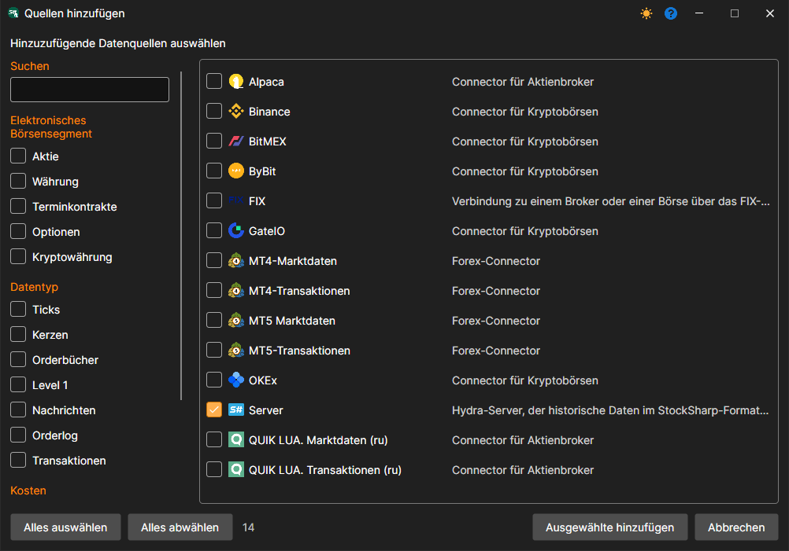
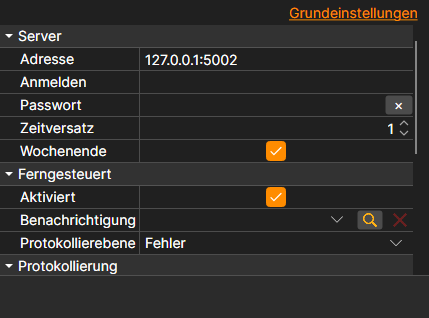

# Hydra Client verbinden

Im Servermodus kann ein weiteres Hydra-Programm verbunden werden, das als Client arbeitet und Daten zu sich selbst herunterlädt. Im Unterschied zu [Verbindung über FIX-Protokoll](fix_fast_connectivity.md) werden Daten in Form von Dateien im StockSharp-Format übertragen. Dadurch eignet sich die Quelle für die Übertragung größer Mengen historischer Daten.

Für die Verbindung wird die Quelle **Server** verwendet: Markieren Sie sie in dem Fenster, das mit der Schaltfläche **+** des Abschnitts **Quellen** geöffnet wird, und klicken Sie auf **Ausgewählte hinzufügen**.

**Einstellungen**

**Server**

- **Adresse** - die Adresse des Hydra-Servers.
- **Anmeldung** - Anmeldung (erforderlich, wenn der Server Autorisierung verlangt).
- **Passwort** - Passwort (erforderlich, wenn der Server Autorisierung verlangt).
- **Zeitversatz** - ein Zeitoffset in Tagen ab dem aktuellen Datum, erforderlich, um das Herunterladen unvollständiger Daten für die aktuelle Handelssitzung zu verhindern.
- **Wochenende** - ob Wochenenden übersprungen werden sollen.

**Hauptbereich**

- **Fortfahren** - das Herunterladen ab dem zuletzt heruntergeladenen Datum fortsetzen.
- **Betriebsintervall** - Ausführungsintervall.
- **Datenverzeichnis** - das Datenverzeichnis, in dem die finalen Dateien im [S#](../../api.md)-Format gespeichert werden.
- **Format** - Datenformat: BIN/CSV.
- **Max. Fehler** - die maximale Anzahl von Fehlern, bei deren Erreichen die Aufgabe gestoppt wird. Standardmäßig 0, die Anzahl der Fehler wird ignoriert.
- **Überschrift** - der Titel der Aufgabe.
- **Arbeitszeiten** - der Zeitplan der Aufgabe.
- **Validierung** - was mit Daten geschehen soll, die die Prüfung nicht bestanden haben: nichts, sie löschen oder das Abonnement beenden.

**Ferngesteuert**

- **Aktiviert** - die Aufgabe fernsteuern.
- **Benachrichtigung** - der Kanal, in den die Benachrichtigungen über die Aufgabe gelangen.
- **Protokollierebene** - welche Meldungen der Aufgabe an den Kanal gesendet werden.

**Protokollierung**

- **Protokollierungsstufe** - Protokollierungsstufe.
