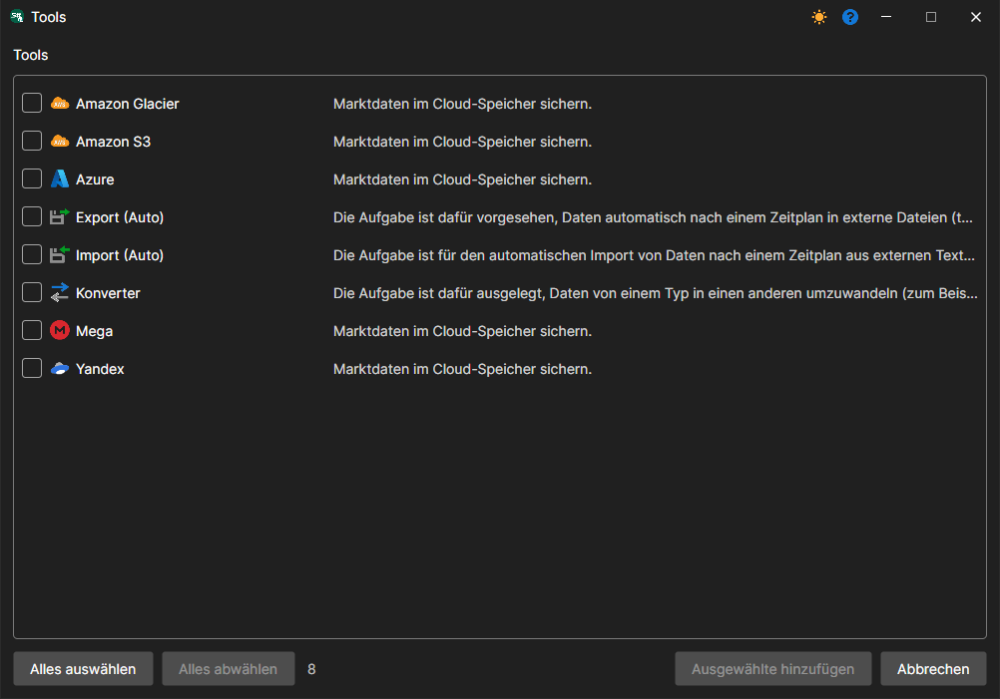

# Aufgaben

Das Werkzeug ist eine wiederkehrende Aktion zu einem bestimmten Zeitpunkt.

Die Werkzeuge sind in der Gruppe **Tools** im Panel **Aufgaben** links zusammengefasst (siehe [Benutzeroberfläche](user_interface.md)). Die Arbeit mit Werkzeugen erfolgt genauso wie mit Quellen: Das Werkzeug kann hinzugefügt, gelöscht, bearbeitet sowie aktiviert\/deaktiviert werden. Um das **Werkzeug** hinzuzufügen, wählen Sie im Menü **Datei** den Eintrag **Tools**. Es erscheint ein entsprechendes Fenster, in dem Sie das erforderliche **Werkzeug** auswählen können.

Derzeit gibt es in [Hydra](../hydra.md) vier Klassen von Aufgaben:

- [Automatischer Import](tasks/import_auto.md) - Aufgabe zum Importieren von Daten aus dem CSV-Format.
- [Konverter](tasks/converter.md) - Aufgabe zum Konvertieren von Börsendaten in Ticks, Kerzen oder Orderbücher.
- [Automatischer Export](tasks/export_auto.md) - Aufgabe zum Exportieren von Kerzen in verschiedene Formate.
- [Sicherung](misc/backup.md) - Aufgabe zum Sichern von Daten in einem Cloud-Service.
