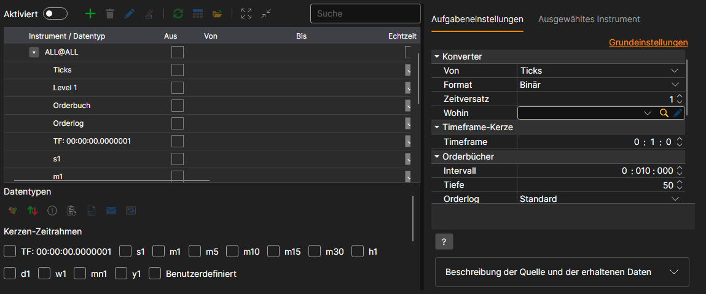
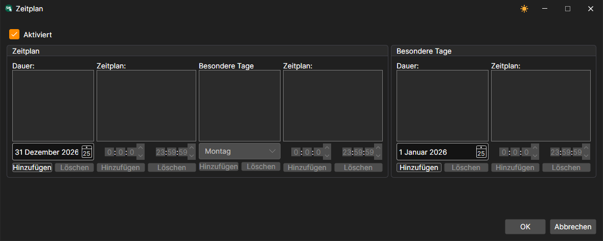
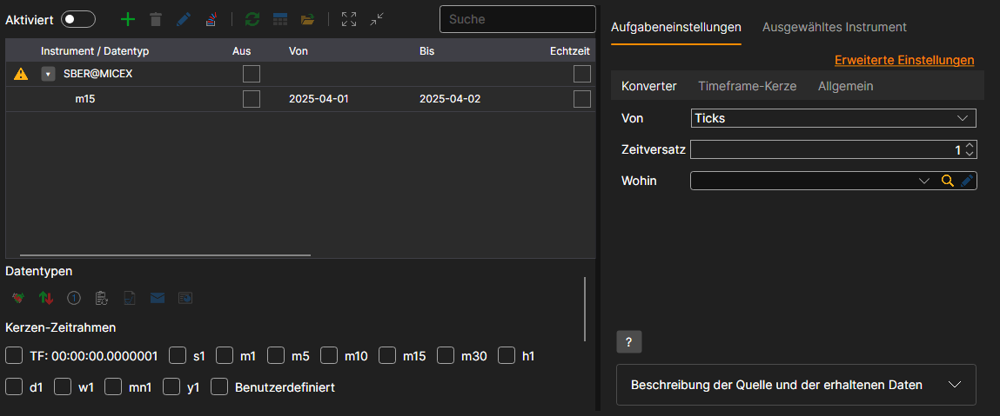
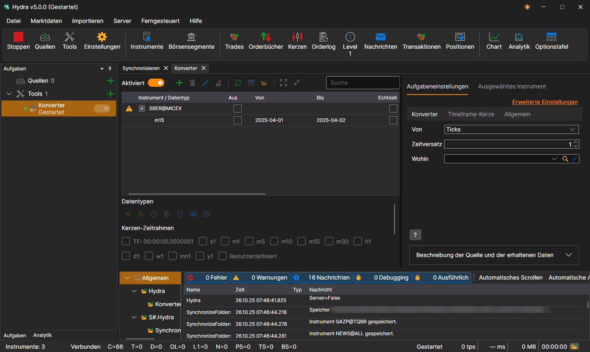
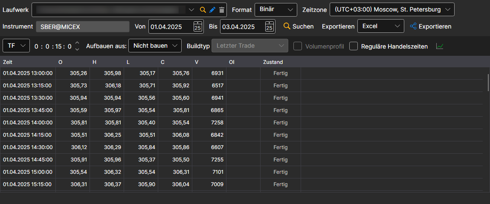

# Konverter

Die Aufgabe konvertiert Börsendaten. Zum Beispiel von Orderprotokollen in Ticks oder von Ticks in Kerzen usw.

Die Aufgabe wird mit der Schaltfläche **Tools** hinzugefügt: Markieren Sie im geöffneten Fenster den Eintrag **Konverter** und klicken Sie auf die Schaltfläche **Ausgewählte hinzufügen**. Die Einstellungen der Aufgabe sind auf Registerkarten verteilt, und der Link **Erweiterte Einstellungen** zeigt sie alle in einer Liste.

**Konverter**

- **Von** - welcher Datentyp konvertiert wird.
- **Format** - Format der konvertierten Daten: BIN\/CSV.
- **Zeitversatz** - Zeitoffset in Tagen ab dem Datum, an dem die Aufgabe gestartet wurde. Dies verhindert die Konvertierung eines unvollständigen Tages. Wenn die Datenkonvertierung in Echtzeit konfiguriert ist, kann das Aktualisierungsintervall den aktuellen Tag nur teilweise konvertieren. Verwenden Sie den Zeitoffset, um dies zu vermeiden.
- **Ziel** - das Datenverzeichnis, in dem die konvertierten Daten gespeichert werden.

**Timeframe-Kerze**

- **Timeframe** - der Zeitrahmen der Kerzen, aus denen konvertiert wird, wenn im Feld **Von** Kerzen ausgewählt sind.

**Orderbücher**

- **Intervall** - Intervall für die Orderbucherzeugung.
- **Tiefe** - maximale Tiefe der Orderbucherzeugung.
- **Orderprotokoll** - wie Orderbücher aus dem Orderprotokoll erstellt werden.

  **Standardmäßig** eignet sich in den meisten Fällen. Wenn eine Verbindung ein eigenes Format des Orderprotokolls hat (zum Beispiel **Plaza** bei der Moskauer Börse), erscheint dieses Format in der Liste, sobald die Verbindung hergestellt ist.

**Allgemein**

- **Fortfahren** - die Konvertierung ab dem zuletzt konvertierten Datum fortsetzen.
- **Betriebsintervall** - das Ausführungsintervall.
- **Datenverzeichnis** - Datenverzeichnis, aus dem die Daten für die Konvertierung gelesen werden.
- **Format** - Format der zu konvertierenden Daten: BIN\/CSV.
- **Max. Fehler** - maximale Anzahl von Fehlern, bei deren Erreichen die Aufgabe gestoppt wird. Standardmäßig 0, die Anzahl der Fehler wird ignoriert.
- **Kopfzeile** - Konverter.
- **Arbeitszeiten** - der Zeitplan der Aufgabe. 

**Protokollierung**

- **Protokollierungsstufe** - die Protokollierungsstufe.

Betrachten wir ein Beispiel für eine Datenkonvertierung.

1. Wechseln Sie zur Aufgabe **Konverter** und fügen Sie mit der Schaltfläche **+** über der Tabelle ein Instrument hinzu. 
2. Legen Sie im erscheinenden Fenster den Datentyp, der bei der Konvertierung entstehen soll, und den Zeitraum fest. Der Datentyp, aus dem konvertiert wird, wird in der Einstellung **Von** festgelegt.

   Zum Beispiel müssen Ticks in Kerzen mit einem Zeitrahmen von 15 Minuten konvertiert werden.

   > [!TIP]
   > WICHTIG\! Der angeforderte Datenzeitraum muss dem für die Konvertierung verfügbaren Zeitraum entsprechen, andernfalls werden die Daten nicht konvertiert. Geben Sie in den Einstellungen das korrekte Quelldatenformat an, damit es dem Format der zu konvertierenden Daten entspricht.
3. Geben Sie die erforderlichen Verzeichnisse, den Zeitoffset und das Ausführungsintervall an.
4. Aktivieren Sie die Aufgabe mit dem Schalter **Aktiviert** und starten Sie die Konvertierung mit der Schaltfläche **Start**. 

Es ist zu sehen, dass die Daten konvertiert wurden. [Sehen wir uns](../working_with_data/view_and_export.md) die resultierenden Daten an.

Diese Funktion ist vergleichbar mit dem [Abrufen der erforderlichen Marktdaten](../working_with_data/any_market_data_types.md) aus einem anderen Datentyp.

**Sehen Sie sich das [Video-Tutorial](../videos/converter_task.md) an**
