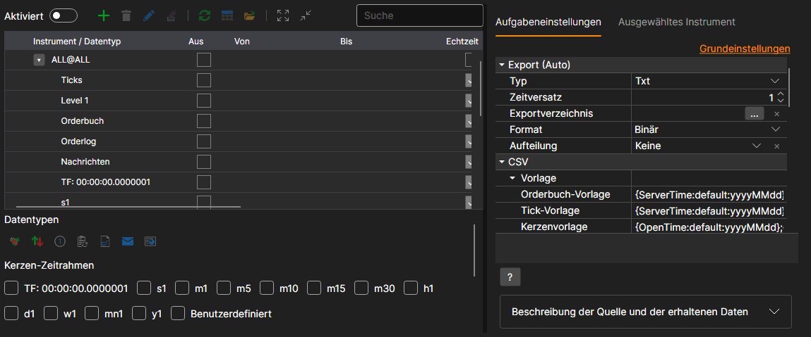
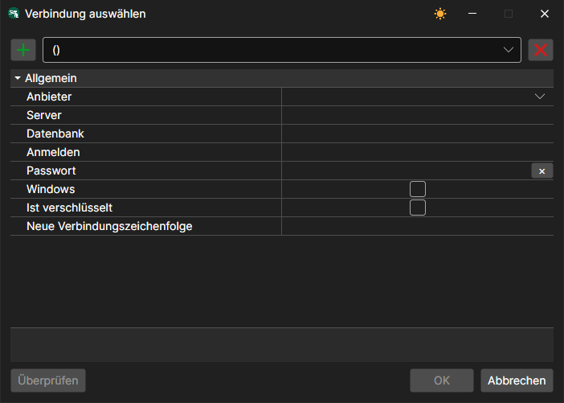
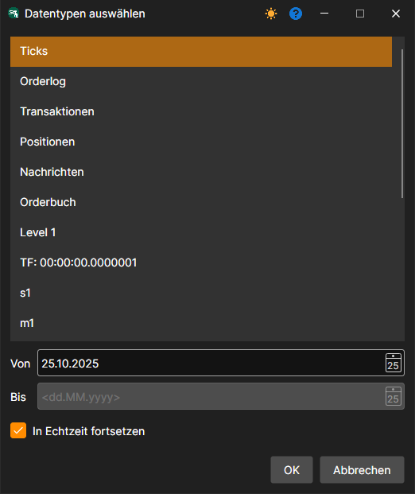
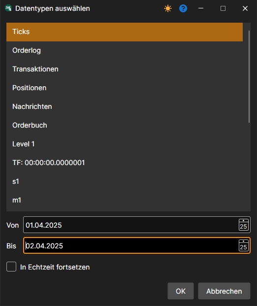
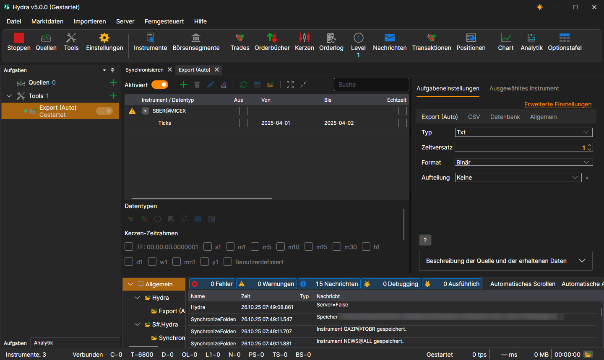

# Automatischer Export

Die Aufgabe exportiert Börsendaten in verschiedene Formate: Excel, xml, sql, bin, Json oder txt.

Die Aufgabe wird mit der Schaltfläche **Tools** hinzugefügt: Markieren Sie im geöffneten Fenster den Eintrag **Export (Auto)** und klicken Sie auf die Schaltfläche **Ausgewählte hinzufügen**. Die Einstellungen der Aufgabe sind auf Registerkarten verteilt, und der Link **Erweiterte Einstellungen** zeigt sie alle in einer Liste.



**Export (Auto)**

- **Typ** - Exporttyp (Format).
- **Zeitversatz** - Zeitoffset in Tagen.
- **Exportverzeichnis** - Verzeichnis, in das Daten exportiert werden. Wenn es nicht festgelegt ist, werden die Dateien im Datenverzeichnis gespeichert.
- **Format** - Datenformat.
- **Aufteilung** - Aufteilungstyp: nach Tagen, Monaten oder Jahren.

**Datenbank**

- **Verbindung** - Verbindung zur Datenbank. Wird beim Export über SQL verwendet.
- **Paket** - Größe des übertragenen Datenpakets. Standardmäßig beträgt die Größe 50 Elemente. Wird beim Export über SQL verwendet.
- **Eindeutigkeit** - Prüfung der Dateneindeutigkeit in der Datenbank. Beeinflusst die Performance. Standardmäßig aktiviert. Wird beim Export über SQL verwendet.

> [!TIP]
> Beim Export über SQL muss die Verbindung zur Datenbank festgelegt werden.

Das Verbindungsfenster wird mit der Lupenschaltfläche im Feld **Verbindung** geöffnet, und die Schaltfläche **+** darin fügt eine neue Verbindung hinzu:



- **Provider** - Provider-Einstellungen.
- **Server** - Serveradresse oder Pfad zur Datenbank.
- **Datenbank** - Datenbankname. Wird für SQLite nicht verwendet.
- **Anmeldung** - Anmeldung für den Zugriff auf die Datenbank. Wird für anonymen Zugriff nicht verwendet.
- **Passwort** - Passwort für den Zugriff auf die Datenbank. Wird für anonymen Zugriff nicht verwendet.
- **Windows** - das aktuelle Windows-Konto für die Verbindung zur Datenbank verwenden.
- **Ist verschlüsselt** - die Verbindung zum Server verschlüsseln.
- **Neue Verbindungszeichenfolge** - fertige Verbindungszeichenfolge.

> [!TIP]
> Sie können die Verbindung zur Datenbank mit der Schaltfläche **Prüfen** prüfen.

**CSV**

- **Vorlage** - Vorlagen für jeden Typ exportierter Daten.
- **Kopfzeile** - Kopfzeile in der ersten Zeile. Wenn eine leere Zeichenfolge übergeben wird, wird dem Dateianfang keine Kopfzeile hinzugefügt.
- **Dateinamenformat** - Format für das Schreiben des exportierten Dateinamens.

**Allgemein**

- **Fortfahren** - den Export ab dem zuletzt exportierten Datum fortsetzen.
- **Betriebsintervall** - das Ausführungsintervall.
- **Datenverzeichnis** - Datenverzeichnis, aus dem die exportierten Daten genommen werden.
- **Format** - Datenformat: BIN\/CSV.
- **Max. Fehler** - maximale Anzahl von Fehlern, bei deren Erreichen die Aufgabe gestoppt wird. Standardmäßig 0, die Anzahl der Fehler wird ignoriert.
- **Kopfzeile** - Aufgabentitel.
- **Arbeitszeiten** - der Zeitplan der Aufgabe. 

**Protokollierung**

- **Protokollierungsstufe** - die Protokollierungsstufe.

Betrachten wir ein Beispiel für den automatischen Export:

1. Wählen Sie mit der Schaltfläche **+** über der Tabelle ein Instrument aus.
2. Richten Sie die Marktdaten ein, die exportiert werden müssen.
3. Legen Sie den Exportzeitraum fest. Wenn das Herunterladen von Marktdaten in Echtzeit konfiguriert ist, können Sie das Enddatum des Zeitraums weglassen. In diesem Fall werden die Daten gemäß dem Arbeitsintervall (Datenaktualisierung) in Echtzeit exportiert. 
4. Richten Sie Verzeichnisse, Ausführungsintervall, Datentyp und Datenformat ein.
5. Aktivieren Sie die Aufgabe mit dem Schalter **Aktiviert** und starten Sie den Export mit der Schaltfläche **Start**.

Sehen wir uns die exportierten Daten an. Die Ticks von SBER@MICEX für den 1. und 2. April, exportiert in den Typ **Txt** mit der Standardvorlage für Ticks, liegen in der Datei `trades_SBER@MICEX_2025_04_01_2025_04_02.csv` und beginnen so:

```
20250401;10:00:00.000000;15500000;305.26;88;Buy
20250401;10:00:09.000000;15500001;305.23;2;Sell
20250401;10:00:18.000000;15500002;305.20;48;Sell
20250401;10:00:27.000000;15500003;305.22;46;Buy
20250401;10:00:36.000000;15500004;305.28;105;Sell
```

**Sehen Sie sich das [Video-Tutorial](../videos/export_task.md) an**
