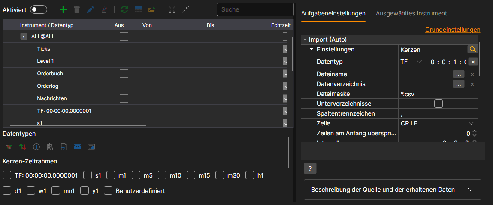
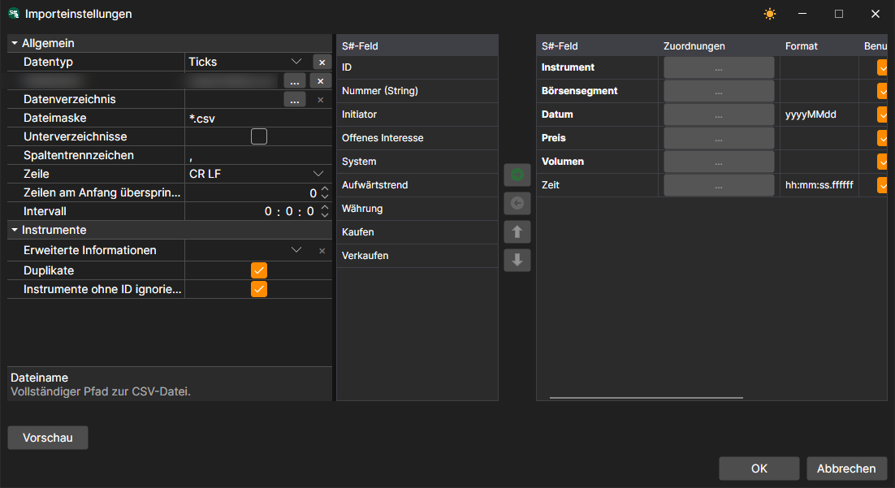
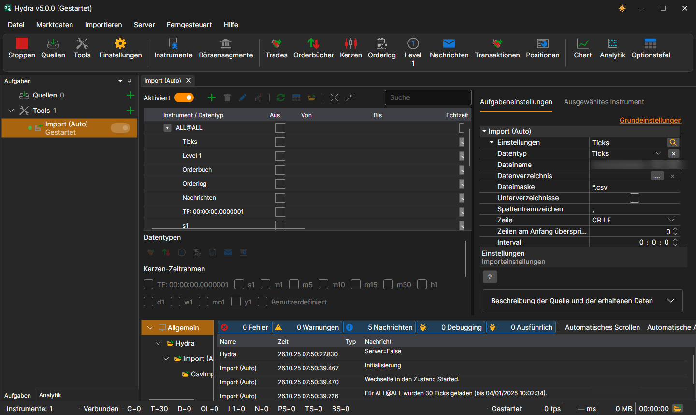

# Automatischer Import

Die Aufgabe führt den automatischen Import von Börsendaten aus Dateien im angegebenen Verzeichnis gemäß der angegebenen Dateimaske aus.

Die Aufgabe wird mit der Schaltfläche **Tools** hinzugefügt: Markieren Sie im geöffneten Fenster den Eintrag **Import (Auto)** und klicken Sie auf die Schaltfläche **Ausgewählte hinzufügen**. Der Link **Erweiterte Einstellungen** zeigt alle Einstellungen der Aufgabe in einer Liste.

Was und woher importiert wird, wird in der Zeile **Einstellungen** festgelegt. Die Lupenschaltfläche in dieser Zeile öffnet ein Fenster, in dem außer denselben Einstellungen die Spalten der Datei den S#-Feldern zugeordnet werden - genauso wie auf der Registerkarte [Import](../importing.md):

**Einstellungen**

- **Datentyp** - Typ der importierten Daten.
- **Dateiname** - vollständiger Pfad zur Datei.
- **Datenverzeichnis** - das Verzeichnis mit den Dateien, wenn nicht eine einzelne Datei, sondern alle passenden Dateien des Verzeichnisses importiert werden.
- **Dateimaske** - Dateimaske, die beim Scannen des Verzeichnisses verwendet wird. Zum Beispiel candles\*.csv.
- **Unterverzeichnisse** - Unterverzeichnisse einschließen.
- **Spaltentrennzeichen** - Spaltentrennzeichen. Tabulator wird als TAB bezeichnet.
- **Zeile** - das Zeilenende in der Datei: CR LF, LF oder CR.
- **Zeilen am Anfang überspringen** - Anzahl der Zeilen, die am Anfang der Datei übersprungen werden sollen (wenn sie Metainformationen enthalten).
- **Intervall** - Häufigkeit der Datenaktualisierung.
- **Erweiterte Informationen** - erweiterte importierte Felder im Speicher für erweiterte Informationen speichern.
- **Duplikate** - ob doppelte Instrumente aktualisiert werden sollen, wenn sie bereits existieren.
- **Ohne ID ignorieren** - Instrumente ohne Kennung ignorieren.

**Allgemein**

- **Fortfahren** - den Import ab dem zuletzt importierten Datum fortsetzen.
- **Betriebsintervall** - das Ausführungsintervall.
- **Datenverzeichnis** - Datenverzeichnis, aus dem die Daten für die Konvertierung gelesen werden.
- **Format** - Format der konvertierten Daten: BIN\/CSV.
- **Max. Fehler** - maximale Anzahl von Fehlern, bei deren Erreichen die Aufgabe gestoppt wird. Standardmäßig 0, die Anzahl der Fehler wird ignoriert.
- **Kopfzeile** - Aufgabentitel.
- **Arbeitszeiten** - der Zeitplan der Aufgabe. 

**Protokollierung**

- **Protokollierungsstufe** - die Protokollierungsstufe.

Betrachten wir ein Beispiel für den automatischen Import von Ticks. In der Datei `ticks.csv` ist jeder Trade als Zeile der Form `GAZP,TQBR,20250401,128.58,74,10:00:02.000000` geschrieben: Instrument, Börsensegment, Datum, Preis, Volumen und Zeit.

1. Öffnen Sie mit der Lupenschaltfläche in der Zeile **Einstellungen** das Fenster mit den Importeinstellungen.
2. Wählen Sie den Datentyp **Ticks** und geben Sie im Feld **Dateiname** den Pfad zur Datei an.
3. Fügen Sie den S#-Feldern das Feld **Zeit** hinzu: Die Pflichtfelder - Instrument, Börsensegment, Datum, Preis und Volumen - stehen bereits in der Reihenfolge, in der die Spalten in der Datei folgen, und die Zeit wird danach angefügt. Klicken Sie auf **OK**.
4. Aktivieren Sie die Aufgabe mit dem Schalter **Aktiviert** und starten Sie den Import mit der Schaltfläche **Start**. 
