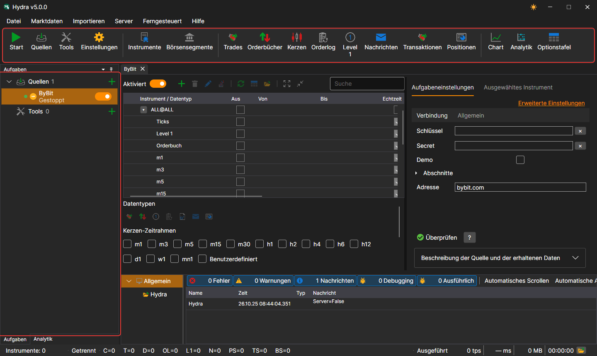
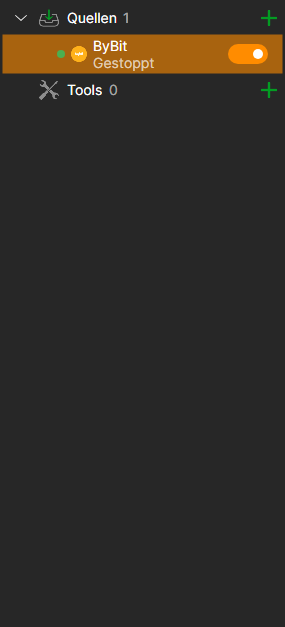
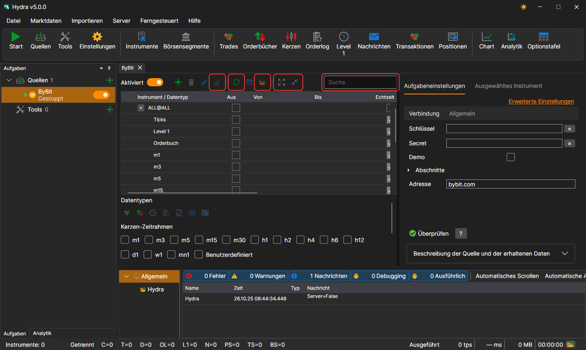

# Benutzeroberfläche

Das Fenster von [Hydra](../hydra.md) besteht aus einem Menü, einer Befehlsleiste darunter, den Panels **Aufgaben** und **Analytik** links, dem Panel **Protokolle** unten und Dokumenten in der Mitte: Panels von Quellen, Werkzeugen und Marktdaten. Unten im Fenster befindet sich die Statusleiste.

## Menü

- **Datei** — Hinzufügen von [Quellen](data_sources.md) und Werkzeugen, [allgemeine Einstellungen](misc/settings.md), [Proxy-Einstellungen](misc/network_settings.md), [Zurücksetzen der Einstellungen](misc/settings_reset.md) und Beenden.
- **Marktdaten** — Panels zur Anzeige der Marktdaten des Speichers: Instrumente, Börsensegmente, Trades, Orderbücher, Kerzen, Orderprotokoll, Level 1, Nachrichten, Transaktionen, Positionen sowie das [Chart](working_with_data/chart.md), die Analytik und die Optionstafel.
- **Importieren** — [Import](importing.md) von Daten aus Dateien, [Synchronisierung](misc/synchronization.md) des Speichers und Aufbau seines Index.
- **Server** — der [Servermodus](server_mode/settings.md): Einschalten, Netzwerkeinstellungen, Benutzer und Abonnements der Clients.
- **Ferngesteuert** — Fernsteuerung von Hydra über den Telegram-Bot ([Bedienfeld](../telegram_services/control_panel.md)) und das Fenster **Kanäle** mit der Liste der Telegram-Kanäle, an die Hydra Nachrichten sendet.
- **Hilfe** — Wechsel des Designs, Kontakt zum StockSharp-Team, Melden eines Problems, Dokumentation und das Fenster **Über das Programm**.

Unter macOS wandert das Menü in die Systemmenüleiste.

## Befehlsleiste

Unter dem Menü befindet sich die Befehlsleiste mit den häufigsten Aktionen: **Alle Aufgaben starten / stoppen**, Hinzufügen von Quellen und Werkzeugen, Einstellungen; die Panels **Instrumente** und **Börsensegmente**; die Marktdaten-Panels — Trades, Orderbücher, Kerzen, Orderprotokoll, Level 1, Nachrichten, Transaktionen und Positionen; **Chart**, **Analytik** und **Optionstafel**.

## Aufgaben

Im Panel **Aufgaben** links sind die Aufgaben in die Gruppen **Quellen** und **Tools** aufgeteilt. Eine Gruppe zeigt die Anzahl ihrer Aufgaben und die Schaltfläche **+**, die eine neue hinzufügt. Eine Aufgabe zeigt einen Punkt (grün, wenn die Aufgabe aktiviert ist), ein Symbol, einen Namen, eine Zeile mit ihrem aktuellen Zustand und einen Schalter; das Uhrsymbol zeigt, dass für die Aufgabe eine Arbeitszeit festgelegt ist. Ein Doppelklick öffnet das Panel der Aufgabe, ein Rechtsklick ein Menü mit den Einträgen **Öffnen** und **Löschen**.

Solange in der Mitte des Fensters nichts geöffnet ist, wird dort ein Begrüßungsbildschirm mit den Schaltflächen **Quellen hinzufügen** und **Tools hinzufügen** angezeigt.

Während eine lange Arbeit läuft — zum Beispiel ein großer Speicher gelesen oder eine Quelle hinzugefügt wird —, ist das Fenster mit einer halbtransparenten Überlagerung bedeckt, die beschreibt, was gerade geschieht.

## Panel der Aufgabe

Über der Instrumententabelle der Quelle befinden sich die Suche, der Schalter **Aktiviert**, die Schaltflächen zum Hinzufügen, Löschen und Bearbeiten von Instrumenten, **ALL@ hinzufügen** (alle Instrumente der Quelle auf einmal), die Synchronisierung der Daten, der Wechsel zu den Daten und zum Ordner des Speichers sowie das Ein- und Ausklappen der Zeilen. Die Registerkarte der Einstellungen enthält eine Schaltfläche zur Prüfung der Verbindung und die Beschreibung der Quelle, und die Registerkarte **Ausgewähltes Instrument** zeigt die Eigenschaften des in der Tabelle markierten Instruments.

## Statusleiste

Unten im Fenster ist zu sehen, wie viele Instrumente im Speicher sind, ob Hydra verbunden ist, wie viele Daten jeder Art seit dem Start empfangen wurden, womit das Programm gerade beschäftigt ist, und die letzte Warnung oder der letzte Fehler des Protokolls. Die Schaltfläche mit dem Ordner öffnet den Protokollordner. Während eine lange Operation läuft — das Lesen eines großen Speichers, das Hinzufügen einer Quelle —, wird das Fenster mit einer Überlagerung bedeckt, die die Arbeit beschreibt.

## Siehe auch

[Erster Start](first_start.md)

[Datenquellen](data_sources.md)
