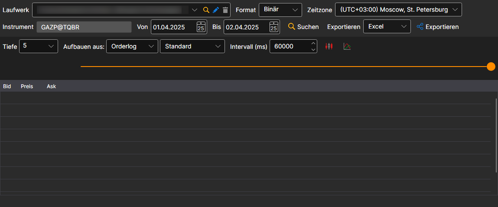
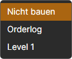
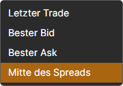
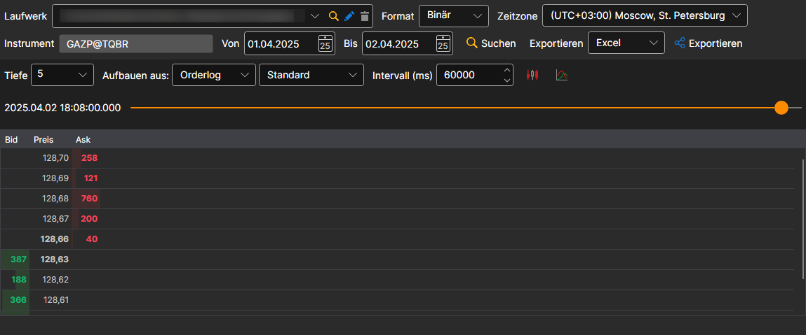

# Beliebige Marktdatentypen

[Hydra](../../hydra.md) ermöglicht die Verwendung alternativer Datentypen, um verschiedene Arten von Marktdaten zu erhalten.

Dies ist erforderlich, wenn die Quelle das Herunterladen der benötigten Marktdaten nicht ermöglicht. So können zum Beispiel mehrere Marktdatentypen gleichzeitig verwendet werden, um das **Orderbuch** zu erstellen.

WICHTIG\! **Orderbuch** kann aus **Orderprotokoll** oder **Level 1** erstellt werden, sofern diese Datentypen die besten Preise enthalten.

Aus **Level 1** entsteht ein Orderbuch nur aus den besten Preisen — je eine Zeile für Kauf und Verkauf. Ein Orderbuch über die gesamte gewählte Tiefe wird aus dem **Orderprotokoll** erstellt: Es enthält jede platzierte, stornierte und ausgeführte Order.

Beachten Sie, dass **Level 1**-Werte aus jeder Quelle heruntergeladen werden können, die Echtzeit-Marktdaten bereitstellt. **Level 1** kann auch durch [Konvertierung](../tasks/converter.md) aus dem **Orderbuch** erhalten werden.

Für die Erstellung gehen Sie wie folgt vor:

1. Wählen Sie den Zeitraum und das Instrument aus, für die Sie Marktdaten erhalten möchten.
2. Wählen Sie das Feld **Erstellen aus** aus und wählen Sie den erforderlichen Datentyp.

   WICHTIG\! Wenn **Orderbuch, Orderprotokoll, Level 1** als Quelle für die Kerzenerstellung ausgewählt sind, erscheint eine Auswahl zusätzlicher Parameter.
3. Nachdem Sie die Parameter festgelegt haben, klicken Sie auf die Schaltfläche .

Zum Erstellen von **Kerzen** ist auch die Option verfügbar, Kerzen mit größerem Zeitrahmen aus Kerzen mit kleinerem Zeitrahmen zu erstellen.

Wenn zum Beispiel Kerzen mit einem Zeitrahmen von 1 Minute vorhanden sind, können Sie daraus Kerzen mit einem Zeitrahmen von 5 Minuten erstellen, indem Sie in der Zeile **Erstellen aus** den entsprechenden Typ auswählen.

**Sehen Sie sich das [Video-Tutorial](../videos/building_order_books.md) an**
