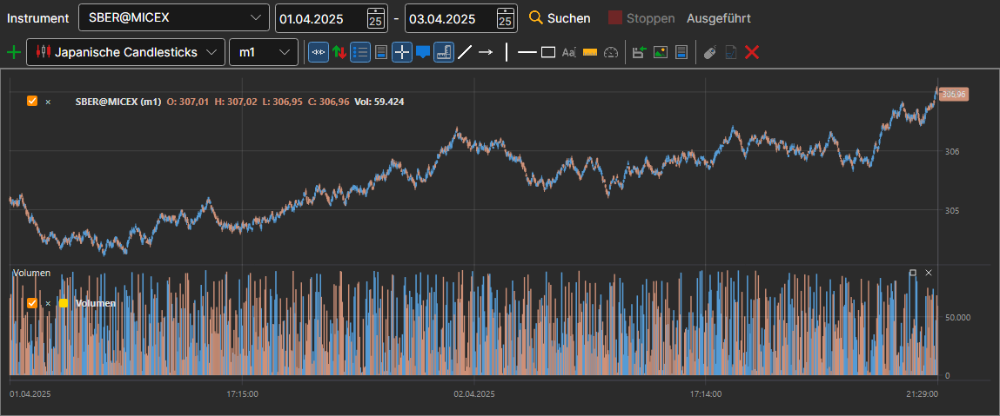

# Chart

Das Panel **Chart** zeigt die Kerzen jedes Instruments, das im Speicher vorhanden ist. Es wird mit dem Eintrag **Marktdaten → Chart** oder mit der Schaltfläche **Chart** in der Befehlsleiste geöffnet.

In der Zeile über dem Chart werden das **Instrument** und der Zeitraum — Anfangs- und Enddatum — gewählt, danach wird auf **Suchen** geklickt. Die Kerzen werden aus dem Speicher gelesen und während des Lesens gezeichnet; **Stoppen** bricht das Lesen ab, und die Zeile neben den Schaltflächen zeigt, wie die Arbeit vorankommt.

Darunter befindet sich ein vollwertiges Chart, genau wie im [Terminal](../../terminal/user_interface/components/chart.md): mit Schaltflächenleiste, Kerzenstilen, Indikatoren und Zeichenwerkzeugen. Dem Chart kann ein [Indikator](view_and_export/indicators.md) hinzugefügt werden, und die Schaltfläche **Zeichnen beenden** stoppt das lange Zeichnen eines großen Zeitraums.

## Siehe auch

[Kerzenerzeugung](candles_generation.md)

[Anzeigen und Exportieren](view_and_export.md)
