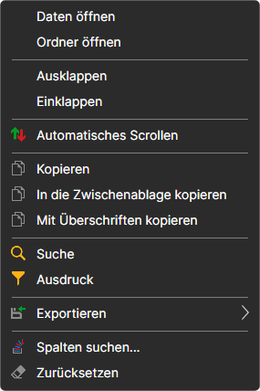
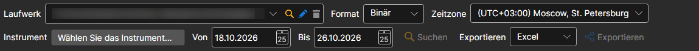
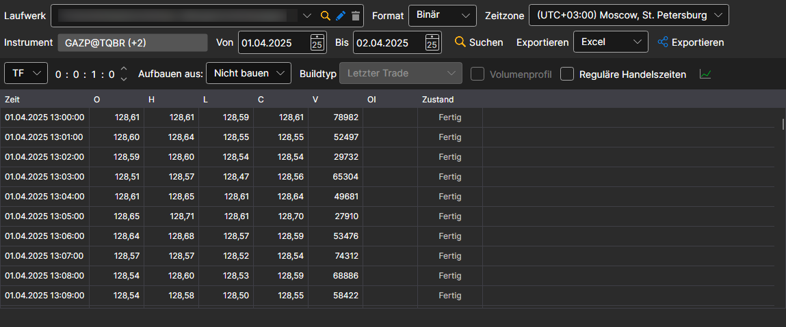
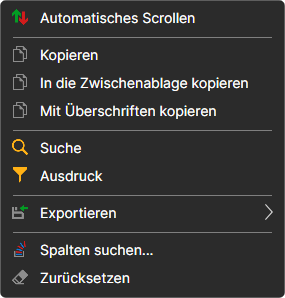

# Anzeigen und Exportieren

Die empfangenen [Hydra](../../hydra.md)-Daten können in speziellen Panels angezeigt werden.

Wählen Sie dazu im Menü **Marktdaten** einen der folgenden Einträge: [Ticks](view_and_export/ticks.md), [Orderbücher](view_and_export/order_books.md), [Kerzengenerierung](candles_generation.md), [Orderprotokoll](view_and_export/order_log.md), [Level 1](view_and_export/level_1_.md), [Nachrichten](view_and_export/news.md), [Transaktionen](view_and_export/transactions.md), [Optionsdesk](view_and_export/option_desk.md), [Indikatoren](view_and_export/indicators.md), [Positionen](view_and_export/positions.md).

Das Panel mit den Daten einer Aufgabe wird auch aus ihrer Instrumententabelle geöffnet: per Doppelklick auf einen Datentyp oder mit dem Eintrag **Daten öffnen** des Kontextmenüs, wie in der Abbildung gezeigt.

Jedes Panel enthält eine allgemeine Oberfläche mit folgenden Einstellungen:

- Die obere Zeile zeigt den Marktdatenspeicher (**Laufwerk**), dessen **Format** (binär oder CSV) und die **Zeitzone**, in der die Zeit angezeigt wird.
- In der zweiten Zeile werden die Instrumente und der Zeitraum gewählt, für den die Daten angefordert werden. Wenn Sie auf die Schaltfläche **Wählen Sie das Instrument...** klicken, erscheint das Fenster zur Instrumentauswahl, in dem Sie ein oder mehrere Instrumente auswählen können. Werden mehrere Instrumente ausgewählt, sortiert das Programm beim anschließenden Export nach Excel oder CSV die Daten der verschiedenen Instrumente automatisch in unterschiedliche Dateien.
- Die gefundenen Daten werden in Portionen zu je tausend Zeilen in die Tabelle geladen: Die nächste Portion wird von selbst nachgeladen, wenn die Tabelle bis zum Ende gescrollt ist, sodass Sie beliebig weit blättern können, ohne auf das Laden des ganzen Zeitraums zu warten. Das Sortieren nach einer Spalte ordnet die bereits geladenen Zeilen, und der Export mit den Schaltflächen des Panels schreibt alle Daten des gewählten Zeitraums, nicht nur die geladenen.
- Wenn die Daten aus Quellen empfangen wurden, deren Zeitzone nicht mit der aktuellen Zeitzone übereinstimmt, können Sie die Zeitzone anpassen. Nach dem Aufbau werden die Daten in der vom Benutzer ausgewählten Zone angezeigt. 
- Da einige Quellen bestimmte Daten nicht zum Herunterladen bereitstellen, enthält das Programm das Feld [Erstellen aus](any_market_data_types.md). Über dieses Feld kann der Benutzer Marktdaten aus einem anderen Marktdatentyp aufbauen. Dieselbe Funktion kann verwendet werden, um Marktdaten ohne zusätzliches Herunterladen auf Basis bereits vorhandener Daten zu erstellen.
- Nachdem die oben genannten Parameter ausgewählt wurden, klicken Sie auf die Schaltfläche **Suchen** . Solange die Suche oder der Export läuft, werden unter den Einstellungszeilen der Fortschritt und die Schaltfläche **Stoppen** angezeigt. Wenn der Export abgeschlossen ist, erscheint an derselben Stelle die Schaltfläche **Datei öffnen** oder **Ordner öffnen** mit seinem Ergebnis.

Das Kontextmenü der Tabelle mit den Werten ermöglicht es, das automatische Scrollen einzuschalten, die markierten Zeilen in die Zwischenablage zu kopieren, einen Wert zu suchen, Zeilen mit einem Ausdruck zu filtern, die Tabelle in eine Datei, in die Zwischenablage oder zum Drucken zu exportieren, die angezeigten Spalten auszuwählen und ihre Anordnung zurückzusetzen.

