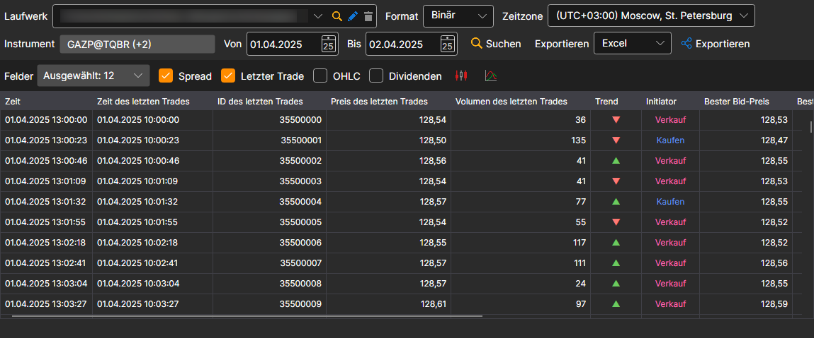
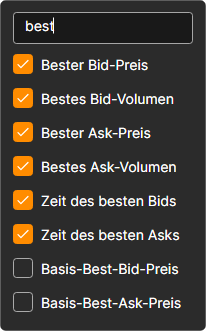

# Level 1

Wählen Sie im erscheinenden Fenster die Instrumente und das erforderliche Zeitintervall aus und klicken Sie auf die Schaltfläche :

Die Liste **Felder** legt fest, welche Level-1-Werte in der Tabelle angezeigt werden und in den Export gelangen. Markieren Sie die benötigten Felder in der Dropdown-Liste; die Suchzeile oben in der Liste lässt nur die Felder übrig, deren Name den eingegebenen Text enthält:

Die empfangenen Werte können [in das erforderliche Format exportiert](../export_data.md) werden.
