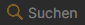
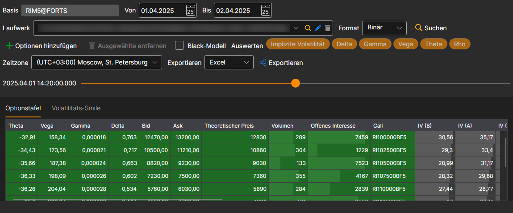
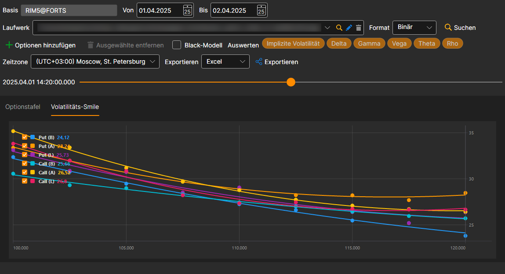

# Option Desk

Wählen Sie im erscheinenden Fenster den Basiswert — die Optionen darauf werden der Tafel von selbst hinzugefügt, und der Zeitbereich wird auf den Zeitraum gesetzt, für den im Speicher Daten vorhanden sind. Mit der Schaltfläche **Optionen hinzufügen** können Sie weitere Optionen hinzufügen, mit der Schaltfläche **Ausgewählte entfernen** überflüssige entfernen. Klicken Sie dann auf die Schaltfläche :

Wenn keine Historie der Griechen vorhanden ist, aber Daten zum Spread vorliegen, können die wichtigsten Griechen (Delta, Gamma, Vega, Theta, Rho, Volatilität (implizit)) berechnet werden: Dazu müssen Sie diese im Feld **Auswerten** markieren. Die Volatilität wird aus dem Geld-, Brief- und letzten Handelspreis berechnet, die übrigen Griechen aus der Volatilität der Spread-Mitte.

Der Schieberegler über der Tafel versetzt sie in einen beliebigen Moment der geladenen Historie; links vom Schieberegler wird die Zeit dieses Moments angezeigt. Wenn der Schieberegler den letzten geladenen Moment erreicht, wird der nächste Teil der Historie nachgeladen.

Um den **Volatilitäts-Smile** anzuzeigen, wechseln Sie zur Registerkarte **Volatilitäts-Smile**.

Die berechneten Werte können [in das erforderliche Format exportiert](../export_data.md) werden.
