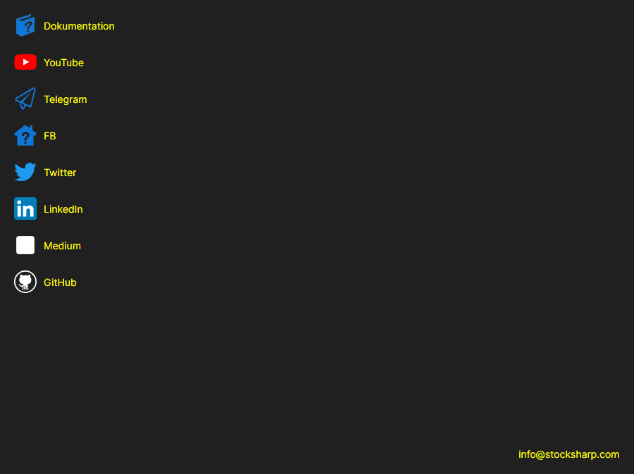

# Hilfe

Die Seite **Hilfe** wird mit der gleichnamigen Registerkarte oben im Fenster des [Installer](../installer.md) geöffnet.

Die Seite sammelt die Links, die aus dem [Installer](../installer.md) am häufigsten aufgerufen werden: **Dokumentation**, **YouTube**, **Telegram** (der Support-Chat), **Twitter**, **Dzen** und **GitHub**. Ein Link wird im Standardbrowser des Systems geöffnet. Unten auf der Seite steht die E-Mail-Adresse, an die Sie dem Unternehmen schreiben können.

Ein Problem können Sie mit der Schaltfläche in der Titelleiste des Fensters melden — sie ist auf jeder Seite vorhanden. Wenn sich der [Installer](../installer.md) anders als erwartet verhalten hat, fügen Sie der Meldung die Einträge von der Seite [Protokolle](logs.md) bei — an ihnen ist zu sehen, was genau passiert ist.

## Siehe auch

[Protokolle](logs.md)
