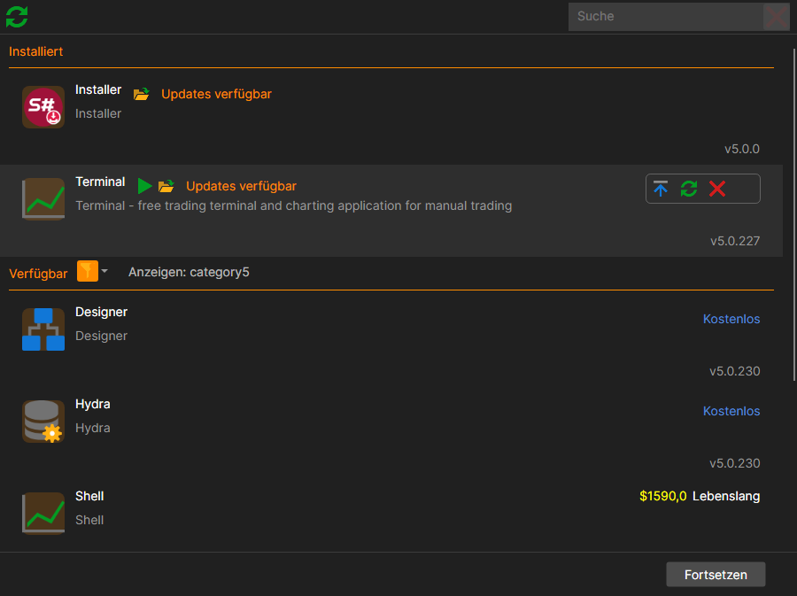
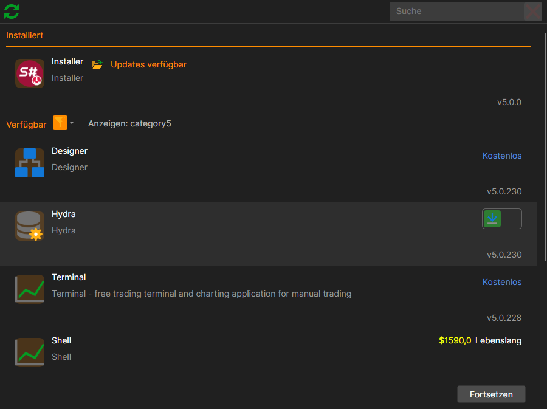
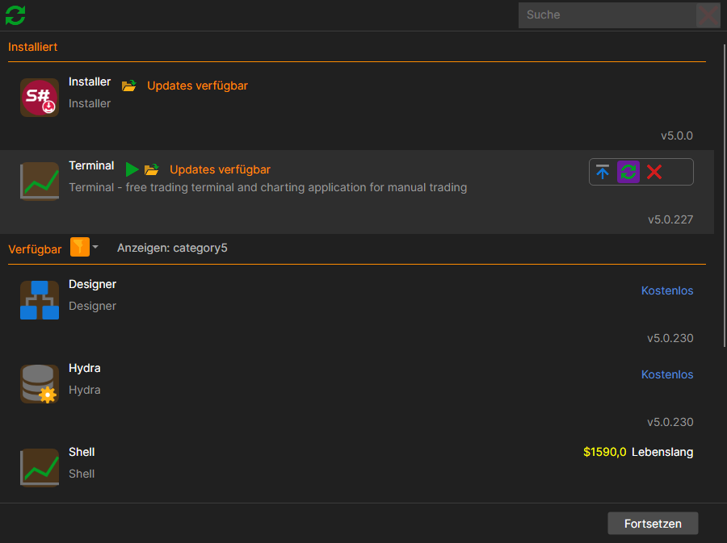
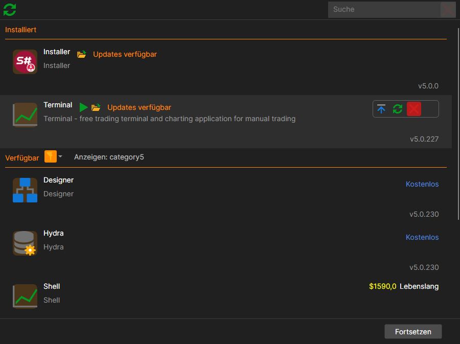
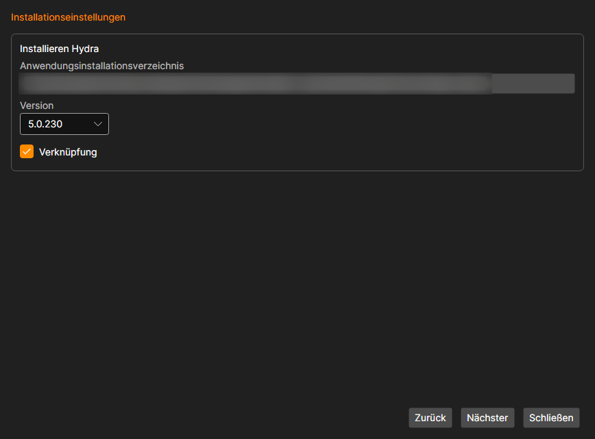

# Apps installieren und entfernen

Alles, was der [Installer](../installer.md) mit Programmen macht, geschieht auf der Registerkarte **Anwendungen**: Installieren, Aktualisieren, Wiederherstellen und Entfernen. Eine Aktion wird bei einem Produkt in der Liste markiert, und alle markierten Aktionen werden auf einmal ausgeführt.

## Katalog

Die Liste ist in zwei Teile geteilt: **Installiert** — was bereits auf diesem Computer vorhanden ist, und **Verfügbar** — was installiert werden kann. Wenn ein Teil nichts enthält, steht dort stattdessen **Leer**.

Beim Finden des Gewünschten helfen:

- das Feld **Suche** über der Liste — die Liste wird während der Eingabe eingegrenzt, und das Kreuz daneben stellt sie vollständig wieder her;
- der Trichter an der Überschrift **Verfügbar** — ein Filter nach Produkttyp; die Schaltfläche **Alle** hebt ihn auf;
- die Schaltfläche mit dem kreisförmigen Pfeil oben links — **Erzwungene Überprüfung von Updates**: Sie fragt den Store, ob etwas Neues erschienen ist, ohne auf die nächste planmäßige Prüfung zu warten.

Bei einem installierten Produkt zeigt die Zeile seine Version und, wenn eine neue erschienen ist, den Hinweis **Updates verfügbar**.

## Lizenzvereinbarung

Unten im Fenster befindet sich ein Kontrollkästchen mit der Zustimmung und einem Link zum Text der Vereinbarung. Solange sie nicht angenommen ist, bleibt die Schaltfläche **Fortsetzen** nicht verfügbar, egal was markiert ist. Die Zustimmung wird einmal und auf der Seite des Servers angenommen — danach wird das Kontrollkästchen nicht mehr angezeigt und kann nicht wieder entfernt werden.

## Was mit einem Produkt geschehen soll

Jede Zeile hat rechts eine Gruppe von Schaltflächen, von denen eine ausgewählt wird. Welche davon vorhanden sind, hängt vom Produkt ab:

| Schaltfläche | Wann verfügbar | Was sie tut |
|---|---|---|
| **Installieren** | das Produkt ist nicht installiert | installiert es |
| **Aktualisieren** | installiert, und eine neue Version ist erschienen | aktualisiert es |
| **Neu installieren** | installiert | installiert es erneut darüber, ohne die Einstellungen anzutasten |
| **Löschen** | installiert | entfernt es |
| **Überspringen** | immer | mit diesem Produkt nichts tun |

Bei einem nicht installierten Produkt gibt es nur eine Wahl — es zu installieren:

Bei einem installierten — die Wiederherstellung:

und das Entfernen:

Die Schaltfläche **Fortsetzen** unten rechts wird aktiv, sobald mindestens eine Aktion markiert ist. Sie können mehrere Produkte auf einmal markieren — zum Beispiel eines aktualisieren und ein anderes entfernen. Wenn alles markiert ist, klicken Sie unten rechts auf **Fortsetzen**.

## Assistent

Danach zeigt das Fenster statt der Liste einen Assistenten mit drei Schritten.

1. **Anwendungen** — was genau getan wird. Prüfen Sie die Liste und klicken Sie auf **Fortsetzen**.
2. **Installationseinstellungen** 

   Jede Aktion hat hier ihre eigenen Einstellungen:

   - **Anwendungsinstallationsverzeichnis** — wird mit einer Schaltfläche ausgewählt. **WICHTIG\!** Der Ordner muss leer sein.
   - **Version** und **Ziel** — welche Version installiert wird und für wen.
   - **Verknüpfung** — eine Verknüpfung auf dem Desktop anlegen.
   - **Anwendungsdatenordner einschließlich aller heruntergeladenen Daten und Einstellungen entfernen** — nur beim Entfernen: zusammen mit dem Programm auch seine Einstellungen und heruntergeladenen Daten löschen. Ohne dieses Kontrollkästchen bleiben sie erhalten.
   - **Plugins** — für Programme, die sie unterstützen: welche Konnektoren zusammen mit dem Produkt installiert werden.
   - **Installieren Hauptanwendungsparameter** — bei einem Produkt mit Plugins können Sie dieses Kontrollkästchen deaktivieren und nur mit den Plugins arbeiten, ohne das Programm selbst anzutasten.

   Klicken Sie auf **Nächster**.
3. **Die folgenden Aktionen werden durchgeführt** — die letzte Prüfung. Klicken Sie auf **Ausführen**.

Während der Arbeit wird **Vorgang läuft. Bitte warten Sie...** angezeigt, nach dem Abschluss **Ausgeführt**. Die Schaltfläche **Schließen** kehrt zur Liste zurück; **Zurück** führt bei jedem Schritt zum vorherigen.

Wenn etwas nicht geklappt hat, wird der Fehlertext direkt im Assistenten angezeigt und die Details auf der Seite [Protokolle](logs.md).

**[Videoanleitung ansehen](videos/install_and_remove_apps.md)**

## Empfohlene Inhalte

[Apps aktualisieren](update_apps.md)

[Protokolle](logs.md)
