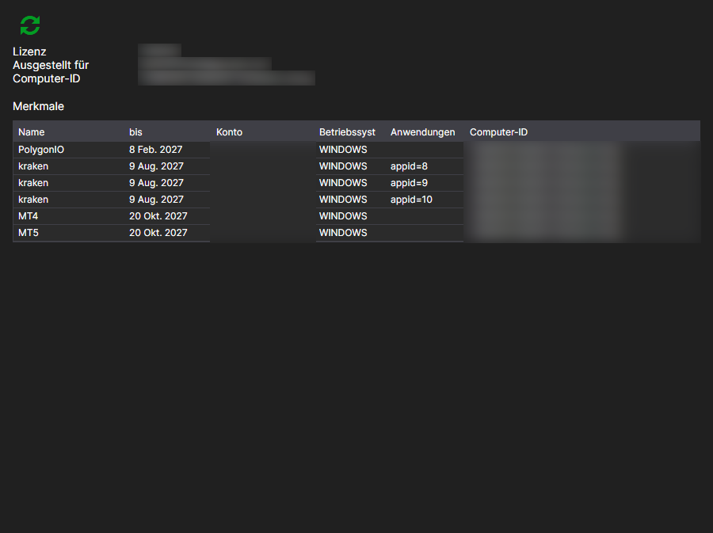

# Lizenzen

Die Seite **Lizenzen** wird mit der gleichnamigen Registerkarte oben im Fenster des [Installer](../installer.md) geöffnet und ist nach der Anmeldung beim Konto verfügbar.

Hier ist zu sehen, welche Lizenz diesem Konto ausgestellt wurde und wozu sie berechtigt.

- **Ausgestellt für** — für wen die Lizenz ausgestellt ist und an welchen Computer sie gebunden ist: **Computer-ID** und **Betriebssystem**. Anhand dieser Bindung entscheidet der Server, ob die Lizenz auf dem aktuellen Rechner gültig ist.
- **bis** — das Ablaufdatum.
- **Anwendungen** — die Programme, für die die Lizenz gilt.
- **Merkmale** — was genau erlaubt ist: Verbindungen zu Handelsplätzen, die Anzahl der Instrumente, der Zugriff auf den Quellcode und anderes.

Die Schaltfläche **Lizenz aktualisieren** fordert die Daten erneut vom Server an. Es ist sinnvoll, sie nach einem Kauf oder einer Verlängerung zu drücken: Der [Installer](../installer.md) liest die Lizenz bei der Anmeldung, und eine später auf der Website vorgenommene Änderung erscheint nicht von selbst im Fenster.

Wenn keine Lizenz vorhanden ist, teilt die Seite das mit. Eine Lizenz können Sie auf der Seite [Tarife](tariffs.md) erwerben.

## Siehe auch

[Tarife](tariffs.md)
