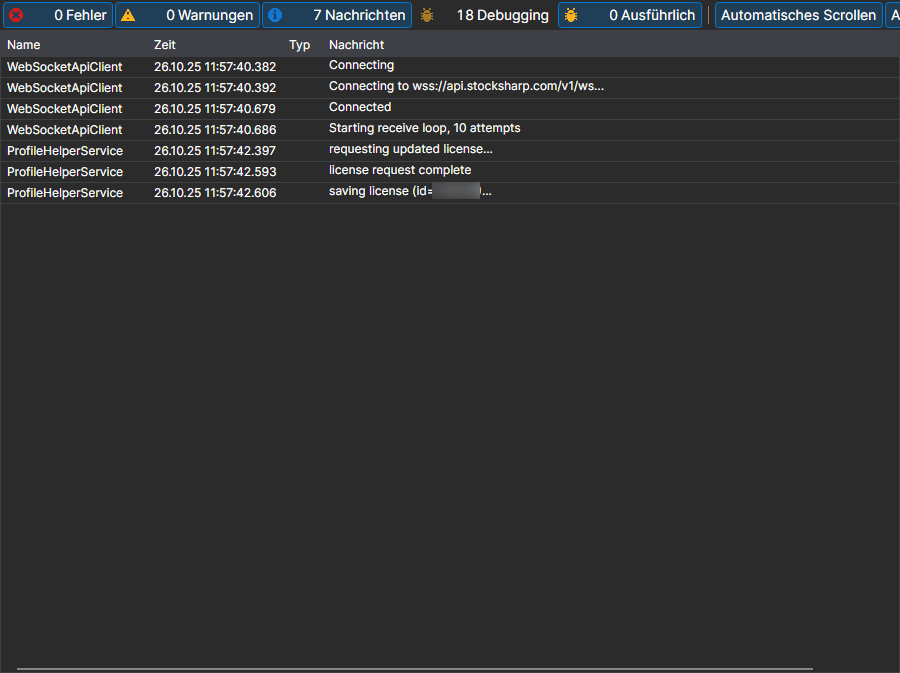

# Protokolle

Die Seite **Protokolle** wird mit der gleichnamigen Registerkarte oben im Fenster des [Installer](../installer.md) geöffnet.

Hier schreibt der [Installer](../installer.md), was er getan hat: an welchen Server er sich gewandt hat, welche Pakete er heruntergeladen hat, wohin er sie installiert hat und wo er angehalten hat. Das ist die erste Stelle, an der Sie nachsehen sollten, wenn eine Installation oder ein Update mit einem Fehler geendet hat.

Jeder Eintrag enthält die Zeit, die Stufe (Fehler, Warnung, Meldung) und den Text. Wie ausführlich das Protokoll ist, legt der Parameter **Protokollierung** auf der Seite [Einstellungen](settings.md) fest: Wenn Sie sich an den Support wenden, sollten Sie ihn erhöhen und die fehlgeschlagene Aktion wiederholen — dann steht im Protokoll die Ursache und nicht nur die Tatsache des Fehlers.

## Siehe auch

[Einstellungen](settings.md)
