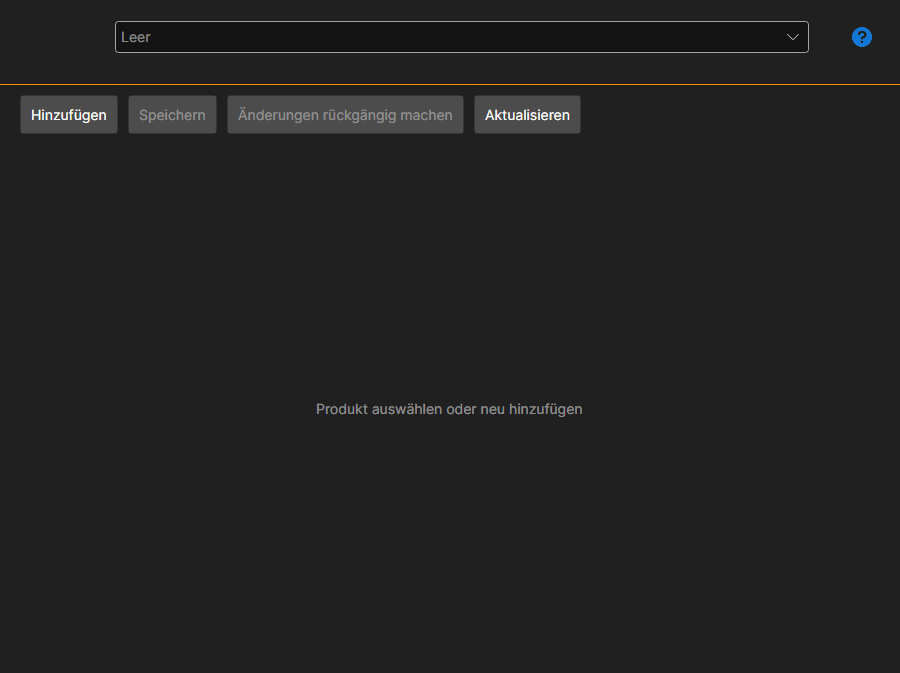

# Meine Produkte

Die Seite **Meine Produkte** wird mit der gleichnamigen Registerkarte oben im Fenster des [Installer](../installer.md) geöffnet und ist nach der Anmeldung beim Konto verfügbar.

Die Seite brauchen diejenigen, die selbst Produkte im [Store](https://stocksharp.com/de/store/) veröffentlichen — Roboter, Indikatoren, Konnektoren. Ein Käufer braucht sie nicht: Installieren und Aktualisieren sind in den Abschnitten [Apps installieren und entfernen](install_and_remove_apps.md) und [Apps aktualisieren](update_apps.md) beschrieben.

## Produktkarte

Das Produkt wird in der Liste oben ausgewählt; die Schaltfläche **Hinzufügen** legt ein neues an.

- **Name** und **Beschreibung** — das, was der Käufer im Store sieht.
- **Nuget-Paket-ID** — unter diesem Namen gelangt das Paket zu NuGet. Daneben wird gezeigt, wie er vollständig aussehen wird.
- **Inhaltstyp** und **Bereich** — was für ein Produkt es ist und wo es eingesetzt wird.
- **Kategorien** — die Bereiche des Stores, in denen das Produkt sichtbar ist.
- **Link zur Dokumentation** und **Link zum Quellcode** — optional.
- **Symbol** — wird mit einer Schaltfläche ausgewählt; dasselbe Symbol wird beim Käufer in der Liste des [Installer](../installer.md) angezeigt.

## Preis

Er wird getrennt festgelegt: einmalig (**Lebenslang**), **Monatlich** und **Jährlich**, dazu der Verlängerungspreis. Ein nicht ausgefüllter Preis bedeutet, dass es diese Art des Kaufs nicht gibt.

## Zugriff

Die Liste der Benutzer legt fest, wer das Produkt außer im Store sieht: Suchen Sie einen Benutzer über die Suche und fügen Sie ihn hinzu. So wird der Zugriff zum Beispiel innerhalb eines Teams vergeben.

## Speichern und Veröffentlichen

**Speichern** schreibt die Änderungen, **Änderungen rückgängig machen** kehrt zum zuletzt gespeicherten Zustand zurück, **Aktualisieren** liest die Liste erneut vom Server.

**Veröffentlichen** sendet das Produkt zur Prüfung. Bis sie bestanden ist, zeigt die Seite, dass das Produkt noch nicht genehmigt ist, und die Fehlerliste unten zählt auf, was ausgefüllt oder korrigiert werden muss — solange sie nicht leer ist, gelingt die Veröffentlichung nicht.

## Siehe auch

[Lizenzen](licenses.md)
