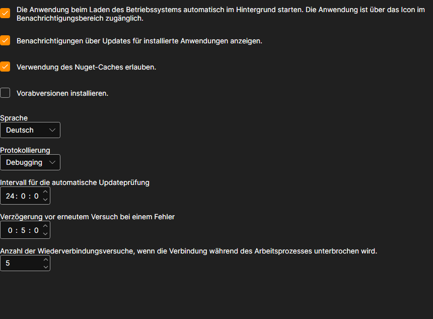

# Einstellungen

Die Seite **Einstellungen** wird mit der gleichnamigen Registerkarte oben im Fenster des [Installer](../installer.md) geöffnet.

## Was hier geändert werden kann

- **Die Anwendung beim Laden des Betriebssystems automatisch im Hintergrund starten.** Der [Installer](../installer.md) startet zusammen mit Windows und bleibt im Infobereich, von wo aus er auch beendet werden muss — das Kreuz im Fenster schaltet das Programm nicht aus.
- **Benachrichtigungen über Updates für installierte Anwendungen anzeigen.** Ohne dieses Häkchen sucht der [Installer](../installer.md) weiterhin nach Updates, aber still: Sie erfahren davon nur auf der Seite mit den Anwendungen. Wie das aussieht, siehe [Apps aktualisieren](update_apps.md).
- **Verwendung des Nuget-Caches erlauben.** Pakete, die auf diesem Rechner bereits heruntergeladen wurden, werden von der Festplatte statt aus dem Netz genommen. Das beschleunigt eine erneute Installation; schalten Sie es aus, wenn ein Paket garantiert neu bezogen werden soll.
- **Vorabversionen installieren.** Außer den regulären Releases werden Vorabversionen angeboten. Schalten Sie das nur ein, wenn Sie wissen, wozu Sie eine noch nicht erschienene Version brauchen.
- **Sprache.** Die Sprache der Oberfläche des [Installer](../installer.md) selbst.
- **Protokollierung.** Wie ausführlich das Protokoll geschrieben wird. Die Einträge sind auf der Seite [Protokolle](logs.md) zu sehen; wenn Sie sich an den Support wenden, hilft eine ausführliche Stufe, die Ursache schneller zu finden.
- **Intervall für die automatische Updateprüfung.** Wie oft der [Installer](../installer.md) den Server nach neuen Versionen fragt, in Stunden.
- **Verzögerung vor erneutem Versuch bei einem Fehler.** Wie lange gewartet wird, bevor ein fehlgeschlagenes Herunterladen wiederholt wird, in Minuten.
- **Anzahl der Wiederverbindungsversuche, wenn die Verbindung während des Arbeitsprozesses unterbrochen wird.** Wie oft der [Installer](../installer.md) versucht, ein Paket fertig herunterzuladen, bevor er einen Fehler meldet.

Die Änderungen werden sofort angewendet und gespeichert — eine eigene Schaltfläche zum Speichern gibt es nicht.

## Siehe auch

[Protokolle](logs.md)
