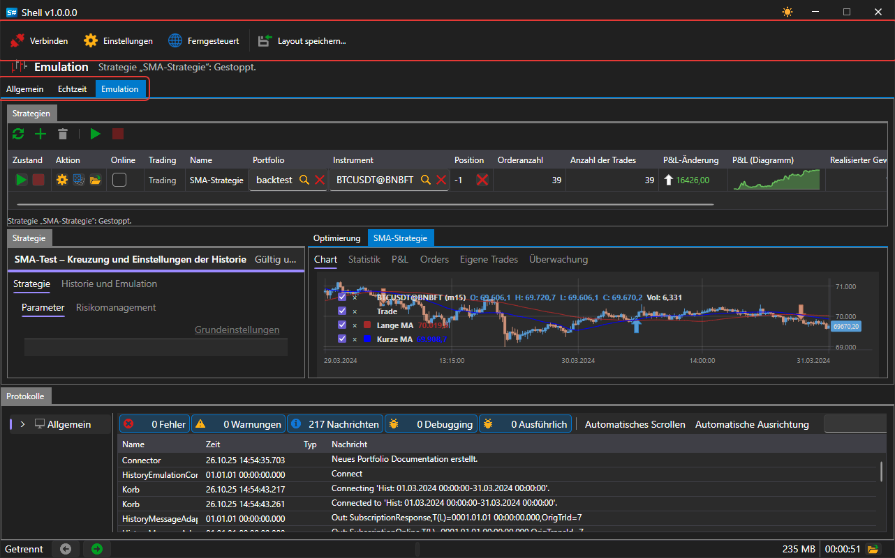
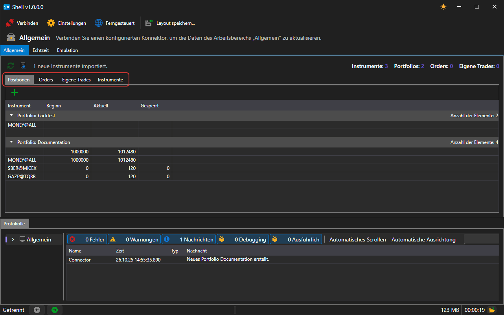
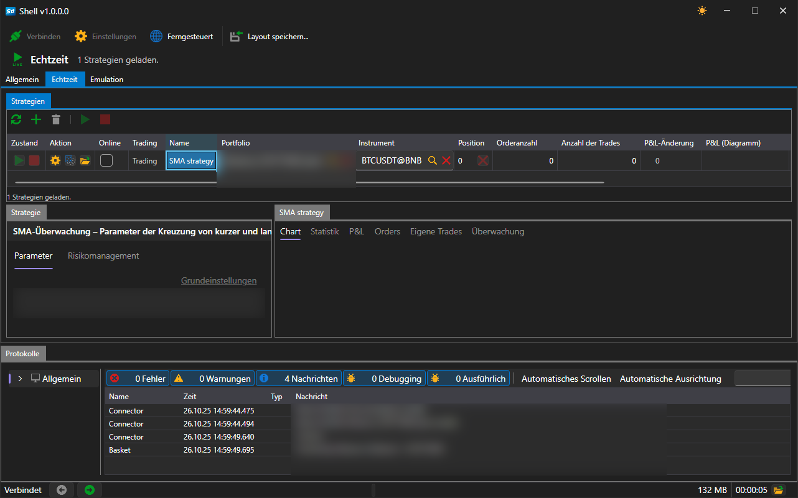
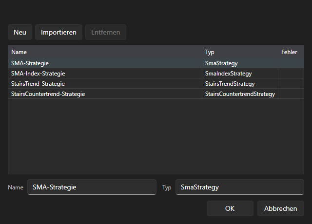
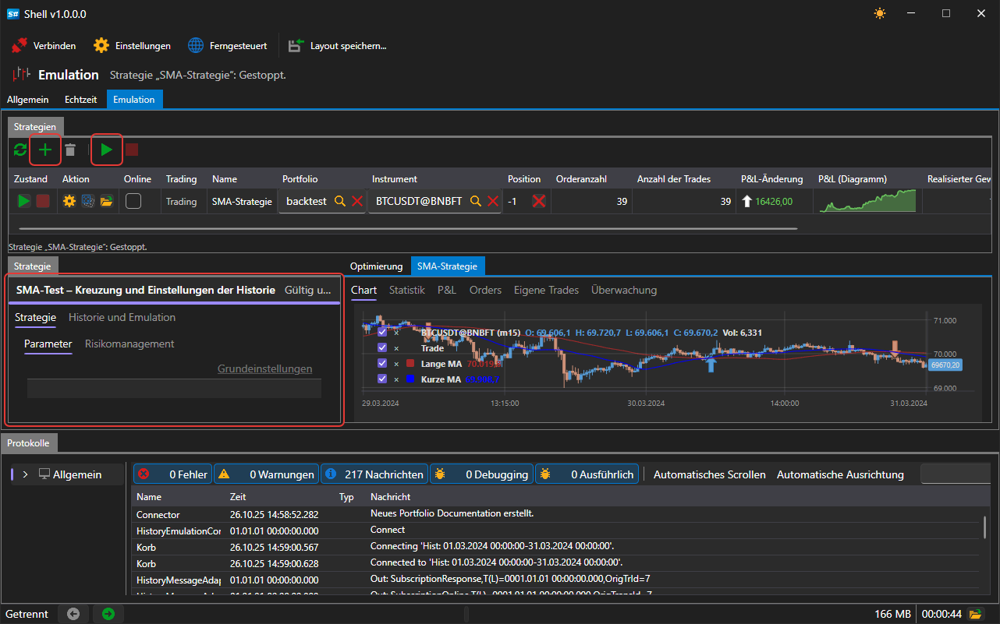

# Schnellstart

[Shell](../shell.md) ist Quellcode in [C#](https://en.wikipedia.org/wiki/C_Sharp_(programming_language)), den man in Visual Studio, Rider oder einer beliebigen anderen Umgebung öffnet und wie eine gewöhnliche Anwendung startet:

```
dotnet run --project Shell.Avalonia/Shell.Avalonia/Shell.Avalonia.csproj
```

Eine Vorbereitung ist nicht nötig: Das Projekt startet so, wie es ist, und arbeitet sofort mit den Strategien, die zum Lieferumfang gehören.

## Hauptfenster

Nach dem Start öffnet sich ein Fenster der folgenden Art:



Links befindet sich die Liste der Arbeitsbereiche, zwischen denen die Anwendung umschaltet. Oben ist die Befehlsleiste: die Schaltfläche für die Verbindungseinstellungen, die Schaltfläche **Verbinden** und das Speichern der aktuellen Anordnung der Panels. Unten ist die Statusleiste mit dem aktuellen Zustand der Verbindung.

Alles, was Shell schreibt — Verbindungseinstellungen, Fensteranordnung, die Liste der Strategien, importierte Designer-Schemata und der lokale Kursspeicher —, liegt im Ordner `Data` neben der ausführbaren Datei.

## Verbindung

Wechseln Sie zu den Verbindungseinstellungen und wählen Sie den benötigten Konnektor. Wie eine Verbindung eingerichtet wird, ist im Abschnitt [Verbindungseinstellungen](connections_settings.md) beschrieben.

Klicken Sie dann auf **Verbinden**. Der Zustand der Verbindung wird in der Statusleiste und neben der Schaltfläche angezeigt.

Nach dem Verbinden erscheinen auf der Registerkarte [Allgemein](user_interface/common.md) die Portfolios, Instrumente, Orders und eigenen Trades, die von der Verbindung empfangen wurden.



## Strategie im Handel

Wechseln Sie zur Registerkarte [Echtzeit](user_interface/real_time.md).



Klicken Sie auf **Hinzufügen** und wählen Sie im geöffneten Fenster eine Strategie aus.



Die Strategie erscheint in der Tabelle **Strategien**, und ihre Parameter erscheinen links im Panel **Strategie**. Füllen Sie **Instrument**, **Portfolio**, Volumen und die Parameter der Strategie selbst aus und klicken Sie dann auf **Start**.

Solange keine Verbindung besteht, sind die Schaltflächen zum Hinzufügen und Starten in diesem Bereich nicht verfügbar — darauf weist der Hinweis unter der Tabelle hin.

## Strategie auf historischen Daten

Dasselbe auf der Registerkarte [Emulation](user_interface/emulation.md) startet die Strategie nicht im Handel, sondern auf historischen Daten.



Eine Verbindung ist dafür nicht nötig: Jeder Durchlauf liest die Historie über einen eigenen Emulationskonnektor von der Festplatte.

## Siehe auch

[Allgemein](user_interface/common.md)

[Echtzeit](user_interface/real_time.md)

[Emulation](user_interface/emulation.md)
