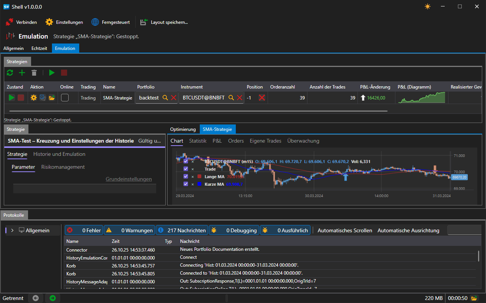

# Fernsteuerung

[Shell](../shell.md) kann seine Strategien der Steuerung über die Website übergeben: Das laufende Programm registriert sich als Anwendung Ihres Kontos, meldet dorthin den Zustand jeder Strategie und führt die von dort kommenden Befehle aus. Genauso ist die Fernsteuerung in [Hydra](../hydra.md) und im [Designer](../designer.md) aufgebaut, deshalb sehen die Liste der Programme und die Steuerschaltflächen im [Telegram-Bot](../telegram_services/control_panel.md) für alle drei gleich aus.

## Einschalten

In der Befehlsleiste des Hauptfensters gibt es den Schalter **Ferngesteuert**.

Solange er ausgeschaltet ist, verbindet sich [Shell](../shell.md) nirgendwohin und erscheint nicht auf der Website. Der eingeschaltete Zustand wird gespeichert und beim nächsten Start des Programms wiederhergestellt.

Der Schalter funktioniert nur, wenn das Programm unter einem StockSharp-Konto läuft und die Website erreichbar ist. Ohne Anmeldung beim Konto bewirkt das Einschalten nichts: Die Verbindung wird nicht geöffnet, und die Anwendung wird auf der Website nicht registriert.

## Was aus der Ferne verfügbar ist

Aus der Ferne sind die Strategien des Bereichs [Emulation](user_interface/emulation.md) verfügbar — diejenigen, die auf historischen Daten arbeiten. Die Strategien des Bereichs [Echtzeit](user_interface/real_time.md) sind absichtlich nicht verfügbar: Sie handeln mit echtem Geld, und eine solche Strategie kann nur direkt am Computer gestartet werden. Dieselbe Grenze zieht auch das Protokoll der Interprozesskommunikation, das Skripte verwenden.

Eine einzelne Strategie erscheint auf der Website nicht von selbst, sondern nur, wenn das in ihren Einstellungen erlaubt ist. Öffnen Sie die Strategie im Bereich [Emulation](user_interface/emulation.md) und suchen Sie in ihren Einstellungen die Gruppe **Ferngesteuert**:

| Einstellung | Was sie festlegt |
|---|---|
| **Aktiviert** | ob die Website diese Strategie sieht und sie steuern kann |
| **Benachrichtigung** | der Kanal, in den ihre Meldungen gehen; wenn kein Kanal gewählt ist, der Kanal des Kontos |
| **Protokollierebene** | ab welcher Stufe eine Meldung an den Kanal gesendet werden soll |

Die Kanäle werden aus dem Konto genommen, deshalb erscheint die Liste nach der Anmeldung. Die Einrichtung eines Kanals in [Telegram](../telegram_services.md) ist im Abschnitt [Autorisierung](../telegram_services/authorization.md) beschrieben.

## Befehle

Von der Website oder vom Bot kommen Befehle zweier Arten — für das Programm als Ganzes und für eine einzelne Strategie.

| Befehl | Was er tut |
|---|---|
| **Start** für eine Strategie | startet den Durchlauf, wenn er gestoppt ist oder mit einem Fehler geendet hat |
| **Stoppen** für eine Strategie | stoppt den laufenden Durchlauf |
| **Start** / **Stoppen** ohne Angabe einer Strategie | dasselbe auf einmal für alle Strategien, denen die Fernsteuerung erlaubt ist |
| **Aktivieren** / **Deaktivieren** des Handels | versetzt die Strategie in den Modus des vollen Handels oder verbietet ihr den Handel; der laufende Durchlauf übernimmt das sofort |
| **Stoppen** des Programms | schließt [Shell](../shell.md) |
| **Neustart** des Programms | schließt [Shell](../shell.md) und startet es erneut |

Ein Befehl an eine Strategie, der die Fernsteuerung nicht erlaubt ist, wird ignoriert.

## Was an die Website gesendet wird

- Der Zustand des Programms selbst: gestartet, solange das Fenster geöffnet ist, und gestoppt, wenn es geschlossen wird.
- Der Zustand jeder erlaubten Strategie — bei jeder Änderung.
- Die Meldungen der Strategie ab der gewählten Stufe — in den gewählten Kanal. Gleiche Meldungen werden nicht wiederholt.

## Siehe auch

[Bedienfeld](../telegram_services/control_panel.md)

[Emulation](user_interface/emulation.md)
