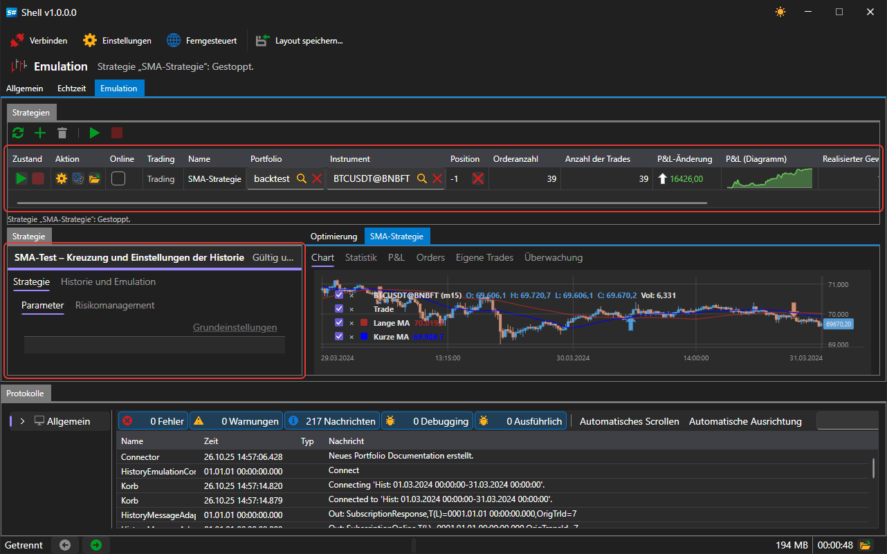
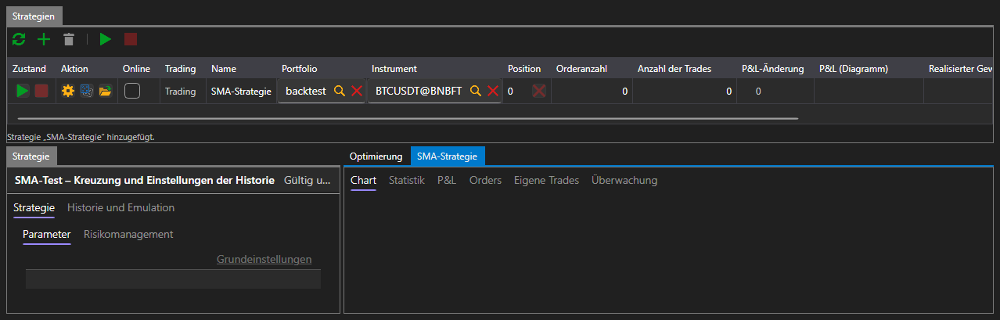
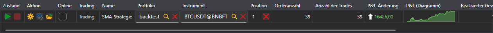
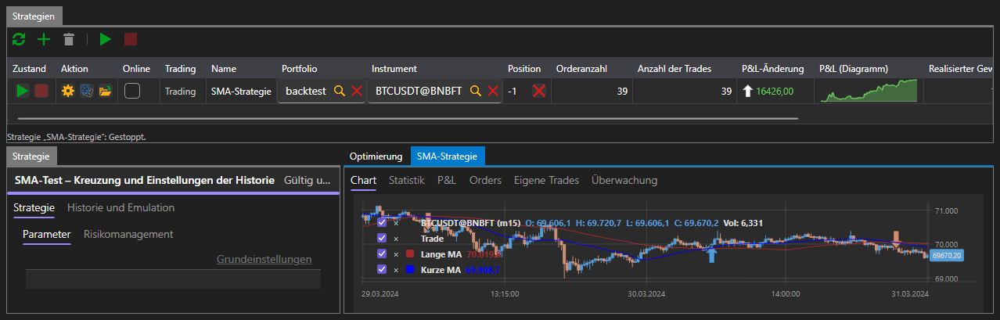
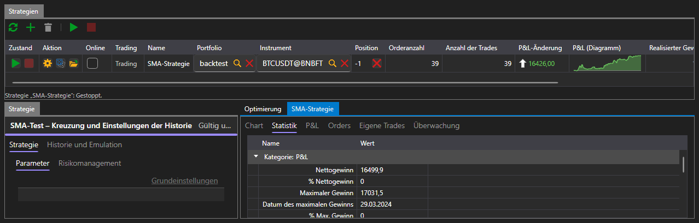
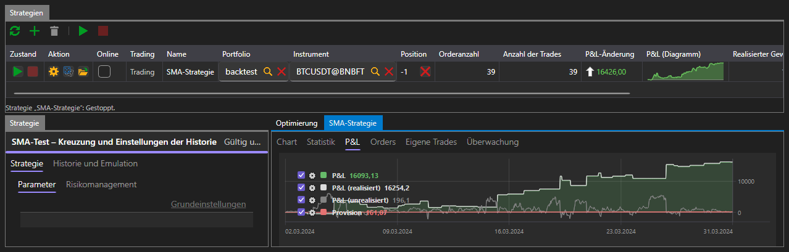
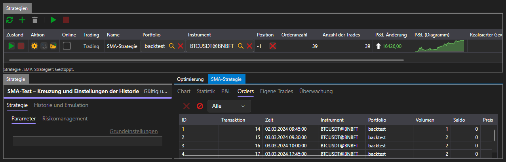
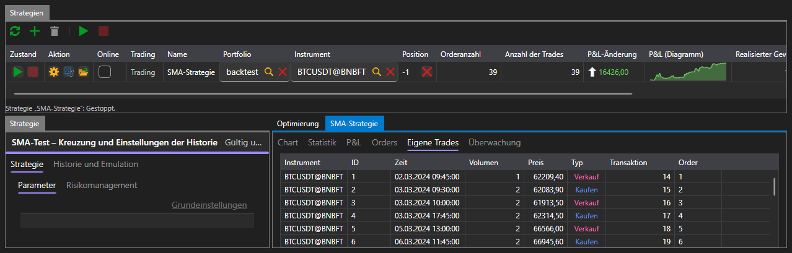

# Emulation

Die Registerkarte **Emulation** lässt eine Strategie auf historischen Daten laufen. Eine Verbindung ist dafür nicht nötig: Jeder Durchlauf liest die Historie über einen eigenen Emulationskonnektor von der Festplatte.

Der Bereich ist genauso aufgebaut wie [Echtzeit](real_time.md): oben die Tabelle **Strategien** mit Schaltflächen, links das Panel der ausgewählten Strategie, rechts die Registerkarten mit allem, was der Durchlauf hervorgebracht hat. Die Unterschiede sind zwei Registerkarten im Panel der Strategie und die Registerkarte **Optimierung** unter den Ergebnissen.

## Parameter des Durchlaufs

Links befindet sich das Panel **Strategie**, in dem alles festgelegt wird, womit die Strategie auf die Historie geht. Es hat zwei Registerkarten:

- **Strategie** — Instrument, Portfolio, Volumen, Risikoregeln und die eigenen Parameter der Strategie;
- **Historie und Emulation** — woher die Daten genommen werden und wie sie der Strategie übergeben werden.

| Parameter | Was er festlegt |
|---|---|
| **Pfad zur Historie** | der Ordner, aus dem der Durchlauf Kerzen und Ticks liest |
| **Von**, **Bis** | der erste und der letzte Tag des Durchlaufs |
| **Speicherformat** | in welcher Form die Historie auf der Festplatte liegt |
| **Bei Berührung abgleichen** | eine Order bei Berührung des Preises ausführen, ohne darauf zu warten, dass der Preis sie durchläuft |
| **Zustand der Handelssitzung** | Orders ablehnen, solange am Handelsplatz nicht gehandelt wird |
| **Latenz** | die Verzögerung zwischen dem Senden einer Order und ihrem Eingang beim Handelsplatz, in Millisekunden |

Standardmäßig sind die Historie, die zusammen mit der Plattform installiert wird, und der Zeitraum, den diese Historie abdeckt, eingetragen — der erste Durchlauf kann also gestartet werden, ohne etwas zu ändern.

Wenn die Parameter falsch ausgefüllt sind — kein Pfad angegeben, das Ende des Zeitraums liegt vor dem Anfang, eine negative Verzögerung —, erscheint unter der Tabelle eine entsprechende Meldung, und der Durchlauf beginnt nicht.

## Durchlauf

Die Schaltfläche **Start** beginnt den Durchlauf, der Balken unter der Überschrift des Panels zeigt, wie viel bereits durchlaufen ist. Der Durchlauf endet von selbst, wenn die Historie endet; die Schaltfläche **Abbrechen** stoppt ihn vorzeitig.

Während des Durchlaufs und nach seinem Ende ist in der Strategietabelle dasselbe zu sehen wie im Handel: Zustand, Position, Anzahl der Orders und Trades, Gewinn und Verlust.

## Ergebnis

Rechts befinden sich die Registerkarten, zwischen denen alles umgeschaltet wird, was der Durchlauf hervorgebracht hat:

| Registerkarte | Was sie zeigt |
|---|---|
| **Chart** | die Kerzen des Instruments und die Trades der Strategie darauf |
| **Statistik** | alle Kennzahlen, die die Plattform berechnet |
| **P&L** | die Equity-Kurve |
| **Aufträge** | alle Orders, die die Strategie platziert hat |
| **Eigene Trades** | alle Trades, die bei ihr zustande gekommen sind |
| **Optimierung** | [Durchlaufen der Parameter](optimization.md) |

### Chart

Das Chart zeigt die Kerzen des Instruments, auf dem der Durchlauf stattfand, und die Markierungen der Trades der Strategie darauf.

### Statistik

Die Statistik ist in Abschnitte gegliedert — Gewinn und Verlust, Trades, Orders, Latenzen. Unter anderem zeigt sie den Nettogewinn, den maximalen Drawdown in Geld und in Prozent, die Anzahl der gewinnbringenden und verlustbringenden Trades, den durchschnittlichen Gewinn pro Trade, den Profitfaktor und die Kennzahlen nach Sharpe, Sortino, Calmar und Sterling.

Die Anzahl der Trades in der Statistik ist kleiner als in der Strategietabelle: Die Statistik zählt die Trades, die etwas geschlossen haben, und der Trade, der die erste Position eröffnet hat, gehört nicht dazu.

### Gewinn und Verlust

Die Equity-Kurve zeigt, wie sich das Ergebnis der Strategie während des Durchlaufs verändert hat.

### Aufträge und Trades

Auf der Registerkarte **Aufträge** steht alles, was die Strategie platziert hat: Zeit, Richtung, Typ, Volumen, Preis und Zustand jeder Order.

Auf der Registerkarte **Eigene Trades** steht, was von diesen Orders ausgeführt wurde.

## Siehe auch

[Optimierung](optimization.md)

[Echtzeit](real_time.md)
