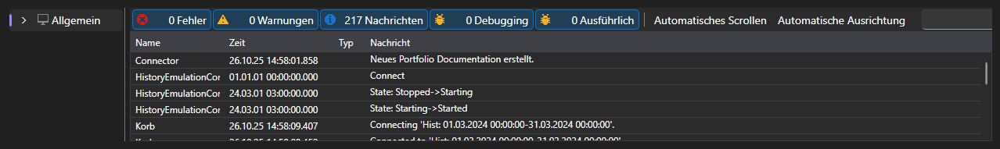

# Protokolle

Die Registerkarte **Protokolle** zeigt alles, was die Anwendung über ihre Arbeit meldet: Meldungen der Verbindung, der Strategien, der Emulation und der Shell selbst.

Jeder Eintrag besteht aus Zeit, Stufe (Debug, Information, Warnung, Fehler), Quelle und Text. Einträge von Strategien sind mit der Kennung der Strategie markiert, deshalb ist bei mehreren gleichzeitig laufenden Strategien zu sehen, von wem eine Meldung stammt.

Über der Tabelle wird angezeigt, wie viele Fehler und Warnungen sich angesammelt haben, dazu eine Schaltfläche, die das Protokoll leert. Die Tabelle selbst kann Einträge nach Stufe filtern, nach Text suchen, Spalten auswählen und ihren Inhalt exportieren.

Die Protokolle sind die erste Stelle, an der Sie nachsehen sollten, wenn eine Strategie nicht startet, keine Orders platziert oder ein Durchlauf auf historischen Daten direkt nach dem Beginn endet.

## Siehe auch

[Allgemein](common.md)
