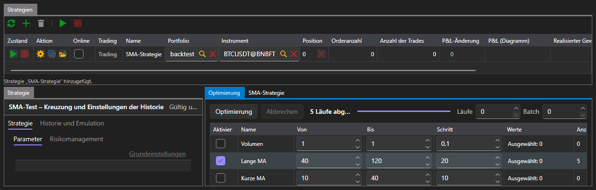

# Optimierung

Die Registerkarte **Optimierung** wählt die Parameter einer Strategie durch Durchlaufen aus: Sie startet dieselbe Strategie auf derselben Historie so oft, wie es Kombinationen von Parametern gibt, und zeigt das Ergebnis jedes Laufs.

Die Optimierung ist nur im Bereich [Emulation](emulation.md) verfügbar. Im Bereich [Echtzeit](real_time.md) gibt es diese Registerkarte nicht: Auf einer Live-Verbindung lassen sich Parameter nicht durchlaufen.

## Was durchlaufen wird

Die Parametertabelle führt die Parameter der ausgewählten Strategie auf, die durchlaufen werden können. Ein Parameter nimmt am Durchlaufen nur teil, wenn er mit einem Häkchen markiert ist; für einen markierten werden Anfang, Ende und Schritt festgelegt. Was genau eingegeben werden kann, hängt vom Typ des Parameters ab: Eine ganze Zahl hat ganzzahlige Werte, ein boolescher Wert nur zwei Werte.

Rechts neben den Schaltflächen werden die Grenzen des Durchlaufens festgelegt:

| Feld | Was es festlegt |
|---|---|
| **Läufe** | wie viele Läufe höchstens ausgeführt werden; 0 bedeutet ohne Begrenzung |
| **Batch** | wie viele Läufe gleichzeitig ausgeführt werden |

Die Anzahl der Kombinationen wird neu berechnet, während Parameter markiert werden, sodass im Voraus zu sehen ist, was das Durchlaufen ergibt.

## Verlauf des Durchlaufens

Die Schaltfläche **Optimierung** startet das Durchlaufen, **Abbrechen** stoppt es. Die Statuszeile sagt, was gerade geschieht: Das Durchlaufen wird geplant, so und so viele Läufe werden ausgeführt, das Durchlaufen wurde nach so und so vielen Läufen gestoppt, das Durchlaufen hat keinen einzigen Lauf ergeben. Der Balken daneben zeigt, wie viel bereits durchlaufen ist.

## Ergebnis

Das Ergebnis wird auf drei Arten gleichzeitig angezeigt:

- eine Tabelle, in der jede Zeile ein Lauf mit seinen Parameterwerten, dem Endgewinn und der Equity-Kurve ist;
- eine Fläche über zwei ausgewählten Parametern;
- dieselbe Fläche als Heatmap.

Die Auswahl einer Zeile in der Tabelle zeigt die Equity-Kurve dieses Laufs.

## Siehe auch

[Emulation](emulation.md)
