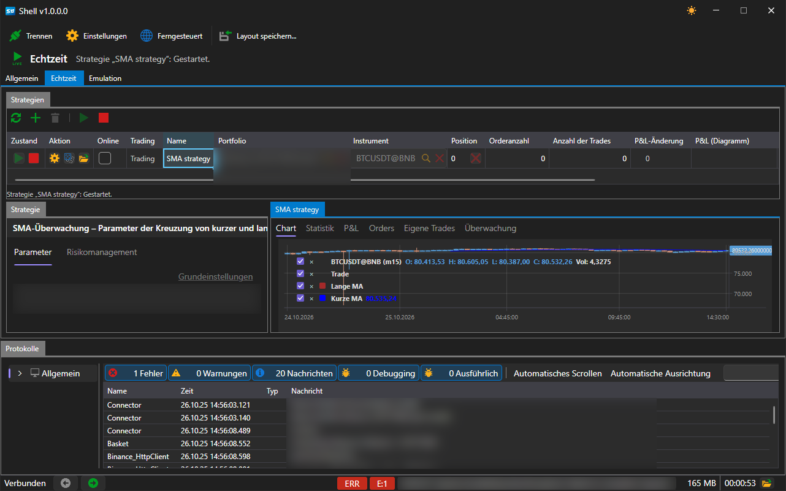

# Echtzeit

Die Registerkarte **Echtzeit** verwaltet die im Handel gestarteten Strategien.

Der Bereich besteht aus drei Teilen:

- **Strategien** — die Tabelle aller Strategien des Bereichs und die Schaltflächen zu ihrer Verwaltung, oben;
- **Strategie** — die Parameter der ausgewählten Strategie, links;
- die Registerkarten rechts — **Chart**, **Statistik**, **P&L**, **Aufträge** und **Eigene Trades**: alles, was die ausgewählte Strategie zeigt, platziert und ausgeführt hat.

Die Arbeit mit diesem Bereich ist nur bei bestehender Verbindung möglich: Ohne sie sind die Schaltflächen nicht verfügbar, und unter der Tabelle wird ein entsprechender Hinweis angezeigt.

## Schaltflächen

| Schaltfläche | Was sie tut |
|---|---|
| **Aktualisieren** | liest die Liste der Strategien erneut |
| **Hinzufügen** | öffnet das Fenster zur Auswahl einer Strategie |
| **Entfernen** | entfernt die ausgewählte Strategie aus dem Bereich |
| **Start** | startet die ausgewählte Strategie im Handel |
| **Stoppen** | stoppt sie |

## Strategietabelle

Jede Zeile ist eine Strategie. Die Spalten zeigen ihren Zustand und ihr Ergebnis:

| Spalte | Was sie zeigt |
|---|---|
| **Zustand** | gestoppt, startet, läuft, stoppt |
| **Aktion** | Starten, Stoppen und Schließen der Position direkt aus der Zeile |
| **Online** | ob die Strategie Daten in Echtzeit empfängt |
| **Handel** | der Handelsmodus der Strategie |
| **Name** | der beim Hinzufügen festgelegte Name |
| **Portfolio**, **Instrument** | womit sie handelt |
| **Position** | die aktuelle Position |
| **Orderanzahl**, **Anzahl der Trades** | wie viele Orders platziert und wie viele Trades ausgeführt wurden |
| **P&L-Änderung**, **P&L (Diagramm)** | Gewinn und Verlust und ihre Entwicklung |
| **Realisierter Gewinn**, **Nicht realisierter Gewinn** | der geschlossene und der offene Teil des Ergebnisses |
| **Fehler** | der letzte Fehler der Strategie, falls es einen gab |

## Hinzufügen einer Strategie

Die Schaltfläche **Hinzufügen** öffnet ein Fenster mit der Liste der verfügbaren Strategien.

Das Fenster führt die vier mitgelieferten Strategien und alles auf, was aus dem [Designer](../run_strategies_from_designer.md) importiert wurde. Die Schaltfläche **Importieren** fügt dieser Liste ein aus dem Designer exportiertes Schema hinzu; die Schaltfläche **Neu** eine Vorlage für eine eigene Strategie; die Schaltfläche **Entfernen** entfernt den ausgewählten Eintrag aus der Liste.

Nach dem Klicken auf **OK** erscheint die Strategie in der Tabelle, und im Panel **Strategie** öffnen sich ihre Parameter: Instrument, Portfolio, Volumen, Risikoregeln und die eigenen Parameter der Strategie — zum Beispiel die Längen der gleitenden Durchschnitte und der Zeitrahmen der Kerzen für die **SMA-Strategie**.

## Siehe auch

[Allgemein](common.md)

[Emulation](emulation.md)
