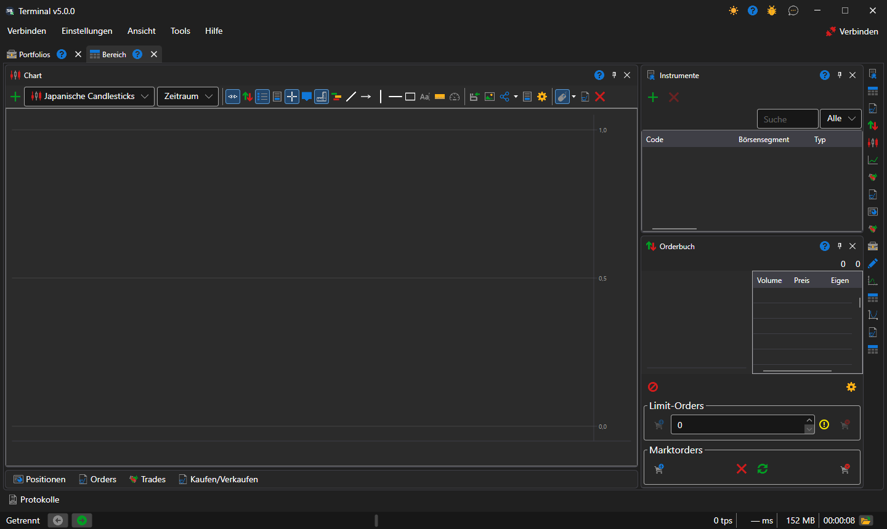
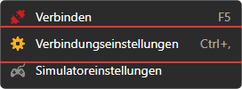
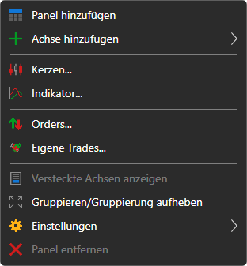
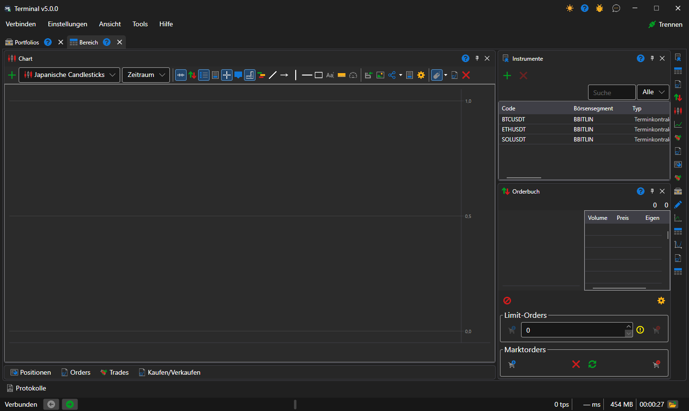
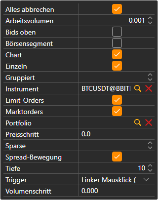
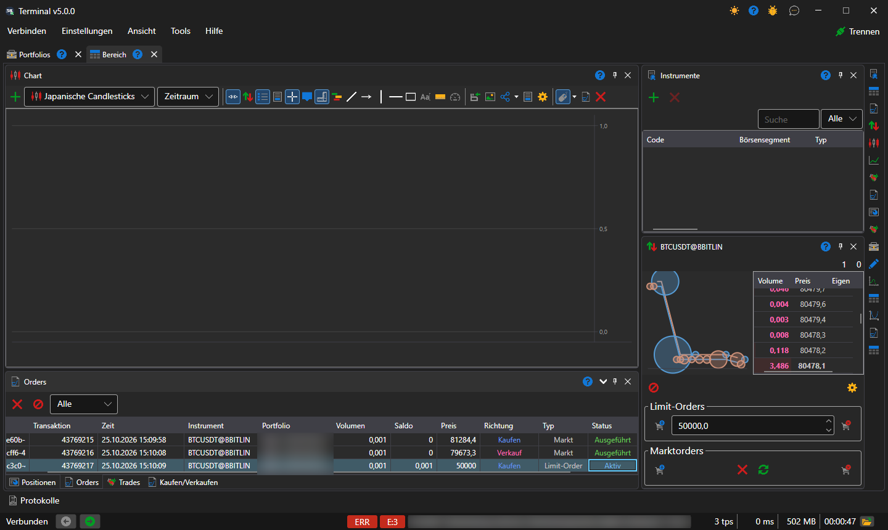
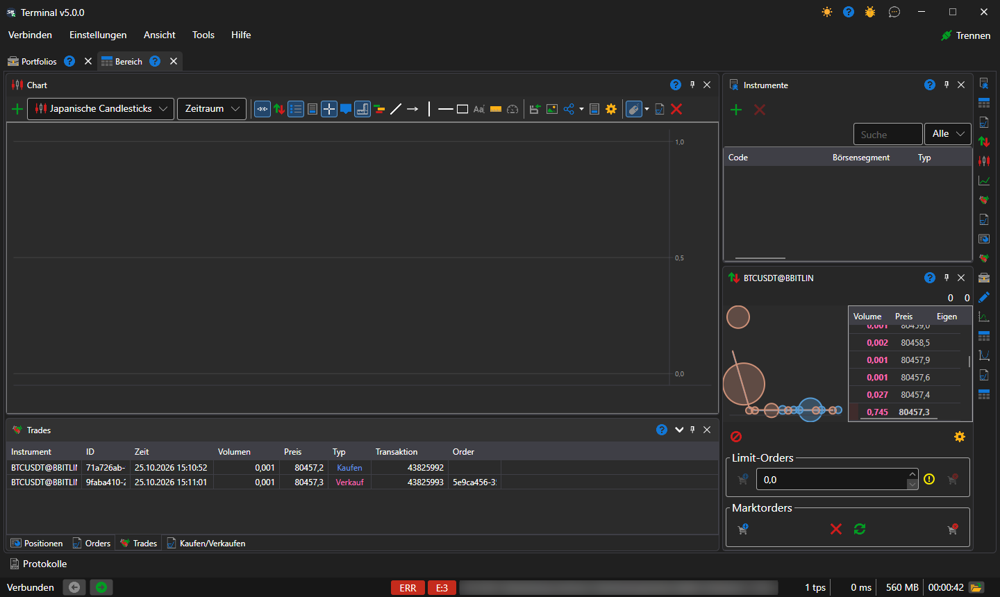
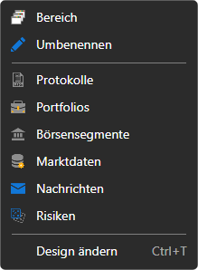

# Schnellstart

Wenn Sie [Terminal](../terminal.md) zum ersten Mal starten, öffnet sich ein Fenster mit einem [Arbeitsbereich](user_interface/workspace.md) in der Standardanordnung: das Chart in der Mitte, rechts die Instrumente und das Orderbuch, unter dem Chart die eingeklappten Registerkarten der Positionen, Orders, Trades und des Tickets **Kaufen/Verkaufen**.

Wechseln Sie zu den Verbindungseinstellungen — Menü **Verbinden → Verbindungseinstellungen** — und wählen Sie die benötigte Verbindung aus. Die Einrichtung der Verbindung wird im Abschnitt [Verbindungseinstellungen](connection_settings.md) beschrieben.

Der nächste Schritt besteht darin, die Verbindung über die Schaltfläche **Verbinden** am Ende der Leiste des [Hauptmenüs](user_interface/ribbon.md) oder mit der Taste **F5** herzustellen.

Durch Klicken auf die Schaltfläche **Hinzufügen**  im Chart-Panel fügen Sie einen neuen Chart-Bereich hinzu. Mit einem Rechtsklick in den Chart-Bereich fügen Sie Kerzen für das gewünschte Instrument hinzu. Sie können dem Chart Indikatoren, eigene Trades und Orders hinzufügen. Außerdem können Orders direkt aus dem Chart registriert werden. Weitere Informationen zur Arbeit mit dem Chart finden Sie im Abschnitt [Chart](user_interface/components/chart.md).

Durch Klicken auf die Schaltfläche **Hinzufügen**  im Instrumente-Panel fügen Sie die Instrumente hinzu, die Sie beobachten möchten. Hier werden die besten Preisdaten angezeigt. Weitere Informationen zur Arbeit mit dem Instrumente-Panel finden Sie im Abschnitt [Instrumente](user_interface/components/instruments.md).

Wenn Sie im Orderbuch auf die Schaltfläche **Einstellungen**  klicken, erscheint ein Panel, in dem Sie das **Instrument** und das **Portfolio** für Trades angeben können. Hier können Sie außerdem die Tiefe des Orderbuchs anpassen. Weitere Informationen zur Arbeit mit einem Orderbuch finden Sie im Abschnitt [Orderbuch](user_interface/components/order_book.md).

Registrieren wir die ersten Aufträge. Aufträge können entweder über die Schaltflächen **Kaufen/Verkaufen** oder durch Doppelklick auf die Zellen in den Spalten **Geld/Brief** des Orderbuchs registriert werden. Das Auftragspanel zeigt alle Ihre Aufträge an. Wenn Sie mit der rechten Maustaste auf einen Auftrag klicken, erscheint ein Panel, über das Sie einen neuen Auftrag senden, den ausgewählten Auftrag stornieren oder ändern können. Weitere Informationen zur Arbeit mit dem Auftragspanel finden Sie im Abschnitt [Aufträge](user_interface/components/orders.md).

Im Ausführungspanel können Sie Ausführungen nach Instrumenten anzeigen. Weitere Informationen zur Arbeit mit dem Ausführungspanel finden Sie im Abschnitt [Ausführungen](user_interface/components/trades.md).

Bei Bedarf können Sie zusätzliche Komponenten hinzufügen — mit den Schaltflächen der Leiste am rechten Rand des Arbeitsbereichs; die Panels des gesamten Fensters, zum Beispiel **Portfolios** und **Protokolle**, werden über das Menü **Ansicht** geöffnet. Alle Komponenten werden im Abschnitt [Komponenten](user_interface/components.md) beschrieben.

