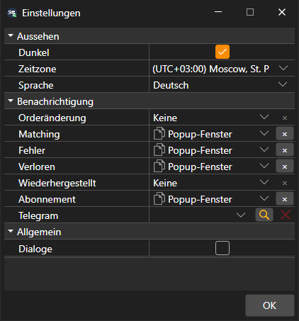

# Allgemeine Einstellungen

Das Fenster **Einstellungen** wird mit dem Eintrag **Einstellungen → Einstellungen** des [Hauptmenüs](../user_interface/ribbon.md) geöffnet. Die Einstellungen darin sind in Gruppen aufgeteilt:

- **Aussehen**:
  - **Dunkel** — das dunkle Design; es wird auch mit der Schaltfläche in der Titelleiste des Fensters umgeschaltet;
  - **Zeitzone** — in welcher Zeitzone die Zeit der Marktdaten angezeigt wird;
  - **Sprache** — die Sprache des Programms.
- **Allgemein**:
  - **Dialoge** — ein Fenster mit einem Fehler anzeigen, den das Programm nicht selbst behandelt hat. Wenn das Kontrollkästchen deaktiviert ist, wird ein solcher Fehler nur ins Protokoll geschrieben.
- **Benachrichtigung** — über welche Ereignisse von Orders und Verbindungen und auf welche Weise informiert wird, sowie der Telegram-Kanal für solche Meldungen. Ausführlich — im Abschnitt [Benachrichtigungen](../notifications.md).

Das Design ändert sich sofort nach dem Klicken auf **OK**. Sprache und Zeitzone werden nach einem Neustart wirksam, deshalb fragt Terminal, ob es jetzt neu gestartet werden soll.

## Siehe auch

[Einstellungen zurücksetzen](reset_settings.md)

[Benachrichtigungen](../notifications.md)
