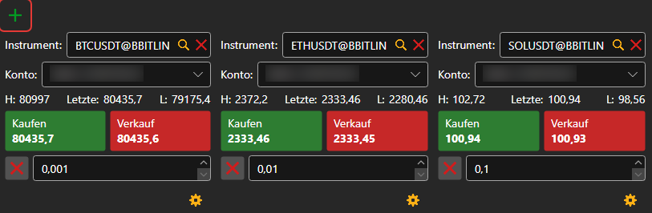
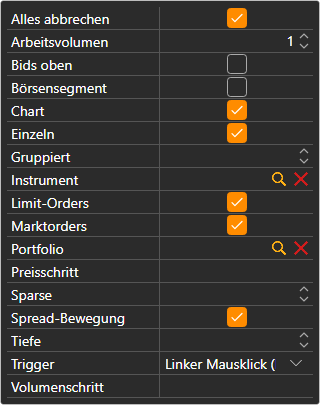

# Kaufen/Verkaufen

Die Komponente **Kaufen/Verkaufen** ist eine Gruppe von Tickets. Jedes Ticket zeigt die besten Preise eines Instruments und platziert darauf Orders für das ausgewählte Portfolio. Ein Ticket wird mit der Schaltfläche  hinzugefügt; bei der ersten Verbindung legt das Panel selbst Tickets für die ersten Instrumente des Handelsplatzes an.

## Einstellungen des Tickets

Die Schaltfläche mit dem Zahnrad unter einem Ticket öffnet seine Einstellungen: **Instrument**, **Portfolio**, **Arbeitsvolumen**, die **Tiefe** des Orderbuchs und welche Blöcke das Ticket zeigt:

- **Limit-Orders** — die Schaltflächen **Kaufen** und **Verkaufen** mit einem Preisfeld dazwischen; die Schaltflächen neben dem Feld setzen den besten Geld- oder Briefkurs darin ein;
- **Marktorders** — **Kaufen**, **Verkaufen**, **Position schließen** und **Position umkehren** zum Marktpreis;
- **Alles abbrechen** — eine Schaltfläche, die alle Orders für das Instrument des Tickets storniert.

Das Instrument des Tickets kann geändert werden, indem man eine Zeile aus den [Instrumenten](instruments.md) auf das Ticket zieht; wenn man eine Zeile aus den [Positionen](positions.md) zieht, übernimmt das Ticket deren Instrument und Portfolio.

## Tastenkürzel

Das Ticket des Panels **Kaufen/Verkaufen** im gerade geöffneten [Arbeitsbereich](../workspace.md) reagiert auf Tasten: **F9** — zum Marktpreis kaufen, **F10** — zum Marktpreis verkaufen, **Esc** — alle Orders stornieren. Solange der Cursor in einem Eingabefeld steht, wirken die Tasten nicht.

> [!WARNING]
> **F9** und **F10** senden echte Marktorders ohne Bestätigung an den Handelsplatz.

## Empfohlene Inhalte

[Orderbuch](order_book.md)

[Level2](level_2.md)

[Hauptmenü](../ribbon.md)
