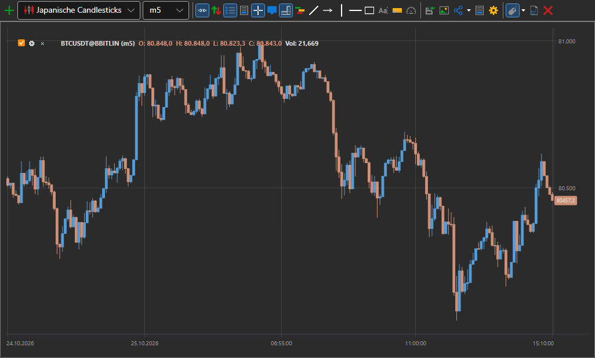
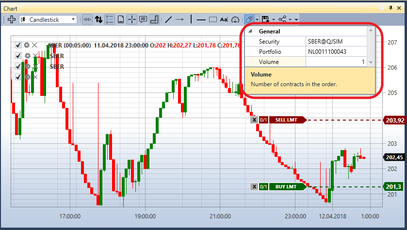
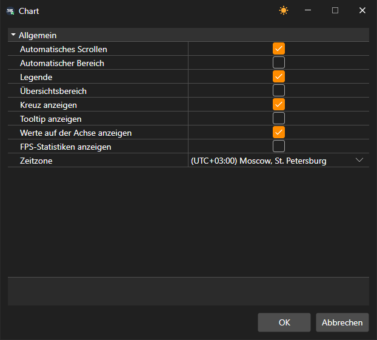

# Chart

Die Komponente **Chart** ermöglicht das Zeichnen von Kerzen und Indikatoren für das ausgewählte Instrument.

Um einen neuen Bereich hinzuzufügen, klicken Sie auf die Schaltfläche .

Um dem Chart ein neues Element hinzuzufügen, klicken Sie mit der rechten Maustaste an eine beliebige Stelle im Chart-Bereich und wählen Sie das benötigte Element aus; verfügbar sind unter anderem Kerzen, Indikatoren, Orders und eigene Trades.

In der oberen linken Ecke jedes Charts werden alle grafischen Elemente angezeigt, die dem Chart hinzugefügt wurden. Wenn Sie das Kontrollkästchen  für ein grafisches Element deaktivieren, wird dieses Element auch aus dem Chart entfernt.

Ein Klick auf  öffnet die Einstellungen für das grafische Element.

## Handel aus dem Chart

Aus dem Chart können Orders platziert, verschoben und storniert werden. Zuerst wird auf der Schaltflächenleiste des Charts der Schalter **Orders aus dem Chart platzieren** eingeschaltet, und in seinen Dropdown-Einstellungen werden **Instrument**, **Portfolio** und das Ordervolumen angegeben.

- Eine Kauforder wird mit **Ctrl+linke Maustaste** auf einem Preis im Chart platziert, eine Verkaufsorder mit **Ctrl+rechte Maustaste**.
- Die eigenen aktiven Orders sind im Chart als Linien auf ihren Preisen gezeichnet. Eine Linie kann gegriffen und zu einem anderen Preis gezogen werden — die Order wird verschoben; das Kreuz an der Linie storniert die Order. Die Schaltfläche **Orders stornieren** storniert alle Orders des Charts.
- Die Schaltfläche **Quick-Orders-Panel anzeigen** blendet über dem Chart ein Panel mit der Schaltfläche **Verkaufen** zum besten Geldkurs und der Schaltfläche **Kaufen** zum besten Briefkurs, dem Spread dazwischen und dem Ordervolumen ein. Das Panel kann an eine beliebige Stelle des Charts gezogen werden.

> [!WARNING]
> Orders aus dem Chart werden sofort und ohne Bestätigung an den Handelsplatz gesendet.

## Einstellungen des Charts

Die Schaltfläche **Einstellungen** auf der Schaltflächenleiste des Charts öffnet das Einstellungsfenster des gesamten Charts: automatisches Scrollen und automatische Skalierung, Legende, Ansichtsbereich, Fadenkreuz, Tooltip, Werte auf den Achsen, FPS-Statistik und die Zeitzone, in der die Zeitachse beschriftet ist.

Ein Rechtsklick auf die Schaltflächenleiste selbst öffnet die Liste ihrer Schaltflächen: Ein deaktiviertes Kontrollkästchen blendet die Schaltfläche aus, ein aktiviertes blendet sie wieder ein. Welche Schaltflächen angezeigt werden, wird zusammen mit dem Chart gespeichert.

Die Schaltfläche **Zwischenablage (als Bild)** kopiert das Bild des Charts, damit Sie es in eine Nachricht oder ein Dokument einfügen können. Ein Rechtsklick auf ein Element des Charts öffnet ein Menü mit den Einträgen **Elementparameter…** und **Löschen**; im Menü des Chartbereichs gibt es **Einstellungen → Chartbereich…** und **Panel entfernen**. Ein Panel unter dem Chart lässt sich auch mit dem Kreuz in seiner Überschrift schließen.

Das Chart wird mit den Pfeiltasten **←** und **→** gescrollt, die Tasten **Home** und **End** springen zum Anfang und zum Ende der Daten, und **+** und **−** ändern den Maßstab.

In den Einstellungen des grafischen Elements können Sie den benötigten Chartstil festlegen: japanische Kerzen, Balken, Box-Chart, Cluster-Profil usw.

Bei einem Box-Chart können Kerzen zusätzlich gruppiert werden; die Gruppierungsreihenfolge wird in den Feldern für den Multiplikator des 2. Zeitrahmens und den Multiplikator des 3. Zeitrahmens festgelegt.

Über dem Chart befindet sich eine Symbolleiste, in der Sie automatisches Scrollen, automatischen Zoom, Legendenmodi und andere allgemeine Chart-Einstellungen auswählen können. Außerdem können Sie die Elemente auswählen, die im Chart gezeichnet werden sollen: Linien, Niveaus, Zeiger, Rechteck, Text.

## Siehe auch

[Aufträge](../../../designer/user_interface/components/orders.md)
