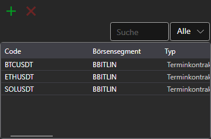

# Instrumente

Die Komponente **Instrumente** (so lautet auch die Überschrift des Panels) ist eine Tabelle mit Instrumenten, die Informationen zu allen ausgewählten Instrumenten anzeigt.

Um ein neues Instrument hinzuzufügen, klicken Sie auf die Schaltfläche . Es öffnet sich das Fenster zur Auswahl von Instrumenten: Es hat eine Suche und einen Filter nach Instrumenttyp und nach Börsensegment, und solange die Liste der Instrumente geladen wird, ist unter der Tabelle ein Ladebalken zu sehen. Die Schaltfläche **Instrumente löschen** entfernt die markierten Instrumente aus der Tabelle.

Das in der Tabelle markierte Instrument wird im Panel **Eigenschaften** desselben Arbeitsbereichs angezeigt. Wenn das Chart des Bereichs noch kein Instrument hat, für das es Orders platziert, wird das markierte Instrument dazu.

Die Zeile eines Instruments kann mit der Maus auf ein anderes Panel des Bereichs gezogen werden — [Kaufen/Verkaufen](buy_sell.md), [Level 1](level_1.md), [Level2](level_2.md), [Orderbuch](order_book.md) oder [Chart](chart.md) —, und das Panel wechselt zu diesem Instrument.

Wie man Zeilen kopiert, durchsucht und filtert und die Spalten einrichtet, ist im Abschnitt [Arbeiten mit Tabellen](../tables.md) beschrieben.

## Empfohlene Inhalte

[Level 1](level_1.md)
