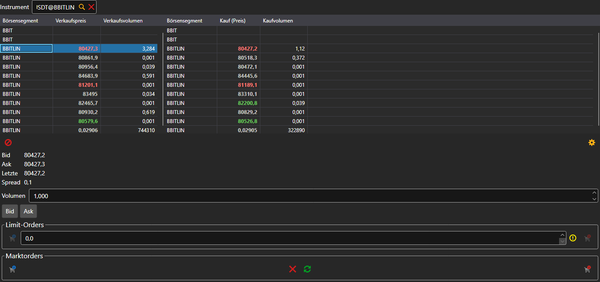

# Level 2

Die Komponente **Level 2** zeigt die Kurse eines Instruments an allen Handelsplätzen gleichzeitig: In die Tabellen gelangt jedes Instrument mit demselben Code, eine Zeile pro Instrument. In der linken Tabelle stehen der beste Verkaufspreis und das Volumen, in der rechten die des Kaufs. Das Instrument wird im Feld über den Tabellen ausgewählt oder aus den [Instrumenten](instruments.md) auf das Panel gezogen.

Unter den Tabellen stehen Geld, Brief, letzter Preis und Spread der in der Tabelle ausgewählten Zeile. Die Schaltflächen **Bid** und **Ask** setzen diesen Preis in eine Limit-Order ein, und darunter befindet sich dasselbe Ticket wie in der Komponente [Kaufen/Verkaufen](buy_sell.md): Limit- und Marktorders.

## Siehe auch

[Orderbuch](order_book.md)

[Kaufen/Verkaufen](buy_sell.md)
