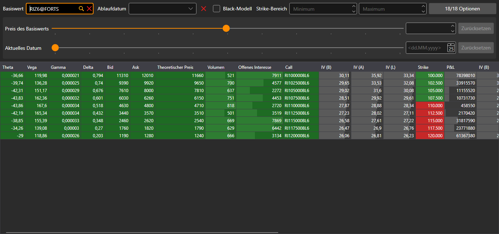

# Optionsdesk

Die Komponente **Optionsdesk** ist eine Tabelle mit den wichtigsten Parametern der Optionen für den Basiswert: Eine Zeile der Tabelle ist ein Strike, links stehen die Parameter des Calls, rechts die des Puts.

## Filter der Optionen

Über der Tabelle befindet sich ein Filter. Er ist bei allen Optionskomponenten gleich — dem Optionsdesk, der [Smile-Volatilität](smile_volatility.md) und den [Positionen (Optionen)](positions_options.md):

- **Basiswert** — das Instrument, dessen Optionen angezeigt werden;
- **Ablaufdatum** — nur die Optionen dieses Ablaufdatums anzeigen; die Schaltfläche daneben leert den Filter;
- **Black-Modell** — theoretische Preise, Volatilität und Griechen nach dem Black-Modell (für Optionen auf Futures) statt nach dem Black-Scholes-Modell berechnen;
- **Strike-Bereich** — der minimale und der maximale Strike;
- die Schaltfläche mit der Anzahl der Optionen öffnet das Fenster zur Auswahl der Optionen des Basiswerts. Auf der Schaltfläche ist zu sehen, wie viele der ausgewählten Optionen den Filter passieren und wie viele insgesamt ausgewählt sind.

Unter dem Filter befindet sich die „Was wäre, wenn“-Berechnung. Der Schieberegler **Preis des Basiswerts** und das Feld daneben legen einen anderen Preis des Basiswerts fest, der Schieberegler **Aktuelles Datum** und der Kalender ein anderes aktuelles Datum. Die Berechnungen der Komponente werden für diese Werte durchgeführt, und die Schaltflächen **Zurücksetzen** stellen den tatsächlichen Preis und das tatsächliche Datum wieder her.

## Tabelle

Die Strikes „im Geld“ sind hervorgehoben: Bei einem Call sind das die Strikes unter dem Preis des Basiswerts, bei einem Put die Strikes darüber.

Ein Doppelklick auf eine Zelle des Calls oder des Puts öffnet das Orderbuch dieser Option.

## Empfohlene Inhalte

[Smile-Volatilität](smile_volatility.md)
